# CI1302 离线语音 + LLM AIoT 工程功能说明报告

> 适用工程：`projects/offline_asr_llm_aiot_uart_sample`
> SDK 版本：YCSC-CI13XX_SDK_LLM_AIOT_V3.0.19
> 芯片平台：CI1302（2MB Flash / SSOP24）
> 板级：CI-D02GS01J
> 编写日期：2026-10-19

---

## 1. 结论速览

本工程是一套运行在 CI130X（CI1302）上的 **"本地离线语音识别 + 在线大模型对话"** 完整解决方案。芯片负责唤醒、命令词识别、语音前处理、录音与本地播放；WiFi/云端模组通过串口与芯片交互，负责联网、云端 ASR/LLM/TTS 与音频数据回传。

核心能力一览：

| 分类 | 能力 | 当前默认状态 |
|---|---|---|
| 离线语音 | 唤醒词识别（双模型组） | 开启 |
| 离线语音 | 命令词识别（G.fst 词条） | 开启 |
| 离线语音 | 命令词自学习 CWSL | 关闭 |
| 语音前处理 | AEC 回声消除 | 开启 |
| 语音前处理 | NN 神经网络降噪 | 开启 |
| 语音前处理 | NN VAD 语音活动检测 | 开启 |
| 语音前处理 | 波束成形 Beamforming | 开启（单麦配置下为软件模式） |
| 语音前处理 | 去混响 Dereverb | 库存在，未启用 |
| 语音前处理 | DOA 声源定位（NN/GCC） | 关闭 |
| 语音前处理 | 声纹识别 VPR / 男女声纹 WMAN | 库存在，未启用 |
| 语音前处理 | 声音事件检测 SED（哭声/鼾声） | 库存在，未启用 |
| 语音前处理 | 就近唤醒 PWK | 关闭 |
| 离在线交互 | UART 上传语音（Speex 压缩） | 开启 |
| 离在线交互 | UART 接收并播放云端音频（MP3） | 开启 |
| 离在线交互 | 多轮对话 / 全双工 | 开启 |
| 离在线交互 | 播放打断（VAD 打断 TTS） | 开启 |
| 离在线交互 | 云端应答超时退出 | 关闭（超时 6s） |
| 网络 | WiFi 配网 / 连接状态管理 | 协议支持 |
| 系统 | OTA 升级 | 关闭 |
| 系统 | 双 Code 分区切换 | 关闭 |
| 本地播放 | 精简播放器 sap_* | 开启 |
| 本地播放 | MP3 / Opus / G722 / PCM 解码 | MP3 开启 |
| 红外 | 空调/风扇/灯/电视红外控制 | 关闭（代码完整保留） |
| 扩展 | I2C 步进电机 + DOA 转向 | 关闭（`ENABLE_MOTOR_DOA`） |
| 扩展 | 充电状态检测 / 功放静音 | 开启 |

---

## 2. 工程目录结构

SDK 根目录主要构成：

```
YCSC-CI13XX_SDK_LLM_AIOT_V3.0.19/
├── .vscode/                 # 编辑器与调试配置
├── components/              # 通用组件（算法、协议、播放器、OTA 等，共 30+ 个）
├── driver/                  # 芯片驱动、板级配置、第三方器件驱动
├── libs/                    # 预编译算法/编解码静态库
├── projects/                # 应用工程
│   ├── offline_asr_llm_aiot_uart_sample/    # UART 上传/播放（本报告对象）
│   ├── offline_asr_llm_aiot_hpout_sample/   # HPOUT 模拟输出
│   └── offline_asr_llm_aiot_iis_sample/     # IIS 数字输出
├── startup/                 # 启动文件
├── system/                  # 系统级配置（user_alg_config.mk 等）
├── tools/                   # 编译/打包工具
├── utils/                   # 公共工具
└── CI1302_开发配置文件与Flash分区说明.md
```

三个示例工程共用同一套 `app/` 代码，仅通过 `project_file/makefile` 中的 `AUDIO_UPLOAD_TYPE` 区分音频通路：

| 工程 | AUDIO_UPLOAD_TYPE | 音频上传方式 |
|---|---|---|
| offline_asr_llm_aiot_uart_sample | 1 | UART 串口上传（外接 WiFi 模组） |
| offline_asr_llm_aiot_hpout_sample | 2 | HPOUT 模拟音频输出 |
| offline_asr_llm_aiot_iis_sample | 3 | IIS 数字音频输出 |

### 2.1 主工程目录

```
projects/offline_asr_llm_aiot_uart_sample/
├── app/
│   ├── app_main/            # 主流程、系统消息、用户逻辑、NLP、Code 切换
│   ├── app_audio_handle/    # 离在线音频协议、上传、播放、队列
│   ├── app_doa/             # DOA 结果处理
│   ├── app_sed/             # 声音事件检测应用层
│   ├── app_cwsl/            # 命令词自学习应用层
│   ├── app_ir/              # 红外控制（设备、协议、EUT 测试）
│   └── app_led/             # 灯效
├── project_file/            # makefile、链接脚本
├── lds/                     # 链接脚本
└── firmware/                # 语音资源、模型、分区配置、打包脚本
    ├── config.ini           # 固件分区与升级配置
    ├── asr/                 # G.fst / G.fst0 / G.fst1 / DNN 模型
    ├── voice/               # wav / mp3 / opus 提示音
    └── user_file/cmd_info/  # 命令词表 xlsx
```

---

## 3. 当前工程默认配置

### 3.1 硬件配置

| 项目 | 配置值 | 说明 |
|---|---|---|
| 芯片 | CI1302 | `CI_CHIP_TYPE 1302` |
| 板级 | CI-D02GS01J | `USE_CI_D02GS01J_BOARD 1` |
| Flash | 2MB | `flash_size=2` |
| 封装 | SSOP24 | — |
| 外部晶振 | 使用 | `USE_EXTERNAL_CRYSTAL_OSC 1` |
| 麦克风 | 1 路 | `HOST_MIC_USE_NUMBER 1` |
| 麦克风类型 | 模拟 MIC（非 DMIC） | `AUDIO_IN_FROM_DMIC 0` |
| 采样率 | 16kHz / 2 通道 | `audio_format_info` |
| 参考通道 | 差分/单端可选 | `REF_DIFF_SINGLE 1` |
| 功放控制 | PC4 | 自动检测有效电平 |
| WiFi 通信串口 | UART1 @ 921600 | `UART_NUM_SEND_PLAY_AUDIO_NUMBER` |
| 日志串口 | UART0 | `CONFIG_CI_LOG_UART HAL_UART0_BASE` |
| I2C | PB7 / PC0 | 电机等外设 |
| PWM 彩灯 | PB0(R)/PB1(G)/PA7(B) | 10kHz |

### 3.2 音频与交互配置

| 项目 | 配置值 |
|---|---|
| 语音上传 | UART 上传（`AUDIO_DATA_UPLOAD_BY_UART 1`） |
| 云端播放 | UART 播放（`AUDIO_DATA_PLAY_BY_UART 1`） |
| 上传压缩 | Speex（`AUDIO_COMPRESS_SPEEX_ENABLE 1`） |
| 云端播放格式 | MP3（`NET_AUDIO_PLAY_BY_MP3 1`） |
| 协议头 | 带协议头（`AUDIO_SEND_WITH_PROTOCOL_HEADER 1`） |
| 多轮对话 | 开启（`CUR_INTERACTION_MULTI_ROUND_ENABLE 1`） |
| 全双工 | 开启（`UPLOAD_PLAY_FULL_DUPLEX_ENABLE 1`） |
| 播放打断 | VAD 打断（`AUDIO_PLAY_MODE 1`） |
| 上传音频降噪 | 开启（`UPLOAD_NNDENOISE_AUDIO_DATA_ENABLE 1`） |
| 本地录音 VAD 结束 | 开启（`LOCAL_REC_VAD_END_ENABLE 1`） |
| 播放缓冲 | 6KB（`AIOT_AUDIO_PLAY_BUF_SIZE`） |
| 唤醒保持时间 | 30 秒（`EXIT_WAKEUP_TIME`） |

### 3.3 算法开关（`system/user_alg_config.mk`）

| 宏 | 值 | 含义 |
|---|---|---|
| `USE_ASR` | 1 | 离线语音识别 |
| `USE_AEC` | 1 | 回声消除（占用约 30KB） |
| `USE_NN_DENOISE` | 1 | 神经网络降噪（约 47KB） |
| `USE_NN_VAD` | 1 | 神经网络 VAD |
| `USE_CWSL` | 0 | 命令词自学习 |
| `USE_ANY_MIC` | 0 | 任意麦克风适配 |
| `USE_GCC_DOA` | 0 | GCC 声源定位 |
| `USE_NN_DOA` | 未启用 | NN 声源定位 |
| `USE_IIS_RECORD` | 0 | IIS 录音 |
| `USE_REF_IN_FROM_INNER_CODEC` | 0 | 内部 codec 参考 |
| `USE_ALC_AUTO_SWITCH_MODULE` | 0 | ALC 自动切换 |
| `AIOT_AUDIO_COMPRESS_TYPE` | 1 | Speex |

---

## 4. 离线语音识别功能

### 4.1 双模型组架构

工程采用两个独立模型组，通过 `DEFAULT_MODEL_GROUP_ID 1` 指定默认组，并支持独立唤醒词：

| 模型组 | 内容 | 说明 |
|---|---|---|
| 组 0 | 命令词模型 `G.fst0.txt` | 识别控制指令 |
| 组 1 | 唤醒词模型 `G.fst1.txt` | 识别唤醒词"小爱" |

- 唤醒与命令词分离，唤醒后切换到命令词模型，降低误唤醒。
- `USE_SEPARATE_WAKEUP_EN 1`：唤醒词与命令词独立配置。
- 支持唤醒词与命令词模型热切换（`change_asr_wakeup_word` / `change_asr_normal_word`）。

### 4.2 唤醒功能

| 功能 | 说明 |
|---|---|
| 唤醒词 | "小爱"（含"小爱小爱"） |
| 唤醒音 | 可配置（`PLAY_ENTER_WAKEUP_EN 1`） |
| 退出唤醒音 | 可配置（`PLAY_EXIT_WAKEUP_EN 1`） |
| 唤醒保持 | 30 秒无有效指令自动退出 |
| 强制进入唤醒 | 串口命令 `SET_ENTER_WAKE_UP 0x0114` |
| 退出唤醒 | 串口命令 `SET_AUDIO_EXIT_WAKE_UP 0x010D` |
| 唤醒时长设置 | 串口命令 `SET_WAKE_UP_CONTINUE_TIME 0x0113` |
| 唤醒超时保护 | 队列内过期唤醒消息自动忽略 |

### 4.3 命令词识别

当前 `G.fst0.txt` 词条覆盖：

- 对话控制：`退出对话`
- 音量：`大声点 / 大点声 / 小声点 / 小点声 / 最大声 / 最小声`
- 连续对话：`进入/开启/打开/关闭/取消/退出 + 连续对话模式`
- 音量调节：`音量 + 增大/减小/最大/最小`
- 删除：`我要/全部/退出 + 删除`
- 配网：`开始/结束/退出 + 配网`
- 自学习：`删除/学习 + 唤醒词`、`学习下一个`、`重新学习`
- 唤醒词：`小爱`

识别结果通过 `cmd_id` 或 `semantic_id` 分发：

| cmd_id | 功能 |
|---|---|
| 100 | 退出对话 |
| 101 | 增大音量 |
| 102 | 减小音量 |
| 103 | 最大音量 |
| 104 | 最小音量 |
| 105 | 开启多轮对话 |
| 106 | 关闭多轮对话 |

通用语义 `semantic_id` 支持：`VOLUME_UP`、`VOLUME_DOWN`、`MAXIMUM_VOLUME`、`MEDIUM_VOLUME`、`MINIMUM_VOLUME`、`TURN_ON_VOICE_BROADCAST`、`TURN_OFF_VOICE_BROADCAST`。

### 4.4 识别流程与状态机

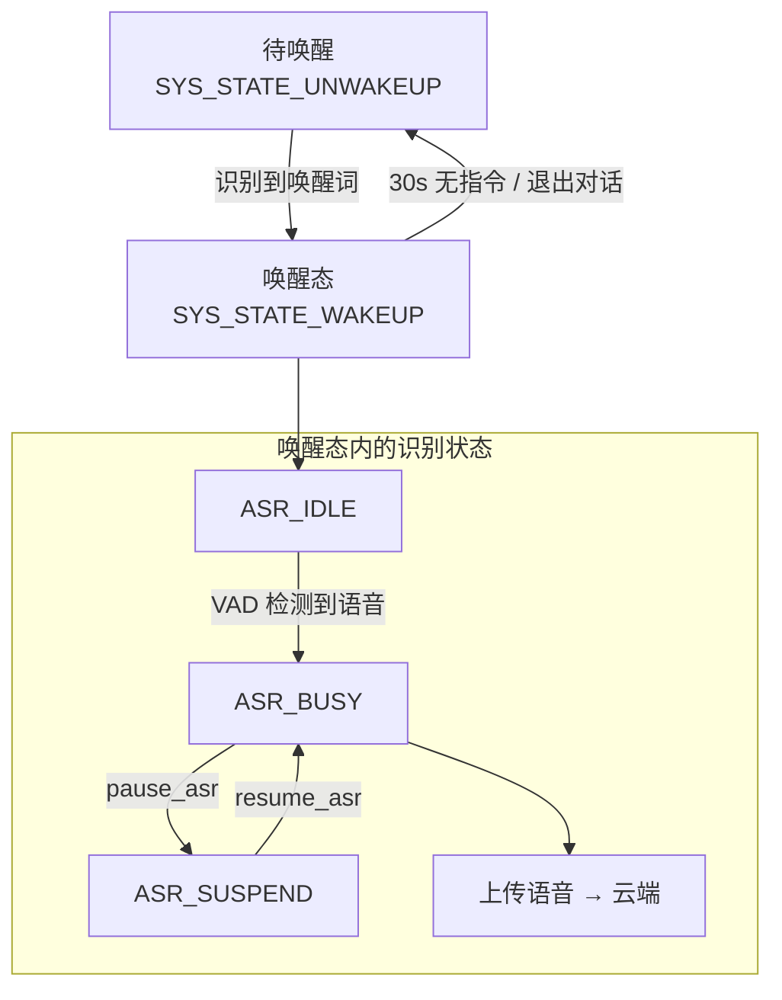

- `SYS_STATE_UNWAKEUP / WAKEUP`：系统唤醒状态。
- `SYS_STATE_ASR_IDLE / BUSY / SUSPEND`：识别器工作状态。
- 支持 `pause_asr()` / `resume_asr()` 暂停恢复。
- 支持中间识别结果输出（`ASR_MIDDLE_RESULT_OUT_EN`，当前关闭）。

### 4.5 命令词自学习 CWSL（代码保留，默认关闭）

- 组件：`ci_cwsl_v2`，应用层：`app_cwsl`。
- 支持学习唤醒词、学习命令词、删除、全部删除、重新学习。
- 可学习唤醒词 2 个，学习遍数 1，阈值 37/35。
- 播报 ID：200 学习唤醒词、201 学习命令词、202 重新学习、203 退出学习、204 我要删除、205 删除唤醒词、206 删除命令词、207 退出删除、208 全部删除、209 学习成功、210 学习失败、211 注册成功、212 模板超限、213 删除成功、217 学习完成、219 请再说一次、220 语音太短、221 与默认指令冲突。
- 串口协议：`0x0701~0x0709`。

---

## 5. 语音前处理算法

算法以静态库形式提供，位于 `libs/`；由 `system/user_alg_config.mk` 与 `components/bnpu_core_alg_pro` 联合裁剪到 BNPU 核。

| 算法 | 库 | 作用 | 默认 |
|---|---|---|---|
| AEC | `libaec` | 回声消除，消除喇叭播放对麦克风的干扰 | 开启 |
| AGC | `libagc` | 自动增益控制（VAD 灵敏度联动） | 开启 |
| ALC 自动切换 | `libalc_auto_switch` | 自动电平控制 | 关闭 |
| 波束成形 | `libbf` | 多麦波束成形 / 定向拾音 | 开启 |
| NN 降噪 | `libnn_denoise_v1/v2/v3` | 神经网络降噪 | 开启（v3） |
| 传统降噪 | `libdenoise` | 传统谱减降噪 | 库存在 |
| NN VAD | `libtvad` | 神经网络语音活动检测 | 开启 |
| NN DOA | `libnn_doa` / `libdoa` | 神经网络声源定位 | 关闭 |
| GCC DOA | `libgcc_doa` | 广义互相关声源定位 | 关闭 |
| 去混响 | `libderverb` | Dereverberation | 库存在 |
| 就近唤醒 | `libpwk` | 多设备就近唤醒 | 关闭 |
| SED | `libnn_sed` | 声音事件检测（哭声/鼾声） | 库存在 |
| VPR | `libnn_vpr` | 声纹识别 | 库存在 |
| WMAN | `libnn_wman_vpr` | 男女声纹识别 | 库存在 |
| FFT | `libfft` | 频域分析 | 开启 |
| 基础算法 | `libbasic_alg` | 通用信号处理 | 开启 |

### 5.1 AEC 回声消除

- 参考通道取自播放数据（内部回采或外部参考）。
- `AEC_INTERRUPT_TYPE 2`：AEC 中断方式。
- 支持 AEC 增益自动获取（`AUTO_GET_AEC_GAIN`，当前关闭）。
- 串口命令 `CIAS_AEC_GET_MIC_REF_GAIN 0x0515` 可触发 MIC/REF 增益测试，结果 `0x0516`。

### 5.2 NN VAD 参数

| 参数 | 值 |
|---|---|
| 灵敏度 | 1 |
| 前置窗口 | 35 帧 |
| 有效性检查模式 | 1 |
| 有效帧数 | 25 |
| VAD 超时 | 5 秒 |
| 回退帧数 | 25 帧 |
| 结束静音帧 | 自动计算 |

VAD 支持串口在线调节：

| 命令 | 功能 |
|---|---|
| `SET_VAD_SENSITIVITY 0x010A` | 45~60 映射为高/中/低灵敏度，同时调整 AGC 门限 |
| `SET_VAD_FILTER_FRAME 0x010F` | 15~40 帧过滤 |
| `SET_VAD_SENSITIVITY_ACTIVATE_LENTH 0x0110` | 6/15/20/50/80/120 帧激活长度 |
| `SET_VAD_START_MAX_TIMEOUT 0x0111` | 最大录音时长 |
| `SET_FORCE_VAD_END 0x011D` | 强制结束 VAD |
| `VAD_VAILD_CHECK_RESULT 0x011E` | 有效性检查结果 |
| `VAD_START 0x0108` / `VAD_END 0x0103` | VAD 起止上报 |
| `VAD_START_BY_KEY 0x010B` / `VAD_END_BY_KEY 0x010C` | 按键触发起止 |
| `VAD_START_STOP_PLAY 0x0216` | VAD 触发是否停止播放 |

### 5.3 声源定位 DOA（代码保留，默认关闭）

- `app_doa/doa_app_handle.c` 提供 `doa_out_result_hand_task()`。
- 识别结果角度范围 -90° ~ +90°。
- 串口上报命令 `DOA_ANGLE 0x0901`。
- 组件 `components/alg/doa` 内含 `gcc_doa` 与 `nn_doa`。

### 5.4 声音事件检测 SED（代码保留，默认关闭）

- `app_sed/sed_app_host.c`，结果码：
  - `SED_DETECTED_CRY = 10010`（哭声）
  - `SED_DETECTED_SNORE = 10011`（鼾声）
- 参数：哭声阈值 0.53 / 连续 3 次；鼾声阈值 0.50 / 连续 3 次。
- 配置接口 `sed_nn_cmpt_cfg(200, 0)`。

### 5.5 声纹识别 VPR / WMAN（代码保留，默认关闭）

- 窗长 1200ms，匹配阈值 0.52，模板最多 3 个，注册 3 次。
- 云端协议支持注册 VPR/WMAN 命令。

### 5.6 波束成形与麦克风适配

- `BF_DEEPSE_MODE 1`：深度模式。
- `BF_ASR_VALID_MODE 0`。
- `USE_ANY_MIC` 支持任意麦克风一致性适配（当前关闭）。

---

## 6. 离在线 LLM AIoT 交互功能

### 6.1 整体链路

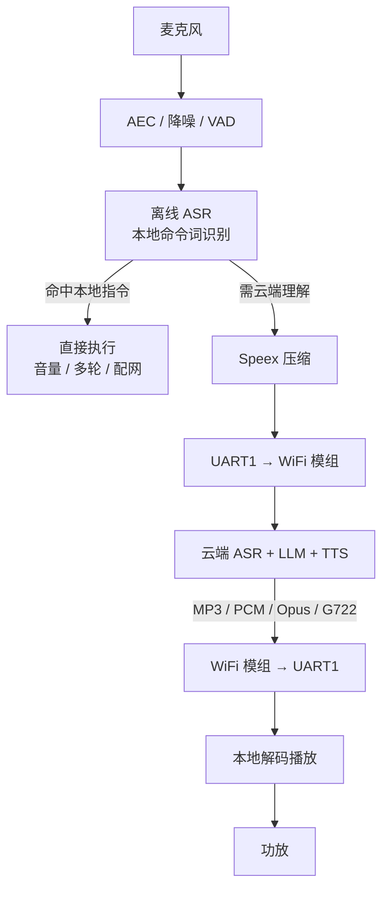

### 6.2 UART 通信

| 项目 | 配置 |
|---|---|
| 串口 | UART1 |
| 波特率 | 921600 |
| 协议版本 | V2（`UART_PROTOCOL_VER 2`） |
| 数据方向 | 双向：上传语音、下发播放数据 |
| 协议头 | 支持（`AUDIO_SEND_WITH_PROTOCOL_HEADER 1`） |
| 数据帧类型 | 纯命令 / 命令+数据 / 音频开始 / 音频中间 / 音频结束 |

### 6.3 语音上传

| 项目 | 说明 |
|---|---|
| 压缩格式 | Speex（可选 Opus / G722 / PCM） |
| 上传前处理 | NN 降噪可选（`UPLOAD_NNDENOISE_AUDIO_DATA_ENABLE`） |
| 上传队列 | `pcm_upload_queue` |
| 单帧请求 | `REQUEST_ONE_FRAME_SEZIE`（1KB） |
| 上传结束 | VAD 结束 + 本地静音帧判定 |
| 上传控制 | `SET_AUDIO_START_RECORD 0x011A` / `SET_AUDIO_STOP_RECORD 0x011B` |

### 6.4 云端音频播放

| 项目 | 说明 |
|---|---|
| 默认格式 | MP3 |
| 可选格式 | PCM / Opus / G722 / M4A / WAV / TTS |
| 播放器 | 精简播放器 `SIMPLE_AUDIO_PLAYER_ENABLE`（`sap_*` + `pdf_*`） |
| 预请求 | 播放开始预请求两帧，降低起播延迟 |
| 播放缓冲 | 6KB |
| 播放模式 | 可打断（`AUDIO_PLAY_MODE 1`） |
| 全双工 | 播放同时可录音上传 |
| 播放状态机 | START → DATA_PLAYING → DATA_WAITING_TIMEOUT → END |
| 播放结束 | 上报 `PLAY_TTS_END 0x020d` / `PLAY_END 0x0208` |

### 6.5 多轮对话与全双工

| 功能 | 命令 | 说明 |
|---|---|---|
| 多轮开关 | `SET_INTERACTION_NULTI_ROUND_ENABLE 0x0115` | 单轮 / 多轮 |
| 全双工开关 | `UPLOAD_PLAY_FULL_DUPLEX_EANBLE 0x0116` | 边说边听 |
| 播放模式 | `SET_AUDIO_PLAY_MODE 0x0215` | 可打断 / 不可打断 |
| VAD 停播 | `VAD_START_STOP_PLAY 0x0216` | VAD 触发是否停播 |
| 应答超时 | `SET_CLOUD_ANS_TIMEOUT_EXIT 0x011C` | 当前关闭，超时 6s |

### 6.6 网络功能

| 功能 | 命令 |
|---|---|
| 进入配网 | `ENTER_NET_CONFIG 0x0401` |
| 配网中 | `NET_CONFIGING 0x0402` |
| 退出配网 | `EXIT_NET_CONFIG 0x0403` |
| 初始化 SmartConfig | `INIT_SMARTCONFIG 0x0404` |
| WiFi 断开 / 连接 | `WIFI_DISCONNECTED 0x0405` / `WIFI_CONNECTED 0x0406` |
| 获取 / 需要 Profile | `GET_PROFILE 0x0407` / `NEED_PROFILE 0x0408` |
| 云连接 / 断开 | `CLOUD_CONNECTED 0x0409` / `CLOUD_DISCONNECTED 0x040a` |
| 配网成功 / 失败 | `NET_CONFIG_SUCCESS 0x040b` / `NET_CONFIG_FAIL 0x040c` |

配网过程配有语音提示：开始配网、配网成功、配网失败、联网中、网络连接成功、云平台连接成功、网络断开、未联网、网络质量不好、网络异常等。

### 6.7 IoT 控制

| 功能 | 命令 |
|---|---|
| 云 IoT 指令 | `QCLOUD_IOT_CMD 0x0301` |
| 网络 / 本地音量设置 | `0x0302` / `0x0303` |
| 音量加 / 减 / 最大 / 最小 | `0x0304` ~ `0x0307` |
| cJSON 数据 | `CIAS_CJSON_DATA 0x0308` |
| 静音 / 取消静音 | `IOT_VOLUME_MUTE 0x0309` / `IOT_VOLUME_UNMUTE 0x030a` |
| 安静唤醒模式 | `IOT_QUITE_WAKE_UP_MODE 0x030b` |
| 获取软件版本 | `GET_SW_VERSION 0x030d` |

### 6.8 系统命令

| 功能 | 命令 |
|---|---|
| 音频系统就绪 | `CIAS_AUDIO_SYS_READY 0x0601` |
| 音频系统错误 | `CIAS_AUDIO_SYS_ERR 0x0602` |
| 音频系统复位 | `CIAS_AUDIO_RST 0x0603` |
| 获取固件版本 | `CIAS_GET_SOFT_VER 0x0500` |
| 命令执行状态 | `CIAS_CMD_EXEC_STATE 0x0801` |

---

## 7. 本地播放与提示音系统

### 7.1 播放器

| 项目 | 配置 |
|---|---|
| 播放器类型 | 精简播放器（`USE_AUDIO_PLAYER_TYPE 0`） |
| 本地播放器开关 | `AUDIO_PLAYER_ENABLE` |
| MP3 解码 | 开启（`USE_MP3_DECODER 1`） |
| 提示音 MP3 支持 | 开启（`AUDIO_PLAY_SUPPT_MP3_PROMPT 1`） |
| 提示音解码 | 开启（`USE_PROMPT_DECODER 1`） |
| 音量范围 | 1 ~ 7，默认 5 |
| 功放控制 | `PLAYER_CONTROL_PA 0`（由板级控制） |

支持解码格式：MP3、Opus、G722、PCM、WAV/M4A（网络侧）。

### 7.2 提示音管理

| 场景 | 提示音 |
|---|---|
| 开机 | 开机音（ID 0） |
| 唤醒 | 唤醒音（ID 1，变体 101/102/103） |
| 退出唤醒 | 退出音（ID 2） |
| 音量 | 增大（4）/ 减小（5）/ 最大（6）/ 最小（7） |
| 多轮对话 | 开启（9）/ 关闭（10） |
| 翻译 | 开启（11）/ 关闭（12） |
| 音乐 | 播放（13）/ 停止（14） |
| 配网 | 开始（3）、成功（2022/2007）、失败（2021/2006）、二维码（2020） |
| 自学习 | 见第 4.5 节 |
| 通用应答 | 好的（199）、未听清（2030）、云端处理中（2050）、可以聊天（2060） |

TTS 音色：**小蝶 · 清新女声**（语速 5，音量 10，中文）。

### 7.3 播放控制接口

`SET_PLAY_VOICE_ID 0x0112` 可指定提示音 ID 与是否打断当前播放；`LOCAL_AUDIO_PLAY_START 0x0217` / `LOCAL_AUDIO_PLAY_STOP 0x0218` 控制本地音频播放。

---

## 8. 红外控制功能（代码完整，默认关闭）

由 `USE_IR_ENABLE 0` 关闭，开启后可支持空调、风扇、灯、电视/机顶盒四类设备，并联动小夜灯（`USE_NIGHT_LIGHT 1`）。

### 8.1 支持的设备与命令

**空调（索引 1000 起）**

- 基础：快速匹配、学习码、清码、开/关
- 风速：高/中/低/自动、风速加/减
- 扫风：开/关扫风、上下扫风、左右扫风及停止
- 温度：16 ~ 30 度、温度加/减
- 模式：制冷、制热、送风、除湿、自动
- 附加：睡眠、ECO、OSD、全自动、快速冷/热、低功率
- 定时：取消、1 ~ 10 小时
- 品牌设置（1500 起）：LG、TCL、AUX、志高、松下、格力、海信、海尔、科龙、美的、长虹、日立、大金、三菱、小米、惠而浦、格兰仕、富士通、山水、约克、创维、新科、春兰、樱花、三星、澳柯玛、新飞、东芝、声宝、月兔、扬子、夏新、夏普
- 辅助功能（1600 起）：电辅热、新风、风随人、睡眠 2/3、健康、静音风、强劲风、感应
- 搜索匹配（1700 起）：按索引 / 品牌搜索
- 语音播报：匹配成功/失败、搜索完成、开机/关机、模式切换、扫风、风速、首次开机等

**电视 / 机顶盒（索引 2000 起）**

- 匹配、清码、电视开/关、机顶盒开/关
- 切换信号源、菜单、确认、返回
- 上/下/左/右
- 上一节目 / 下一节目
- 音量加/减、静音
- 停止自动换台 / 自动换台

**风扇（索引 3000 起）**

- 匹配、清码、开/关
- 开始 / 停止摇头
- 切换风速、1/2/3 档、定时

**灯（索引 4000 起）**

- 匹配、清码、开/关
- 变亮 / 变暗、切换

### 8.2 红外学习与码库

- 支持红外码学习（`LEARN_IR`）、按键学习（`LEARN_KEY`）、码库自动匹配（`AIR_MATCH`）。
- 设备模式：`NORMAL` / `LEARN`。
- 红外码库以 `libir_data.a` 形式提供。
- EUT 产测：支持红外收发、MIC、SPK 测试状态机（`eut_test_init`，受 `IR_TEST==1` 控制）。

---

## 9. 用户自定义功能

### 9.1 I2C 步进电机 + DOA 转向（默认关闭）

- 电机驱动芯片：GC61XX
- I2C 从机地址：`0x13`，芯片 ID：`0x1D`
- 一圈脉冲数：8192
- 功能：读取电机角度、设置速度、配置、运行、按角度运行、停止
- `Motor_A_Run_angle()` 将 DOA 角度（-90° ~ +90°）换算为脉冲，实现"声音来自哪边，设备转向哪边"
- 受 `ENABLE_MOTOR_DOA` 宏控制

### 9.2 充电检测

- GPIO 输入：PD3（充电中）、PD4（充电完成）
- `key_check_task()` 周期检测并打印充电状态

### 9.3 功放静音控制

- GPIO 输出：PD0（`gpio_mute_init`）

### 9.4 自定义串口协议

| 协议 | 数据 |
|---|---|
| 唤醒上报 | `AA BB F0 01 00 01 0A 5F` |
| 断句上报 | `AA BB F0 02 ...` |
| 应答 | `BB AA 00 00 00 00 48 03` |

---

## 10. 外设驱动与板级支持

### 10.1 芯片驱动（`driver/ci130x_chip_driver`）

SPI Flash、SCU、Codec、UART、Timer/WDT、Timer、PWM、PDM、Mailbox、低功耗、IWDG、IIS DMA、IIS、IIC、GPIO、DTR Flash、DPMU、DMA、Core Timer、Core PMP、Core Misc、Core ECLIC、Cache、ALC、ADC。

### 10.2 板级支持（`driver/boards`）

| 板型 | 说明 |
|---|---|
| CI-D01GS01J / 02S | 入门板 |
| CI-D02GS01J / 02S | **当前使用** |
| CI-D03GS01J / 02S | — |
| CI-D06GT01D / J | — |
| CI-D06GS03J | — |
| CI-D12GS01J | — |
| CI-E12GS02J | — |
| CI-1302TEST / CI-1306TEST | 测试板 |
| CI-130X_QFN56_TEST_BORAD | QFN56 测试板 |
| MZ-D02SS02J | — |
| board_default / board_port_template | 默认与模板 |

### 10.3 第三方器件驱动

外部 Codec：ES7243E、ES7243、ES8388、ES8311。

### 10.4 当前板级资源分配（CI-D02GS01J）

| 功能 | 引脚 | 复用 |
|---|---|---|
| UART0（日志） | PB5 / PB6 | 第二功能，RX 上拉 |
| UART1（WiFi） | PA2 / PA3 | 第四功能 |
| UART2 | PA5 / PA6 | — |
| IIS | PA2 ~ PA6 | 第二功能 |
| PDM | PA5 / PA6 | 第五功能 |
| I2C | PB7 / PC0 | 第三功能 |
| 功放使能 | PC4 | GPIO |
| 彩灯 R/G/B | PB0 / PB1 / PA7 | PWM1 / PWM2 / PWM0，10kHz |
| 小夜灯 | PA3 | PWM1，25kHz |
| 闪光灯 | PB4 | GPIO |
| VAD 指示灯 | PD1 | GPIO |
| 充电检测 | PD3 / PD4 | GPIO 输入 |
| 静音控制 | PD0 | GPIO 输出 |

---

## 11. 系统管理与监控

| 功能 | 说明 |
|---|---|
| 实时操作系统 | FreeRTOS（任务、队列、事件组、流缓冲、软件定时器） |
| 双核架构 | HOST MCU + BNPU 核，通过 Mailbox 通信 |
| 看门狗 | IWDG，2 秒 |
| 任务监控 | `sys_monitor/ci_task_monitor`，打印 CPU 占用、任务栈、堆信息 |
| 日志 | `ci_log`，UART0 输出，支持分级 |
| 断言 | `ci_assert` |
| 命令行 | FreeRTOS CLI（可选） |
| 调试 | SEGGER RTT / SystemView（可选） |
| 功耗管理 | DPMU 低功耗模式 |
| 时钟 | 外部晶振 / 内部 RC 可选 |
| 双 Code 切换 | `code_switch`，ASR↔TTS / ASR↔RTC（当前关闭 `USER_CODE_SWITCH_ENABLE 0`） |
| 分区信息 | 通过 `flash_control` 获取 |
| NV 存储 | `ci_nvdm`，NV 区 0x1FC000 / 16KB |
| 版权校验 | `flash_encrypt/copyright_verification` |

### 11.1 系统启动流程

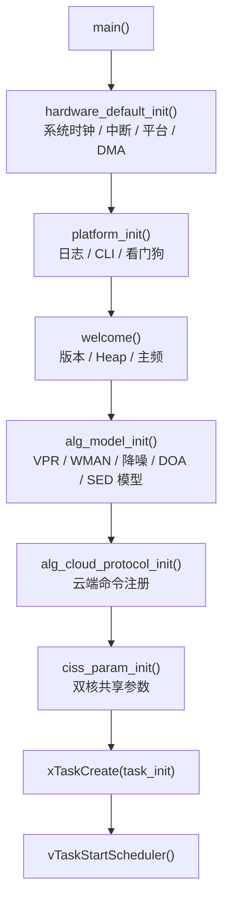

`task_init()` 的内部执行顺序：

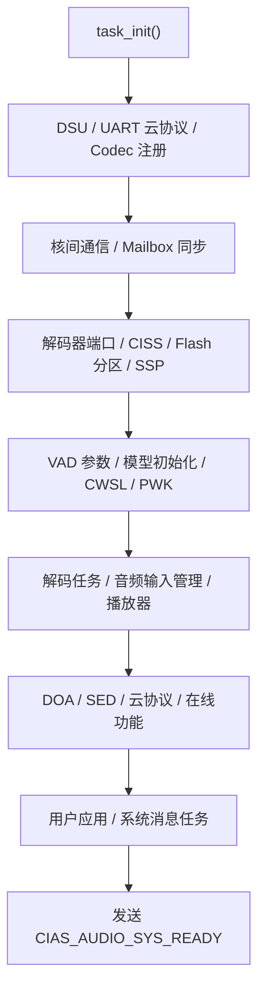

---

## 12. 配置与固件分区

### 12.1 Flash 分区（`firmware/config.ini`）

| 分区 | 起始地址 | 大小 | 内容 |
|---|---|---|---|
| 引导 Boot | 0x000000 | 0x00A000（40KB） | 启动引导 |
| User（Code1） | 0x00A000 | 0x37000（220KB） | 主程序 |
| Command | 0x3B000 | 0x2000（8KB） | 命令词资源 |
| Module（DNN） | 0x3D000 | 0x132000（1224KB） | DNN 模型 |
| Voice | 0x16F000 | 0x3A000（232KB） | 提示音资源 |
| UserFile | 0x1A9000 | 0x2000（8KB） | 命令词表/配置文件 |
| 余量 | 0x1AB000 | — | 预留 |
| NV | 0x1FC000 | 0x4000（16KB） | 掉电存储 |

其他关键配置：

| 项目 | 值 |
|---|---|
| chipid | CI1302 |
| firmware_version | FW_V2（不支持 OTA） |
| FacterID / ProductID | 100 / 101 |
| user_size | 0x3F000 |
| code1_size / code2_size | 0x37000 / 0x24000 |
| code2_state | False（双 Code 关闭） |

### 12.2 编译构建

- `project_file/makefile` 读取 `system/user_alg_config.mk`，通过 `parse_user_alg_config_mk.lua check/sync` 联动裁剪 BNPU 算法库。
- BNPU 核生成 `[0]code.bin` 与 `[1]code.bin`，经 `ci-tool-kit merge user-file` 合并为 `user_code.bin`。
- 链接脚本：`lds/ci130x_asr_alg_mcu.lds`，由 `_temp.lds` 替换 `@@SDK_ALG_PRO_SRAM_HOST_END_ADDR@@` 生成。
- 编译选项：rv32imafc / ilp32f / LTO / 大量 `--wrap`（memcpy、malloc、字符串、数学函数等）。
- 算法 SRAM 预算：`SDK_ALG_PRO_SRAM_HOST_NOT_ALG_END_ADDR = 0x1FFD3000`，AEC 30KB + NN 降噪 47KB。

### 12.3 固件打包脚本

| 脚本 | 用途 |
|---|---|
| `合成分区bin文件.bat` | 合并各分区为整片固件 |
| `打包升级.bat` | 生成升级包 |
| `烧录user_code.bat` | 烧录用户区 |
| `cmd_info.bat` | 生成命令词信息 |

---

## 13. 功能启用状态总表

| 功能模块 | 关键宏 / 命令 | 状态 |
|---|---|---|
| 离线 ASR | `USE_ASR 1` | 开启 |
| 唤醒（小爱） | `USE_SEPARATE_WAKEUP_EN 1` | 开启 |
| 命令词识别 | `G.fst0.txt` | 开启 |
| 命令词自学习 | `USE_CWSL 0` | 关闭 |
| AEC | `USE_AEC 1` | 开启 |
| NN 降噪 | `USE_NN_DENOISE 1` | 开启 |
| NN VAD | `USE_NN_VAD 1` | 开启 |
| 波束成形 | `USE_BF` / `BF_DEEPSE_MODE 1` | 开启 |
| 去混响 | `USE_DEREVERB` | 未启用 |
| NN DOA | `USE_NN_DOA` | 关闭 |
| GCC DOA | `USE_GCC_DOA 0` | 关闭 |
| 就近唤醒 | `USE_PWK_ENABLE 0` | 关闭 |
| 声纹 VPR | 模型代码保留 | 关闭 |
| 男女声纹 WMAN | 模型代码保留 | 关闭 |
| 声音事件 SED | 模型代码保留 | 关闭 |
| ALC 自动切换 | `USE_ALC_AUTO_SWITCH_MODULE 0` | 关闭 |
| UART 语音上传 | `AUDIO_UPLOAD_TYPE 1` | 开启 |
| Speex 压缩 | `AIOT_AUDIO_COMPRESS_TYPE 1` | 开启 |
| 云端 MP3 播放 | `NET_AUDIO_PLAY_BY_MP3 1` | 开启 |
| 多轮对话 | `CUR_INTERACTION_MULTI_ROUND_ENABLE 1` | 开启 |
| 全双工 | `UPLOAD_PLAY_FULL_DUPLEX_ENABLE 1` | 开启 |
| 播放打断 | `AUDIO_PLAY_MODE 1` | 开启 |
| 云端应答超时 | `CLOUD_ANS_TIME_OUT_ENEABLE 0` | 关闭 |
| 本地录音 VAD 结束 | `LOCAL_REC_VAD_END_ENABLE 1` | 开启 |
| 上传降噪 | `UPLOAD_NNDENOISE_AUDIO_DATA_ENABLE 1` | 开启 |
| WiFi 配网 | 协议 `0x04xx` | 协议支持 |
| IoT 控制 | 协议 `0x03xx` | 协议支持 |
| OTA | `CI_OTA_ENABLE 0` | 关闭 |
| 双 Code 切换 | `USER_CODE_SWITCH_ENABLE 0` | 关闭 |
| 红外控制 | `USE_IR_ENABLE 0` | 关闭 |
| 小夜灯 | `USE_NIGHT_LIGHT 1` | 随红外开启 |
| I2C 电机 + DOA | `ENABLE_MOTOR_DOA` | 关闭 |
| 充电检测 | PD3/PD4 | 开启 |
| 功放静音 | PD0 | 开启 |
| 播放器 | `AUDIO_PLAYER_ENABLE` | 开启 |
| 提示音 | `PLAY_*_EN` 均 1 | 开启 |
| 工厂测试 | `components/factory_test` | 协议支持 |
| AEC 增益自动获取 | `AUTO_GET_AEC_GAIN 0` | 关闭 |

---

## 14. 重点功能详解

本章针对语音前处理、离在线交互与系统升级中的关键模块做展开说明。

| 序号 | 功能 | 当前状态 | 关键开关 |
|---|---|---|---|
| 14.1 | 声音事件检测 SED | 关闭 | `USE_SED` / `USE_SED_CRY` / `USE_SED_SNORE` |
| 14.2 | 就近唤醒 PWK | 关闭 | `USE_PWK_ENABLE` |
| 14.3 | UART 语音上传（Speex） | 开启 | `AUDIO_DATA_UPLOAD_BY_UART` / `AUDIO_COMPRESS_SPEEX_ENABLE` |
| 14.4 | 云端音频接收与播放（MP3） | 开启 | `NET_AUDIO_PLAY_BY_MP3` / `SIMPLE_AUDIO_PLAYER_ENABLE` |
| 14.5 | 多轮对话 / 全双工 | 开启 | `CUR_INTERACTION_MULTI_ROUND_ENABLE` / `UPLOAD_PLAY_FULL_DUPLEX_ENABLE` |
| 14.6 | 播放打断（VAD 打断 TTS） | 开启 | `AUDIO_PLAY_MODE` / `VAD_START_STOP_PLAY_ENABLE` |
| 14.7 | 云端应答超时退出 | 关闭 | `CLOUD_ANS_TIME_OUT_ENEABLE` |
| 14.8 | WiFi 配网与连接状态管理 | 协议支持 | `CHECK_NET_WORK_STATE_ENABLE` |
| 14.9 | OTA 升级 | 关闭 | `CI_OTA_ENABLE` |
| 14.10 | 双 Code 分区切换 | 关闭 | `USER_CODE_SWITCH_ENABLE` |

---

### 14.1 声音事件检测 SED（哭声 / 鼾声）

#### 14.1.1 功能定位

SED（Sound Event Detection）利用神经网络模型识别环境中的特定声音事件，当前支持两类：

| 事件 | 结果码 | 默认阈值 | 连续判定次数 |
|---|---|---|---|
| 婴儿哭声 | `SED_DETECTED_CRY = 10010` | 0.53 | 3 次 |
| 打鼾声 | `SED_DETECTED_SNORE = 10011` | 0.50 | 3 次 |

与语音识别不同，SED 不需要唤醒，可长时间后台运行，用于婴儿看护、睡眠监测等场景。

#### 14.1.2 代码组成

| 层次 | 文件 | 作用 |
|---|---|---|
| 模型层 | `libs/libnn_sed` | 神经网络推理 |
| 管理组件 | `components/alg/sound_event_detection/sed_manage.*` | 算法初始化与帧级推理 |
| 应用层 | `app/app_sed/sed_app_host.c` | 连续判定、结果输出、播报 |
| 头文件 | `app/app_sed/sed_app_host.h` | `sed_param_config_t`、结果码 |

#### 14.1.3 判定逻辑

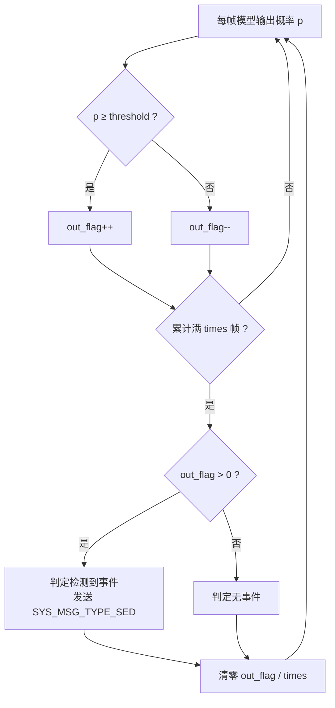

关键实现：`sed_continuous_detect(float out_array)` 采用"投票式"累计，而不是简单连续计数，单帧误判会被后续帧抵消，可降低误报。`sed_rslt_cb()` 从模型输出数组中取 `data_sed[0]` 作为当前帧概率。

#### 14.1.4 结果输出

检测到事件后，系统消息任务调用 `sed_rslt_out()`：

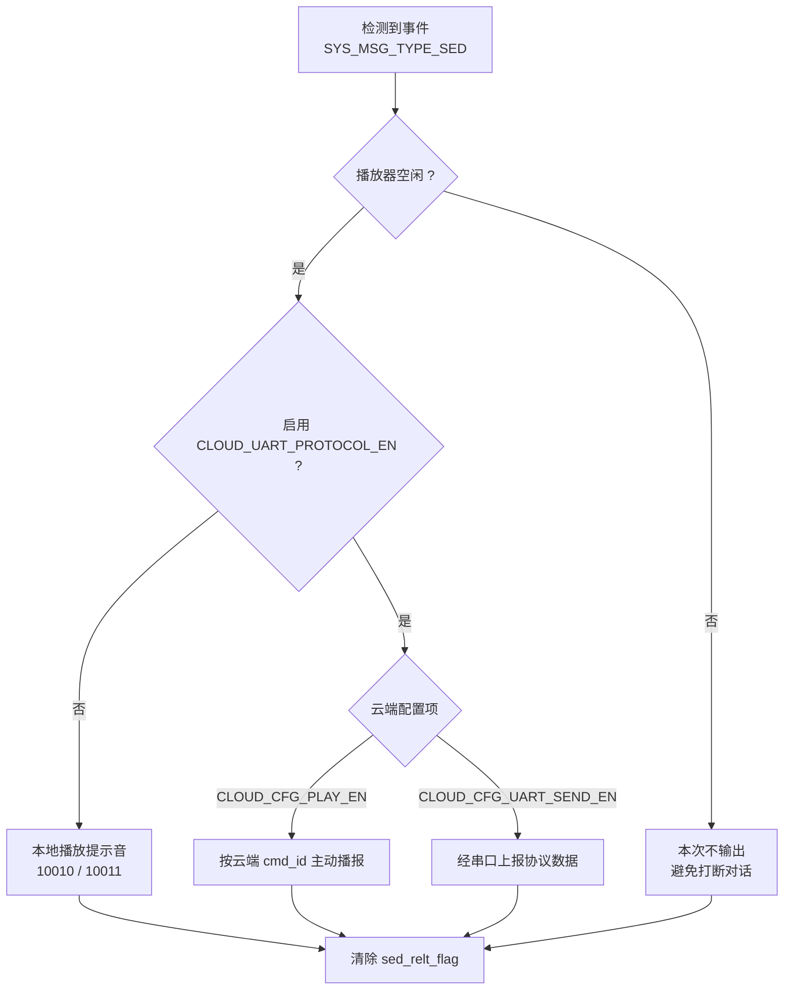

#### 14.1.5 配置与约束

- 模型初始化：`alg_model_init()` 中调用 SED 模型初始化，并设置 `sed_nn_cmpt_cfg(200, 0)`。
- 阈值与次数通过 `sed_param_config_t { threshold, times }` 配置。
- 编译宏：`USE_SED` 总开关，`USE_SED_CRY` / `USE_SED_SNORE` 二选一或分别配置。
- 与 PWK 互斥：`user_config.h` 中 `USE_PWK && (... || USE_SED_CRY || USE_SED_SNORE)` 会触发 `#error`。
- 当前工程未定义 `USE_SED`，因此该功能不参与编译；模型库与代码完整保留。

---

### 14.2 就近唤醒 PWK

#### 14.2.1 功能定位

PWK（Pick Wakeup / 就近唤醒）用于同一空间内多台语音设备同时听到唤醒词的场景：各设备比较唤醒声音能量，仅距离用户最近的设备响应，避免"一呼百应"。

#### 14.2.2 实现方式

| 项目 | 内容 |
|---|---|
| 算法库 | `libs/libpwk` |
| 组件头文件 | `components/alg/pwk/ci_pwk.h` |
| 模块配置 | `ci_ssp_config.c` 中 `pwk_config_t ci_pwk_config = { .alg_enable = true }` |
| 注册位置 | SSP 配置表 `.pwk = { .module_config = &ci_pwk_config }` |
| 结果回调 | `system_msg_deal.c` 中 `ci_pwk_get_cb(int db_val)` |
| 编译开关 | `project_file/makefile` 中 `USE_PWK_ENABLE := 0` |

`ci_pwk_get_cb(int db_val)` 接收当前设备检测到的能量值（dB），配合多设备间的比较逻辑决定是否本机响应。

#### 14.2.3 约束条件（重要）

`user_config.h` 对 PWK 有严格的组合限制，违反会直接编译报错：

| 约束 | 说明 |
|---|---|
| 与波束成形互斥 | `USE_BEAMFORMING_MODULE && USE_PWK` → `#error "bf + pwk algorithm, not support"` |
| 与 UART 语音上传互斥 | `AUDIO_DATA_UPLOAD_BY_UART && USE_PWK` → `#error "ONLY USE_NULL WITH NO PWK SUPPORT AUDIO_DATA_UPLOAD_BY_UART!"` |
| 与多种算法互斥 | `USE_PWK && (ALC_AUTO_SWITCH / NN_DENOISE / CWSL / SED_CRY / SED_SNORE)` → `#error "can't be toghter pwk"` |

因此，对于当前"UART 上传 + NN 降噪"的离在线方案，PWK 在架构上无法同时启用，`USE_PWK_ENABLE` 必须为 0。PWK 主要适用于纯离线、单机或多机就近响应的产品形态。

---

### 14.3 UART 语音上传（Speex 压缩）

#### 14.3.1 数据链路

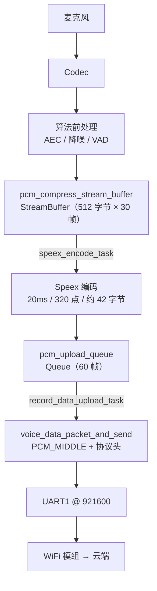

#### 14.3.2 任务划分

| 任务 | 栈大小 | 优先级 | 职责 |
|---|---|---|---|
| `speex_encode_task` | 1024 | 4 | 从 StreamBuffer 取 PCM，Speex 编码，写入上传队列 |
| `record_data_upload_task` | 512 | 4 | 从队列取压缩帧，打包后经 UART 发送 |
| `vad_state_handle_task` | 256 | 4 | 轮询 VAD 状态，触发开始/结束/强制结束 |

#### 14.3.3 Speex 编码参数

| 项目 | 值 |
|---|---|
| 模式 | Wideband（Sub-band CELP） |
| 模式 ID | 1 |
| 帧长 | 20ms（16kHz 下 320 个采样点） |
| 输入帧大小 | `COMPRESS_NEED_PCM_LEN * 2` 字节 |
| 输出帧大小 | `COMPRESS_UPLOAD_QUEUE_TIEM_SIZE`（43 字节，实际压缩帧约 42 字节） |
| 上传队列深度 | `PCM_UPLOAD_QUEUE_NUM`（60 帧） |
| 原始音频流缓冲 | `PCM_ALG_FRAME_LEN × PCM_MSG_STREAM_NUM`（512 字节 × 30 帧） |
| 实例创建 | `ci_speex_create()`，`ci_speex_mode = CI_SPEEX_INT` |
| 编码调用 | `cias_speex_compressed_data()` |

初始化函数 `audio_speex_task_init()` 动态构造 Wideband 模式对象（`sb_encoder_init`、`sb_encode`、`sb_encoder_ctl`），再创建编码实例与任务。

#### 14.3.4 上传流程细节

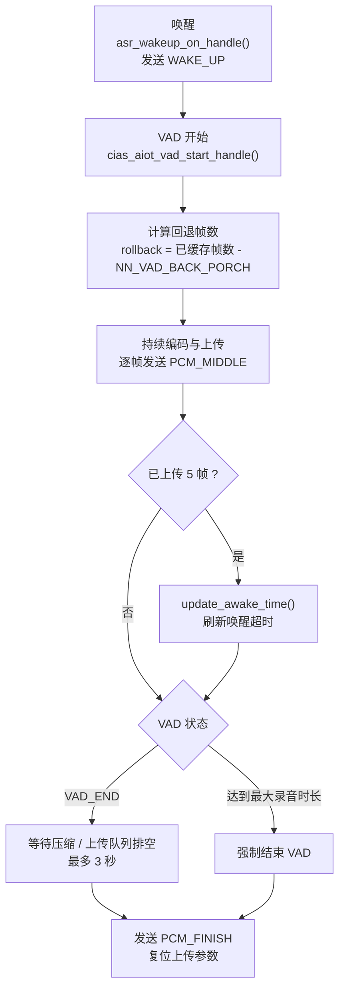

- **回退帧**：丢弃多余的前置缓存，只保留 VAD 前置窗口，确保上传音频包含语音起始部分。
- **VAD 结束排空**：最多等待 30 × 100ms = 3 秒；若本地 ASR 已出结果（`local_asr_finish_flag`）则立即退出等待。
- **强制结束条件**：VAD 持续帧数超过 `vad_start_max_timeout * 1000 / 16`，防止无限录音。

#### 14.3.5 其他压缩格式

工程同时保留 Opus 与 G722 实现，通过 `AIOT_AUDIO_COMPRESS_TYPE` 切换：

| 格式 | 参数 | 特点 |
|---|---|---|
| Speex | Wideband，20ms 帧 | **当前使用**，算力与带宽平衡 |
| Opus | 16kbps CBR，40ms 帧，复杂度 10，VOICE 模式，低延迟 | 压缩率高，算力占用大（任务栈 512×11） |
| G722 | 64kbps | 实现简单，带宽较高 |
| PCM | 不压缩 | 通过 `UPLOAD_PCM_DATA_ENABLE` 直传，调试用 |

#### 14.3.6 异常处理

- **未连云**：`wifi_net_state_check()` 检测到非 `CLOUD_CONNECTED_STATE` 时，播放 2009"设备网络异常，请重新配网"，结束本次 VAD 并发送 `SKIP_INVAILD_SPEAK`。
- **队列满**：`xQueueSend` 超时后打印错误日志，丢弃该帧，避免阻塞编码任务。
- **云端忙**：若 `cloud_parse_is_busy_flag` 为真且启用超时机制，新的 VAD 开始会被忽略，防止上一轮未处理完就再次上传。

---

### 14.4 云端音频接收与播放（MP3）

#### 14.4.1 数据链路

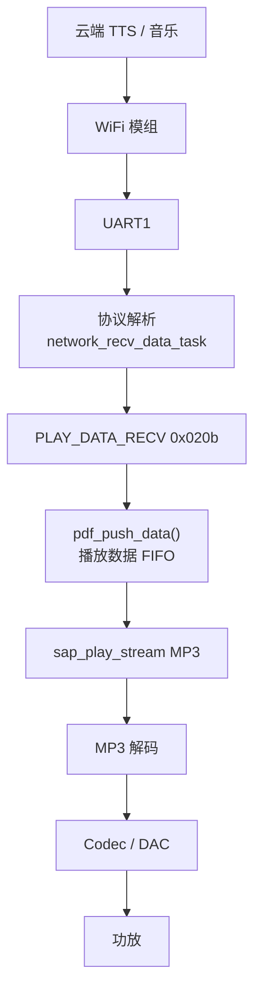

#### 14.4.2 播放启动

收到 `NET_PLAY_START 0x0201` 后：

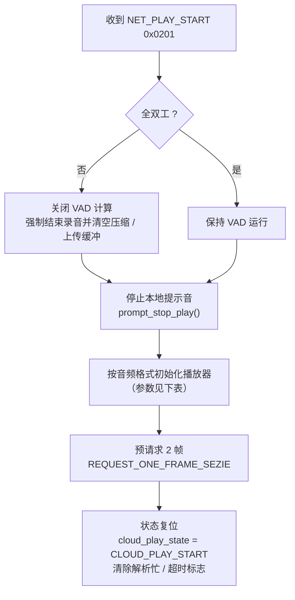

| 格式 | 预初始化大小 | 流式播放接口 |
|---|---|---|
| MP3 | `pdf_cloud_pre_init(4096)` | `sap_play_stream("MP3", 4096, ...)` |
| PCM | `pdf_cloud_pre_init(8192)` | `sap_play_stream("pcm", 8192, ...)` |
| G722 | `pdf_cloud_pre_init(8192)` | `sap_play_stream("g722", 8192, ...)` |

> MP3 比特率大于 128kbps 时建议把预初始化大小改为 8192。MP3 单帧请求 1KB，降低起播延迟。

#### 14.4.3 数据接收与播放

| 命令 | 处理 |
|---|---|
| `PLAY_DATA_RECV 0x020b` | `pdf_push_data(data, len, 1000ms)` 写入播放 FIFO；若 FIFO 满则阻塞等待 |
| `PLAY_DATA_END 0x020c` | 先推入最后一段数据，再置 `play_cloud_end_flag = true` |
| `NET_PLAY_STOP 0x0204` | `sap_stop()` 立即停止，恢复 VAD，清标志，上报 `PLAY_TTS_END` |
| `NET_PLAY_PAUSE 0x0202` | 暂停播放 |
| `NET_PLAY_RESUME 0x0203` | 恢复播放 |

播放过程中，`data_request_callback()` 会在缓冲低于阈值时主动向 WiFi 模组请求下一帧，形成"请求—下发—消费"的流式闭环。

#### 14.4.4 播放缓冲与状态机

| 项目 | 值 |
|---|---|
| 播放缓冲 | 6KB（`AIOT_AUDIO_PLAY_BUF_SIZE`） |
| 单次请求 | 1KB（`REQUEST_ONE_FRAME_SEZIE`） |
| 预请求帧数 | 2 帧 |
| 状态机 | `CLOUD_PLAY_START` → `CLOUD_PLAYING_DATA` → `CLOUD_PLAYING_DATA_WITING_TIMEOUT` → `CLOUD_PLAY_END` |
| 播放结束回调 | `play_end_callback` |

#### 14.4.5 兼容老播放器

当 `SIMPLE_AUDIO_PLAYER_ENABLE` 为 0 时，改用老播放器路径：

- MP3：`outside_write_stream(mp3_player, ...)` + `play_with_outside(0, "mp3", ...)`；
- PCM：写入 `pcm_play_data_stream_buffer`，由 `pcm_data_play_task` 消费；
- Opus：写入 `opus_play_queue`，由 `opus_data_decode_task` 解码。

当前工程使用精简播放器（`USE_AUDIO_PLAYER_TYPE 0`），因此走 `sap_*` / `pdf_*` 路径。

---

### 14.5 多轮对话 / 全双工

#### 14.5.1 多轮对话

| 项目 | 值 |
|---|---|
| 默认配置 | `CUR_INTERACTION_MULTI_ROUND_ENABLE 1`（开启） |
| 运行时变量 | `gCiasAiotFuncParam.interaction_multi_round` |
| 串口命令 | `SET_INTERACTION_NULTI_ROUND_ENABLE 0x0115`（1 字节：0 单轮 / 1 多轮） |
| 语音命令 | "进入/开启/打开连续对话模式"、"关闭/取消/退出连续对话模式"（cmd_id 105 / 106） |

行为差异：

- **多轮模式**：一次唤醒后可连续多轮问答，`is_wake_up_flag` 在参数刷新时保持不变。
- **单轮模式**：`cias_aiot_param_refresh()` 中执行 `is_wake_up_flag = false`，每轮结束后回到待唤醒状态，需要重新说唤醒词。
- 运行时切换：若当前处于唤醒态，收到 0x0115 后会立即把 `is_wake_up_flag` 置为 true，使新配置即时生效。

#### 14.5.2 全双工

| 项目 | 值 |
|---|---|
| 默认配置 | `UPLOAD_PLAY_FULL_DUPLEX_ENABLE 1`（开启） |
| 运行时变量 | `gCiasAiotFuncParam.upload_play_full_duplex` |
| 串口命令 | `UPLOAD_PLAY_FULL_DUPLEX_EANBLE 0x0116` |

行为差异：

| 模式 | 播放时 VAD | 播放时上传 | 典型场景 |
|---|---|---|---|
| 全双工 = 1 | 保持运行 | 允许 | 用户可随时打断 TTS，边说边听 |
| 全双工 = 0 | 关闭（`CI_SS_VOX_WORK_STATE = 0`） | 禁止 | 保证 TTS 播放纯净，播完再听 |

关键代码位置：

- `vad_state_handle_task()`：非全双工时，若 `CI_SS_PLAY_STATE == PLAYING` 则跳过 VAD 检测。
- `NET_PLAY_START`：非全双工时关闭 VAD 并清空上传缓冲。
- `NET_PLAY_STOP`：非全双工时重新打开 VAD 计算。

#### 14.5.3 组合建议

多轮 + 全双工是当前默认组合，适合大模型对话类产品：用户可以随时插话，对话不中断。若产品对 TTS 音质和识别准确率要求更高，可关闭全双工，改为"播放时静音麦克风"的半双工模式。

---

### 14.6 播放打断（VAD 打断 TTS）

#### 14.6.1 两个相关开关

| 开关 | 默认值 | 作用 |
|---|---|---|
| `AUDIO_PLAY_MODE` | 1 | 云端播放模式：1 可打断，0 不可打断 |
| `VAD_START_STOP_PLAY_ENABLE` | 0 | VAD 检测到说话时是否立即停止当前播放 |
| `UPLOAD_PLAY_FULL_DUPLEX_ENABLE` | 1 | 播放期间是否允许 VAD 工作 |

三者关系：

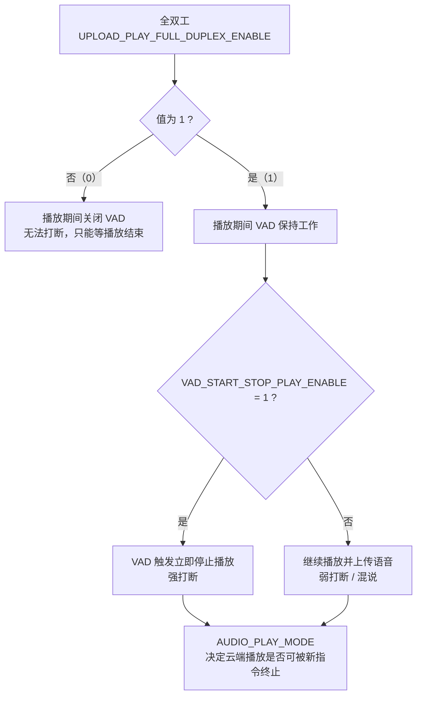

#### 14.6.2 打断流程

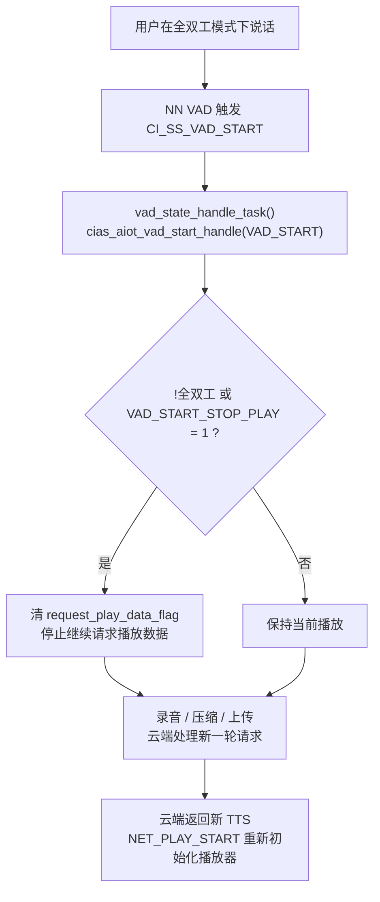

#### 14.6.3 串口动态配置

| 命令 | 值 | 效果 |
|---|---|---|
| `SET_AUDIO_PLAY_MODE` | 0x0215 | 运行时切换可打断/不可打断 |
| `VAD_START_STOP_PLAY` | 0x0216 | 运行时切换 VAD 是否停播 |

---

### 14.7 云端应答超时退出

#### 14.7.1 功能定位

用户说完话后，若云端长时间无响应（网络差、云端排队、服务异常），设备需要主动结束本轮交互并提示用户，避免一直停留在"处理中"状态。

#### 14.7.2 配置

| 项目 | 值 |
|---|---|
| 总开关 | `CLOUD_ANS_TIME_OUT_ENEABLE 0`（当前关闭） |
| 超时时长 | `CLOUD_ANS_TIME_OUT_VALUE`（配置为 6 秒） |
| 定时器句柄 | `gCiasAiotRunParam.cloud_ans_count_timer` |
| 回调 | `cloud_ans_count_timer_callback()` |

定时器仅在 `CLOUD_ANS_TIME_OUT_ENEABLE && CLOUD_ANS_TIME_OUT_VALUE > 0` 时创建，单次触发（`pdFALSE`）。

#### 14.7.3 启停时机

| 时机 | 动作 |
|---|---|
| VAD 结束且为云端识别（`type == 0`） | `xTimerStart()` 开始计时 |
| 本地 ASR 命中（`type != 0`） | `xTimerStop()` 停止计时，走本地指令 |
| 收到 `NET_PLAY_START` | `xTimerStop()`，说明云端已响应 |
| 唤醒 | `xTimerStop()`，复位状态 |

#### 14.7.4 超时处理

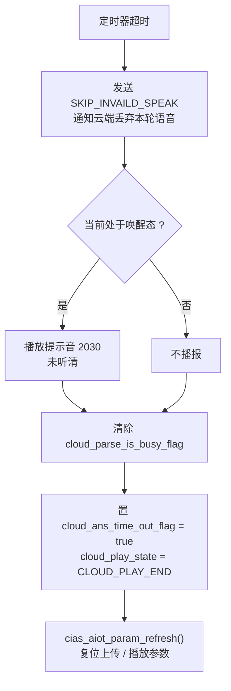

#### 14.7.5 与 VAD 的配合

启用超时后，`vad_state_handle_task()` 在云端处理中（`cloud_parse_is_busy_flag`）会忽略新的 VAD 开始事件，避免用户连续说话导致多轮请求叠加。当前该功能关闭，因此云端处理期间的新语音仍会被正常触发。

---

### 14.8 WiFi 配网与连接状态管理

#### 14.8.1 状态模型

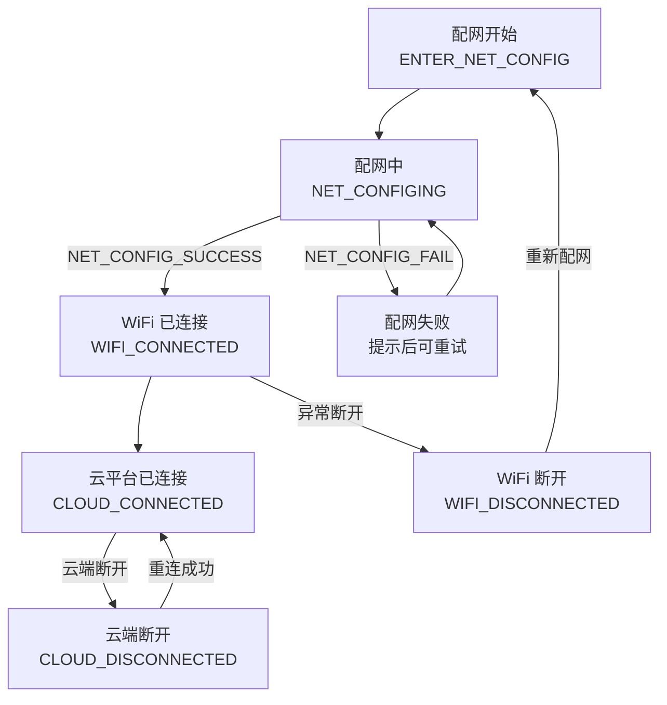

软件内部状态（`wifi_current_state_get/set`）：

| 状态 | 含义 |
|---|---|
| `WIFI_CONNECTED_STATE` | WiFi 已连接 |
| `CLOUD_CONNECTED_STATE` | 云平台已连接（可正常对话） |
| `CLOUD_DISCONNECT_STATE` | WiFi 或云端断开 |

#### 14.8.2 配网流程

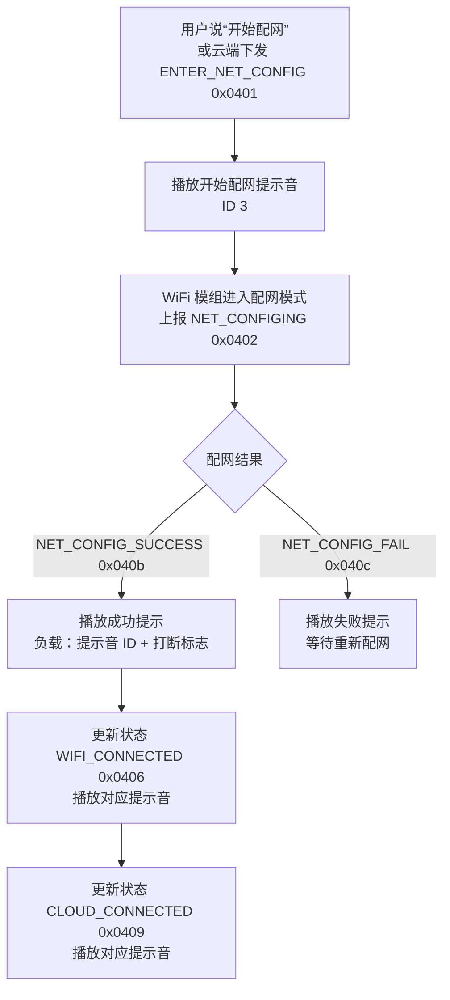

#### 14.8.3 连接校验

`CHECK_NET_WORK_STATE_ENABLE` 控制是否做联网前置校验，当前值为 **0**（关闭），即不拦截离线流程；置 1 后行为如下：

| 场景 | 行为 |
|---|---|
| 唤醒时未连云 | 播放 2005"未联网"，不进入识别流程 |
| 上传时未连云 | 播放 2009"设备网络异常，请重新配网"，结束 VAD 并发送 `SKIP_INVAILD_SPEAK` |
| 正常连云 | 正常唤醒、录音、上传 |

`wifi_current_state_get()` 在 `vad_state_handle_task()` 中每 5ms 轮询一次，未连云时直接跳过 VAD 检测。

#### 14.8.4 提示音下发机制

`WIFI_CONNECTED`、`CLOUD_CONNECTED`、`WIFI_DISCONNECTED`、`NET_CONFIG_SUCCESS`、`NET_CONFIG_FAIL` 五类命令均支持 3 字节负载：

| 字节 | 内容 |
|---|---|
| byte0 | 提示音 ID 低字节 |
| byte1 | 提示音 ID 高字节 |
| byte2 | 是否打断当前播放（bool） |

设备收到后调用 `prompt_play_by_voice_id(id, default_play_done_callback, m_flag)`，把提示音选择权交给 WiFi 模组/云端配置，便于不同产品定制。

#### 14.8.5 其他网络命令

| 命令 | 说明 |
|---|---|
| `EXIT_NET_CONFIG 0x0403` | 退出配网 |
| `INIT_SMARTCONFIG 0x0404` | 初始化 SmartConfig |
| `GET_PROFILE 0x0407` | 获取配网信息 |
| `NEED_PROFILE 0x0408` | 请求配网信息 |
| `CLOUD_DISCONNECTED 0x040a` | 云端断开 |

---

### 14.9 OTA 升级

#### 14.9.1 两套升级通道

工程同时保留两套 OTA 实现：

| 通道 | 代码位置 | 协议 | 当前状态 |
|---|---|---|---|
| Bootloader 串口升级 | `components/ota/firmware_updater.c`、`flash_update.c` | 自定义帧协议（`MSG_TYPE_CMD/REQ/ACK/NOTIFY`） | 代码保留 |
| 云端 OTA | `cias_network_msg_protocol.h`、`cias_audio_data_handle.c` | `CIAS_OTA_*` + `DL_*` 子协议 | 关闭 |

总开关：`CI_OTA_ENABLE 0`；`config.ini` 中 `firmware_version=FW_V2`（不支持 OTA）。

#### 14.9.2 Bootloader 串口升级协议

帧结构（`Data_t`）：

| 字段 | 长度 | 说明 |
|---|---|---|
| msg_head | 2 字节 | 帧头 |
| length | 2 字节 | 数据长度 |
| type | 1 字节 | 消息类型（CMD / REQ / ACK / NOTIFY） |
| cmd | 1 字节 | 命令字 |
| number | 1 字节 | 序号 |
| data | 变长 | 负载数据 |
| crc | 2 字节 | CRC16 校验 |
| msg_tail | 1 字节 | 帧尾 |

| 类型 | 值 | 含义 |
|---|---|---|
| `MSG_TYPE_CMD` | 0xA0 | 命令 |
| `MSG_TYPE_REQ` | 0xA1 | 请求 |
| `MSG_TYPE_ACK` | 0xA2 | 应答 |
| `MSG_TYPE_NOTIFY` | 0xA3 | 通知 |

命令集：

| 命令 | 值 | 说明 |
|---|---|---|
| `MSG_CMD_UPDATE_REQ` | 0x03 | 请求升级 |
| `MSG_CMD_GET_INFO` | 0x04 | 获取设备信息 |
| `MSG_CMD_UPDATE_CHECK_READY` | 0x05 | 检查就绪 |
| `MSG_CMD_UPDATE_BLOCK_INFO` | 0x06 | 块信息 |
| `MSG_CMD_UPDATE_ERA` | 0x07 | 擦除 |
| `MSG_CMD_UPDATE_WRITE` | 0x08 | 写数据 |
| `MSG_CMD_UPDATE_BLOCK_WRITE_DONE` | 0x09 | 块写入完成 |
| `MSG_CMD_UPDATE_VERIFY` | 0x0A | 校验 |
| `MSG_CMD_TRY_FAST_BD` | 0x0b | 尝试快速波特率 |
| `MSG_CMD_TRY_FAST_BD_TEST` | 0x0c | 快速波特率测试 |
| `MSG_CMD_UPDATE_READ` | 0x0d | 回读 |
| `MSG_CMD_UPDATE_COMPLETE` | 0x0e | 升级完成 |
| `MSG_CMD_UPDATE_EXTERNAL_DEV` | 0x10 | 外部设备升级 |
| `MSG_CMD_UPDATE_PROGRESS` | 0x11 | 进度通知 |
| `MSG_CMD_TESTCMD` | 0xA0 | 测试命令 |
| `MSG_CMD_SYS_RST` | 0xA1 | 系统复位 |

- CRC16 校验：`crc_func()`。
- 用户区最大 448KB（`USERCODE_MAX_SIZE`），块大小 4KB（`USERCODE_PER_SIZE`）。
- 分区状态：`0xFC` 升级中、`0xF0` 完成、`0xC0` 旧版本。

#### 14.9.3 分区元数据

`FileConfig_Struct` 为每个可升级分区记录以下字段：

| 分区 | 记录内容 |
|---|---|
| UserCode1 / UserCode2 | Version、StartAddr、Size、CRC、CompltStatus |
| ASRCMDModel | Version、StartAddr、Size、CRC、CompltStatus |
| DNNModel | 同上 |
| VoicePlaying | 同上 |
| UserFile | 同上 |
| 其他 | ManufacturerID、ProductID、HWName、HWVersion、SWName、SWVersion、BootLoaderVersion、PartitionTableChecksum |

升级时按分区擦除、写入、校验，最后写分区表并重启。

#### 14.9.4 云端 OTA 流程

| 命令 | 值 | 说明 |
|---|---|---|
| `CIAS_OTA_START` | 0x0501 | 云端通知开始 OTA，设备写 OTA 状态 0x05 并复位进入升级模式 |
| `CIAS_OTA_DATA` | 0x0502 | 传输升级数据 |
| `CIAS_OTA_SUCESS` | 0x0503 | 升级成功 |

`DL_*` 子协议负责登录、版本查询、文件配置、区域信息、擦除、写入、校验、写配置、写版本、完成等细粒度操作。安全相关组件：

- `ota_aes.c/h`：升级包 AES 解密；
- `ota_partition_verify.c/h`：分区完整性校验；
- `flash_encrypt/copyright_verification.h`：版权校验。

#### 14.9.5 当前为何关闭

- `config.ini` 中 `firmware_version=FW_V2`，固件版本标识本身不支持 OTA。
- `CI_OTA_ENABLE 0`，云端 OTA 的业务处理逻辑未参与编译。
- 若产品需要 OTA，需要同时调整 `config.ini` 分区规划、开启 `CI_OTA_ENABLE`，并确保 WiFi 模组侧实现 `DL_*` 协议、升级包具备正确的 AES 密钥与 CRC。

---

### 14.10 双 Code 分区切换

#### 14.10.1 功能定位

CI130X 的 HOST 核 SRAM 有限，当"离线 ASR 代码"与"TTS/其他大代码"无法同时驻留时，可把两套代码分别放在两个 Flash 分区，运行时切换分区并复位，实现"同一固件、两套 Code"。

#### 14.10.2 分区与参数

| 项目 | 值 |
|---|---|
| 总开关 | `USER_CODE_SWITCH_ENABLE 0` |
| code1_size | 0x37000（220KB） |
| code2_size | 0x24000（144KB） |
| code2_state | False（未启用） |
| Code2 地址来源 | DNN 分区 ID `60099`（`DNN_CODE2_ADDR_ID`） |
| Code2 描述符保存地址 | `USER_CODE2_SAVE_ADDR`（0x4000 - 8） |
| AES 密钥地址 | 0x3000，32 字节 |

#### 14.10.3 描述符结构

8 字节：

| 字节 | 内容 |
|---|---|
| byte0 ~ byte3 | Code2 起始地址（大端） |
| byte4 ~ byte7 | Code2 大小（大端） |

启动时 `check_code2_param()` 读取该描述符：

- 若 8 字节全为 `0xFF`（未初始化），说明当前应运行 ASR，调用 `get_code2_addr(TTS_SWITCH_TO_ASR)` 写入默认 Code2 地址 0x4000。
- 否则按描述符加载 Code2。

#### 14.10.4 切换流程

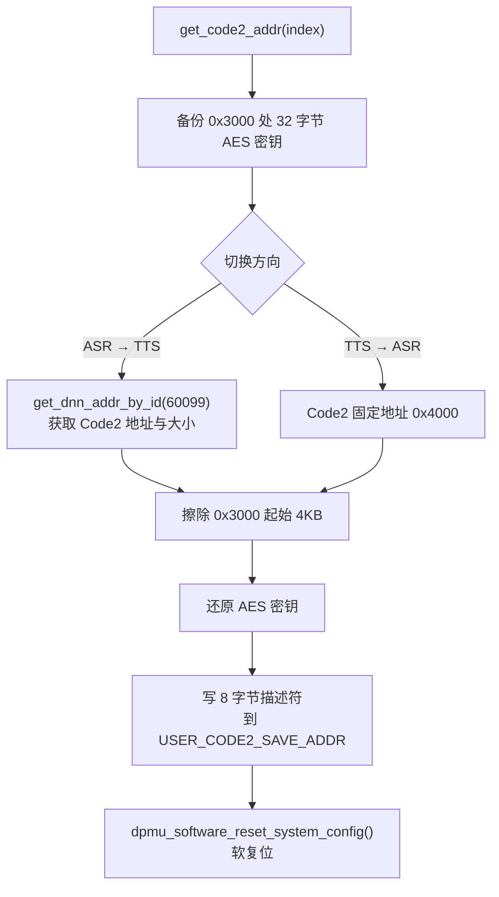

- ASR → TTS 分支会先在分支内写一次描述符，擦除 0x3000 后再统一写入一次。
- 擦除 0x3000 是为了让 Bootloader 重新识别分区状态；密钥先备份后还原，避免擦除导致解密失败。

#### 14.10.5 串口触发条件

`uart_data_handle_task()` 监听 8 字节串口帧：

| 帧特征 | 动作 |
|---|---|
| `A5 FC ... [5] == 0x23` | ASR 切换至 TTS |
| `FD ... [3] == 0x22` | TTS 切换至 ASR |

切换后系统立即软复位，由 Bootloader 根据描述符加载新 Code。

#### 14.10.6 使用注意

- 切换会 **复位系统**，当前播放、录音、联网状态全部丢失。
- 两套 Code 必须分别编译并烧录到各自分区，且都通过 CRC/版权校验。
- 描述符写错会导致无法启动，需要保留串口/烧录恢复通道。
- 当前工程 `USER_CODE_SWITCH_ENABLE 0`、`code2_state=False`，功能不参与运行。

---

## 附录 A：WiFi 串口协议命令总表

### A.1 语音识别与 VAD（0x01xx）

| 命令 | 值 | 说明 |
|---|---|---|
| `LOCAL_ASR_RESULT_NOTIFY` | 0x0101 | 本地 ASR 结果上报 |
| `WAKE_UP` | 0x0102 | 唤醒上报 |
| `VAD_END` | 0x0103 | VAD 结束 |
| `SKIP_INVAILD_SPEAK` | 0x0104 | 跳过无效语音 |
| `PCM_MIDDLE` | 0x0105 | 音频中间帧 |
| `PCM_FINISH` | 0x0106 | 音频结束 |
| `PCM_IDLE` | 0x0107 | 音频空闲 |
| `VAD_START` | 0x0108 | VAD 开始 |
| `EXIT_WAKE_UP` | 0x0109 | 退出唤醒 |
| `SET_VAD_SENSITIVITY` | 0x010A | 设置 VAD 灵敏度 |
| `VAD_START_BY_KEY` | 0x010B | 按键触发 VAD 开始 |
| `VAD_END_BY_KEY` | 0x010C | 按键触发 VAD 结束 |
| `SET_AUDIO_EXIT_WAKE_UP` | 0x010D | 主动退出唤醒 |
| `PCM_DENOISE_ENABLE` | 0x010E | 上传降噪开关 |
| `SET_VAD_FILTER_FRAME` | 0x010F | VAD 过滤帧 |
| `SET_VAD_SENSITIVITY_ACTIVATE_LENTH` | 0x0110 | 激活长度 |
| `SET_VAD_START_MAX_TIMEOUT` | 0x0111 | 最大录音时间 |
| `SET_PLAY_VOICE_ID` | 0x0112 | 播放指定提示音 |
| `SET_WAKE_UP_CONTINUE_TIME` | 0x0113 | 唤醒保持时长 |
| `SET_ENTER_WAKE_UP` | 0x0114 | 强制进入唤醒 |
| `SET_INTERACTION_NULTI_ROUND_ENABLE` | 0x0115 | 多轮开关 |
| `UPLOAD_PLAY_FULL_DUPLEX_EANBLE` | 0x0116 | 全双工开关 |
| `SET_AUDIO_VOLUME` | 0x0117 | 设置音量 |
| `SET_AUDIO_COMPRESS_TYPE` | 0x0118 | 设置压缩类型 |
| `SET_VOLUME_MUTE_STATE` | 0x0119 | 功放静音 |
| `SET_AUDIO_START_RECORD` | 0x011A | 强制开始录音 |
| `SET_AUDIO_STOP_RECORD` | 0x011B | 强制停止录音 |
| `SET_CLOUD_ANS_TIMEOUT_EXIT` | 0x011C | 云端应答超时退出 |
| `SET_FORCE_VAD_END` | 0x011D | 强制结束 VAD |
| `VAD_VAILD_CHECK_RESULT` | 0x011E | VAD 有效性结果 |

### A.2 网络播放（0x02xx）

| 命令 | 值 | 说明 |
|---|---|---|
| `NET_PLAY_START` | 0x0201 | 开始播放 |
| `NET_PLAY_PAUSE` | 0x0202 | 暂停 |
| `NET_PLAY_RESUME` | 0x0203 | 恢复 |
| `NET_PLAY_STOP` | 0x0204 | 停止 |
| `NET_PLAY_RESTART` | 0x0205 | 重播 |
| `NET_PLAY_NEXT` | 0x0206 | 下一首 |
| `NET_PLAY_LOCAL_TTS` | 0x0207 | 本地 TTS |
| `NET_PLAY_END` | 0x0208 | 播放结束 |
| `NET_PLAY_RECONECT_URL` | 0x0209 | 重连 URL |
| `PLAY_DATA_GET` | 0x020a | 请求播放数据 |
| `PLAY_DATA_RECV` | 0x020b | 接收播放数据 |
| `PLAY_DATA_END` | 0x020c | 播放数据结束 |
| `PLAY_TTS_END` | 0x020d | TTS 结束 |
| `PLAY_EMPTY` | 0x020e | 播放队列空 |
| `PLAY_NEXT` | 0x020f | 播放下一段 |
| `PLAYING_TTS` | 0x0210 | TTS 播放中 |
| `PLAY_RESUME_ERRO` | 0x0211 | 恢复失败 |
| `PLAY_LAST` | 0x0212 | 最后一段 |
| `PLAY_AUDIO_SIZE` | 0x0213 | 音频大小 |
| `PLAY_AUDIO_TYPE` | 0x0214 | 音频类型 |
| `SET_AUDIO_PLAY_MODE` | 0x0215 | 播放模式 |
| `VAD_START_STOP_PLAY` | 0x0216 | VAD 停播开关 |
| `LOCAL_AUDIO_PLAY_START` | 0x0217 | 本地播放开始 |
| `LOCAL_AUDIO_PLAY_STOP` | 0x0218 | 本地播放停止 |

### A.3 网络与 IoT（0x03xx / 0x04xx）

| 命令 | 值 |
|---|---|
| `QCLOUD_IOT_CMD` | 0x0301 |
| `NET_VOLUME` | 0x0302 |
| `LOCAL_VOLUME` | 0x0303 |
| `NET_VOLUME_INC` | 0x0304 |
| `NET_VOLUME_DEC` | 0x0305 |
| `NET_VOLUME_MAXI` | 0x0306 |
| `NET_VOLUME_MINI` | 0x0307 |
| `CIAS_CJSON_DATA` | 0x0308 |
| `IOT_VOLUME_MUTE` | 0x0309 |
| `IOT_VOLUME_UNMUTE` | 0x030a |
| `IOT_QUITE_WAKE_UP_MODE` | 0x030b |
| `GET_SW_VERSION` | 0x030d |
| `ENTER_NET_CONFIG` | 0x0401 |
| `NET_CONFIGING` | 0x0402 |
| `EXIT_NET_CONFIG` | 0x0403 |
| `INIT_SMARTCONFIG` | 0x0404 |
| `WIFI_DISCONNECTED` | 0x0405 |
| `WIFI_CONNECTED` | 0x0406 |
| `GET_PROFILE` | 0x0407 |
| `NEED_PROFILE` | 0x0408 |
| `CLOUD_CONNECTED` | 0x0409 |
| `CLOUD_DISCONNECTED` | 0x040a |
| `NET_CONFIG_SUCCESS` | 0x040b |
| `NET_CONFIG_FAIL` | 0x040c |

### A.4 系统 / OTA / 工厂测试 / 红外（0x05xx ~ 0x09xx）

| 命令 | 值 | 说明 |
|---|---|---|
| `CIAS_GET_SOFT_VER` | 0x0500 | 获取固件版本 |
| `CIAS_OTA_START` | 0x0501 | OTA 开始 |
| `CIAS_OTA_DATA` | 0x0502 | OTA 数据 |
| `CIAS_OTA_SUCESS` | 0x0503 | OTA 成功 |
| `CIAS_FACTORY_START` | 0x0504 | 工厂测试开始 |
| `CIAS_FACTORY_OK` | 0x0505 | 测试通过 |
| `CIAS_FACTORY_FAIL` | 0x0506 | 测试失败 |
| `CIAS_FACTORY_SELF_TEST_START` | 0x0507 | 自检开始 |
| `CIAS_IR_DATA` | 0x0508 | 红外数据 |
| `CIAS_IR_LOADING_DATA` | 0x0509 | 红外码加载中 |
| `CIAS_IR_LOAD_DATA_OVER` | 0x050a | 红外码加载完成 |
| `CIAS_IR_LOAD_DATA_START` | 0x050b | 红外码开始加载 |
| `CIAS_FACTORY_TEST_ENG_THR_SET` | 0x050c | 测试阈值设置 |
| 各通道测试结果 | 0x050d ~ 0x0514 | MICL/MICR/REFL/REFR/SPK 等 |
| `CIAS_AEC_GET_MIC_REF_GAIN` | 0x0515 | 获取 MIC/REF 增益 |
| `CIAS_AEC_GAIN_RESULT` | 0x0516 | 增益测试结果 |
| `CIAS_AUDIO_SYS_READY` | 0x0601 | 音频系统就绪 |
| `CIAS_AUDIO_SYS_ERR` | 0x0602 | 音频系统错误 |
| `CIAS_AUDIO_RST` | 0x0603 | 音频系统复位 |
| CWSL 注册唤醒词 | 0x0701 | 自学习 |
| CWSL 注册中 | 0x0702 | — |
| CWSL 注册命令词 | 0x0703 / 0x0704 | — |
| CWSL 成功 / 失败 | 0x0705 / 0x0706 | — |
| CWSL 退出注册 | 0x0707 | — |
| CWSL 删除唤醒词 / 命令词 | 0x0708 / 0x0709 | — |
| `CIAS_CMD_EXEC_STATE` | 0x0801 | 命令执行状态 |
| `DOA_ANGLE` | 0x0901 | DOA 角度上报 |

> OTA 子协议还包括：`DL_OTA_REQ/RSP`、`DL_LOGIN_INFO_REQ/RSP`、`DL_VER_REQ/RSP`、`DL_FILE_CONFIG_REQ/RSP`、`DL_QUERY_READY_REQ/RSP`、`DL_AREA_INFO_REQ/RSP`、`DL_ERASE_AREA_REQ/RSP`、`DL_WRITE_DATA_REQ/RSP`、`DL_WRITE_DATA_COMPLETE_REQ/RSP`、`DL_VERIFY_AREA_REQ/RSP`、`DL_WRITE_CONFIG_REQ/RSP`、`DL_WRITE_VER_REQ/RSP`、`DL_COMPLETE_OTA_REQ/RSP`、`DL_CMD_ACK`、`DL_RESET_SYS`、`DL_OTA_TEST`。

---

## 附录 B：提示音 ID 速查

| ID | 含义 | ID | 含义 |
|---|---|---|---|
| 0 | 开机音 | 199 | 好的 |
| 1 | 唤醒播放 | 200 | 学习唤醒词提示 |
| 2 | 退出唤醒 | 201 | 学习命令词提示 |
| 3 | 开始配网 | 203 | 退出学习 |
| 4 | 音量增大 | 204 | 删除询问 |
| 5 | 音量减小 | 206 | 删除命令词 |
| 6 | 音量最大 | 207 | 退出删除 |
| 7 | 音量最小 | 208 | 全部删除 |
| 9 | 开启连续对话 | 209 | 学习成功 |
| 10 | 关闭连续对话 | 210 | 学习失败 |
| 11 | 开启中英翻译 | 211 | 注册成功 |
| 12 | 关闭中英翻译 | 212 | 模板超限 |
| 13 | 播放音乐 | 213 | 删除成功 |
| 14 | 停止音乐 | 214 | 删除失败 |
| 101/102/103 | 唤醒播放变体 | 215 | 正在删除 |
| 1001~1004 | 学习指令提示 | 216 | 找不到命令词 |
| 2000 | 联网中 | 217 | 学习完成 |
| 2001 | 网络连接成功 | 218 | 退出学习 |
| 2002 | 网络成功连云 | 219 | 请再说一次 |
| 2003 | 云平台连接成功 | 220 | 语音太短 |
| 2004 | 网络断开 | 221 | 与默认指令冲突 |
| 2005 | 未联网 | 2020 | 配网二维码 |
| 2006 | 配网失败 | 2021 | 配网失败 |
| 2007 | 配网成功 | 2022 | 配网成功 |
| 2008 | 网络质量不好 | 2030 | 未听清 |
| 2009 | 网络异常 | 2040 | 请配置鉴权 |
| 2050 | 云端处理中 | 2060 | 可以聊天 |

产测音频：`3000` pink1、`3001` pink_aec_thr、`56789` 1kHz。

---

## 附录 C：当前命令词表（G.fst0.txt）

```
退出对话
大声点 / 大点声
小声点 / 小点声
最大声 / 最小声
进入连续对话模式 / 开启连续对话模式 / 打开连续对话模式
关闭连续对话模式 / 取消连续对话模式 / 退出连续对话模式
音量增大 / 音量减小 / 音量最大 / 音量最小
我要删除 / 全部删除 / 退出删除
开始配网 / 结束配网 / 退出配网
删除唤醒词 / 学习唤醒词
学习下一个
重新学习
小爱
```

唤醒词表（G.fst1.txt）：`小爱`

---

## 附录 D：关键源码索引

| 功能 | 文件 |
|---|---|
| 主流程 | `app/app_main/main.c` |
| 用户配置 | `app/app_main/user_config.h` |
| 系统消息与状态机 | `app/app_main/system_msg_deal.c/h` |
| 用户自定义逻辑 | `app/app_main/user_msg_deal.c` |
| NLP 多意图 | `app/app_main/ci_nlp_user.c` |
| 系统钩子 | `app/app_main/system_hook.c` |
| 双 Code 切换 | `app/app_main/code_switch.h` |
| 云协议命令定义 | `app/app_audio_handle/cias_network_msg_protocol.h` |
| 在线音频处理 | `app/app_audio_handle/cias_audio_data_handle.c` |
| AIoT 运行参数 | `app/app_audio_handle/cias_aiot_protocol.h` |
| 语音上传 | `app/app_audio_handle/cias_voice_upload.c/h` |
| 播放控制 | `app/app_audio_handle/cias_voice_plyer_handle.h` |
| 串口收发 | `app/app_audio_handle/cias_uart_protocol.h` |
| 红外设备 | `app/app_ir/device/*.c/h` |
| 红外 EUT 测试 | `app/app_ir/eut_test/eut_fun_test.c/h` |
| 板级定义 | `driver/boards/CI-D02GS01J.c` |
| 算法裁剪 | `system/user_alg_config.mk` |
| 工程构建 | `project_file/makefile` |
| 固件分区 | `firmware/config.ini` |
| 命令词 | `firmware/asr/G.fst*.txt` |
| 语音资源 | `firmware/voice/{wav,mp3,opus}` |

---

*本报告基于工程源码与配置文件的静态分析整理，具体功能以实际编译配置为准。*
