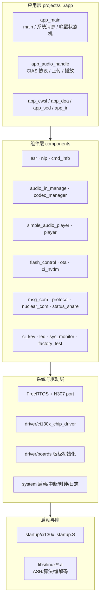
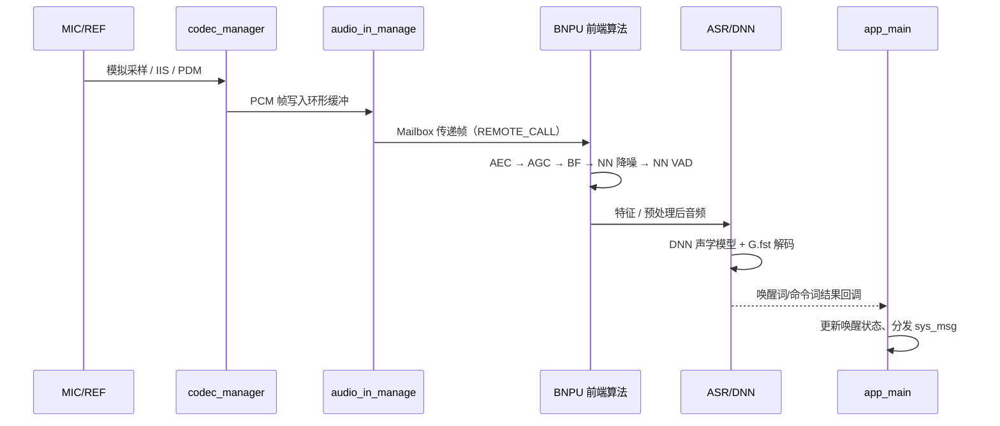
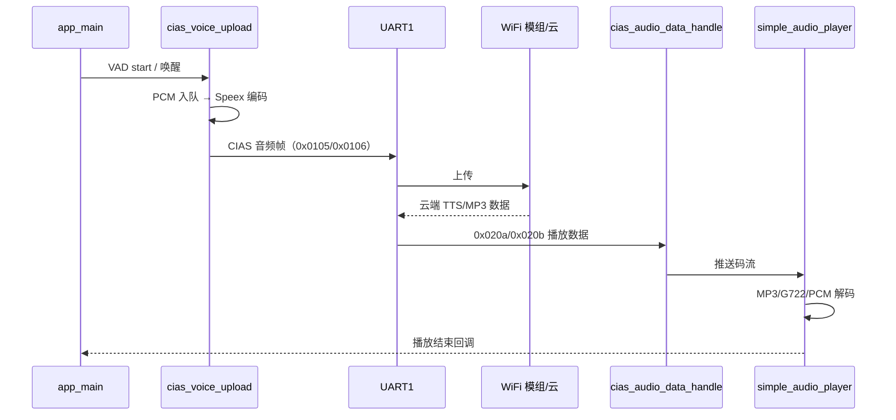

# 01 · 系统架构

## 1. 硬件与双核模型

CI1302 是一颗面向离线语音的 SoC，内部包含两个执行单元：

| 核 | 角色 | 运行内容 | 代码来源 |
| --- | --- | --- | --- |
| HOST（RISC-V） | 主控 | FreeRTOS、驱动、协议、播放器、应用逻辑 | `[0]code.bin` |
| BNPU | 神经网络加速 | 前端算法、DNN 推理、DOA/VPR/SED 等模型 | `[1]code.bin`（算法库） |

两个镜像在构建末期由 `ci-tool-kit merge user-file` 合并进同一个 User 分区，运行期由 Bootloader/分区表分别加载。

片内/片外资源：

- 2 MB SPI Flash，按 `firmware/config.ini` 静态分区（见第 5 节）。
- HOST SRAM 与 BNPU 专用 SRAM 由链接脚本切分，分界符号为 `SDK_ALG_PRO_SRAM_HOST_END_ADDR`。
- 音频外设：内部 Codec（ADC/DAC）、IIS、PDM/DMIC、ALC。
- 通信外设：UART0/1/2、I2C、PWM、GPIO、Mailbox。

---

## 2. 软件分层



依赖方向总体向上：应用只通过组件公开头文件访问能力；组件通过 `nuclear_com` 访问 BNPU，通过 `ciss` 读取共享状态，避免直接跨核耦合。

---

## 3. 运行时数据流

### 3.1 语音输入到识别



关键点：

- 音频帧大小由 `PCM_ALG_FRAME_LEN`（默认 512 点）决定。
- 前端算法与 ASR 的开关、模型地址通过 `ciss` 在核间同步；HOST 在 `ciss_param_init()` 中写入使能位。
- ASR 的 DNN 推理在 BNPU 完成，HOST 侧只做流程控制与结果处理。

### 3.2 离在线交互



- 上传与播放分别由独立任务/队列驱动，可配置为全双工。
- 播放期间是否继续上传由 `UPLOAD_PLAY_FULL_DUPLEX_ENABLE` 控制。
- VAD 起点/终点既可由本地算法判定，也可由云端下发 `VAD_END` 强制结束。

---

## 4. 核间通信与共享状态

### 4.1 nuclear_com（控制面）

`components/nuclear_com/ci130x_nuclear_com.h` 提供两套接口：

1. **消息式**：`nuclear_com_send()` + `nuclear_com_registe_serve()`，通过 Mailbox 端点 `mailbox_serve_ept_t` 发送带 payload 的消息。
2. **远端调用式**：`REMOTE_CALL(X)` 宏展开为 `rc_caller_X`，配合 `DECLEAR_REMOTE_FUNC_ID(X)` 声明接口 ID，最多 8 个参数。

```c
/* 调用方（HOST） */
REMOTE_CALL(set_ssp_registe(&audio_capture, (ci_ssp_st*)&ci_ssp, sizeof(ci_ssp)/sizeof(ci_ssp_st)));

/* 被调方（BNPU）注册 rc_callee_X 实现 */
```

`RC_HOST_CALLER/RC_BNPU_CALLER` 根据 `CORE_ID` 自动屏蔽不属于当前核的方向，因此同一份头文件可被双核复用。

### 4.2 ciss（数据面）

`components/status_share/status_share.h` 定义 `status_id_t` 枚举与两个 API：

```c
void ciss_init(void);
void ciss_set(status_id_t id, status_t value);
status_t ciss_get(status_id_t id);
```

它保存的是**标量状态**：ASR 使能、VAD 状态、唤醒状态、播放状态、模型地址、DNN 配置完成标志、解码器参数等。适合高频读、低频写的场景，不传输大块音频。

典型同步点：

- HOST 写 `CI_SS_HOST_PARAM_SET_OK = BNPU_HOST_PARAM_SYNC_MAGIC`，通知 BNPU 参数配置完成。
- BNPU 写 `CI_SS_DNN_*_CFG_READY`，HOST 据此判断模型是否就绪。
- 应用通过 `CI_SS_WAKING_UP_STATE`、`CI_SS_ASR_SYS_STATE` 判断当前是否可交互。

---

## 5. 固件镜像与 Flash 布局

默认 UART 工程 `firmware/config.ini` 的关键分区（地址为配置文件中的期望值）：

| 分区 | 起始（config.ini） | 预留 | 内容 |
| --- | --- | --- | --- |
| Bootloader + 分区表 | `0x000000` | 40 KB | 引导程序、`partition_table_t` |
| User（Code1） | `0x00A000` | 252 KB（`user_size=0x3F000`） | HOST 固件 + BNPU 算法库 |
| Command | `0x03B000` | 8 KB | ASR 模型/命令词 |
| Module（DNN） | `0x03D000` | 1336 KB（`0x132000`） | DNN 模型 |
| Voice | `0x16F000` | 232 KB（`0x3A000`） | 提示音 |
| UserFile | `0x1A9000` | 8 KB | 自定义文件（如 `cmd_info`） |
| NV | `0x1FC000` | 16 KB | 掉电保存参数 |

> 表中的 `*_addr` 只是配置期望值，**实际排布由打包工具按各分区 `*_size` 从低到高顺序累加**；NV 区固定在 flash 顶端。因此实际落点可能与上表不同（例如本工程实测 ASR 分区落在 `0x049000`）。详细规律与踩坑记录见 [CI1302 开发配置文件与 Flash 分区说明](../../CI1302_开发配置文件与Flash分区说明.md)。

分区表结构见 `components/flash_control/flash_control_inc/ci_flash_data_info.h`：

```c
#pragma pack(1)
typedef struct {
    uint32_t manu_facturer_id;
    uint32_t product_id[2];
    char     ChipName[9];
    /* user_code1 / user_code2 / asr / dnn / voice / user_file 的
       version / offset / size / crc / status */
    uint32_t nv_data_offset;
    uint32_t nv_data_size;
    uint16_t patitiontablechecksum;
} partition_table_t;
```

运行时通过 `ci_flash_data_info_init()` 解析分区表，再用 `get_current_model_addr()`、`get_file_addr()`、`get_dnn_addr_by_id()` 等函数取模型/音频地址。

---

## 6. 三种工程变体的差异

| 工程 | 音频上传方式 | 差异点 |
| --- | --- | --- |
| `offline_asr_llm_aiot_uart_sample` | UART1 传输压缩音频 | 默认工程；依赖 WiFi 模组；`AUDIO_DATA_UPLOAD_BY_UART=1` |
| `offline_asr_llm_aiot_hpout_sample` | 模拟 HPOUT | 直接输出到外部录音通路，适配合外挂主控 |
| `offline_asr_llm_aiot_iis_sample` | IIS 输出 | 通过 IIS 送出 16 kHz 音频，适合数字主控 |

三者 `app/` 目录结构基本一致，构建时由 `AUDIO_UPLOAD_TYPE` 选择 `C_FLAGS` 与音频配置。业务代码共享意味着：**修改 app 层时需同时验证三个工程**。

---

## 7. 关键设计取舍

| 设计 | 原因 | 影响 |
| --- | --- | --- |
| 双核拆分 | ASR/降噪算力需求高，HOST 需保证实时协议与播放 | 跨核调用与状态同步成为主要复杂度 |
| 静态 Flash 分区 | 启动快、无文件系统开销 | 模型/提示音大小必须预先规划，超出即打包失败 |
| 两套播放器 | 老播放器功能全但占资源；SAP 轻量、支持流式 | 由 `SIMPLE_AUDIO_PLAYER_ENABLE` 二选一 |
| 协议分层 | VMUP 面向通用模组，CIAS 面向云端业务 | 同一 UART 上可能出现两类帧，解析需区分 |
| 编译期裁剪 | Flash/SRAM 紧张 | 算法、压缩、播放格式通过 `user_alg_config.mk` 与 `user_config.h` 联动 |

---

## 8. 继续阅读

- 模块清单：[02-目录结构与模块职责](02-目录结构与模块职责.md)
- 启动细节：[03-启动流程与运行时](03-启动流程与运行时.md)
- 构建与烧录：[08-构建、烧录与运行](08-构建、烧录与运行.md)
