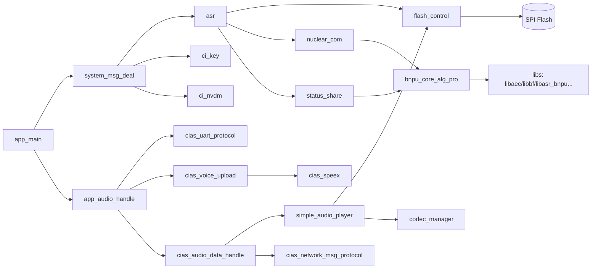

# 02 · 目录结构与模块职责

## 1. 仓库顶层

| 目录 | 职责 | 关键内容 |
| --- | --- | --- |
| `startup/` | 复位向量、C 运行时初始化、中断向量表 | `ci130x_startup.S`、`ci130x_vtable.S`、`ci130x_init.c` |
| `system/` | 系统级配置与中断服务 | `ci130x_system.c`、`ci130x_it.c`、`ci130x_handlers.c`、`FreeRTOSConfig.h`、`platform_config.c`、`user_alg_config.mk` |
| `driver/` | 芯片外设驱动与板级支持包 | `ci130x_chip_driver/`、`boards/`、`third_device_driver/outside_codec/` |
| `components/` | 可复用软件组件（RTOS、ASR、音频、协议、存储等） | 见第 3 节 |
| `libs/linux/` | 预编译静态库 | `libasr*.a`、`libaec.a`、`libspeex.a`、`libopus.a`、`libnlp.a`、`libfreertos_port.a` 等 |
| `projects/` | 可编译的示例工程 | 三个 `offline_asr_llm_aiot_*_sample` |
| `tools/build-tools/` | 构建工具链 | `riscv-nuclei-elf-*`、`busybox`、`lua`、`ci-tool-kit`、音频转换工具 |
| `utils/` | 构建脚本与通用工具 | `common_head.mk`、`common_tail_mcu.mk`、`common.lds`、`generate_makefile.lua`、`parse_user_alg_config_mk.lua`、`crc.c` |
| `external/ota_reference/` | OTA 参考固件与协议文档 | `ota_code_1302_uart*.bin`、OTA 协议说明 PDF |
| `对接协议/` | 对外协议资料 | 与模组/云端对接说明 |
| `文档-YCSC/` | 项目文档 | 功能说明报告、本 Code Wiki |

---

## 2. 启动与系统层

### 2.1 `startup/`

| 文件 | 作用 |
| --- | --- |
| `ci130x_startup.S` | 复位入口、栈指针设置、`.data`/`.bss` 初始化、跳转 `main` |
| `ci130x_vtable.S` | 中断向量表 |
| `ci130x_init.c` | 早期 C 初始化 |

### 2.2 `system/`

| 文件 | 作用 |
| --- | --- |
| `ci130x_system.c/.h` | 时钟、外设时钟使能、系统初始化封装 |
| `ci130x_it.c/.h` | 中断服务例程集中实现 |
| `ci130x_handlers.c` | 异常/中断处理入口 |
| `platform_config.c/.h` / `platform_config_bnpu.c` | HOST/BNPU 平台参数、内存与启动配置 |
| `FreeRTOSConfig.h` | 内核裁剪：500 Hz tick、6 优先级、动态内存、软件定时器 |
| `sdk_default_config.h` | SDK 默认宏，可被 `user_config.h` 覆盖 |
| `user_alg_config.mk` | 算法开关与 SRAM 预算，构建时被 Makefile include |
| `baudrate_calibrate.c` | 串口波特率校准 |
| `ci_assert.h` | 断言 |

---

## 3. `components/` 组件清单

### 3.1 语音与算法

| 组件 | 职责 | 关键文件 |
| --- | --- | --- |
| `asr/` | 离线识别系统：任务、模型加载、解码回调、Flash 模型管理 | `asr_api.h`、`asr_process_callback.c`、`nn_and_flash/` |
| `audio_in_manage/` | 音频采集缓冲、预处理任务、核间音频通路 | `audio_in_manage_inner.c`、`alg_preprocess.c`、`ci_buffer_manage.c` |
| `alg/` | 算法参数结构定义与胶水层 | `aec/`、`agc/`、`beamforming/`、`nn_denoise/`、`doa/`、`pwk/`、`dereverb/`、`tra_denoise/`、`sound_event_detection/` |
| `tvad/` | 时域 VAD | `temporal_vad_api.h` |
| `fft/` | FFT/STFT 封装 | `ci_fft.h`、`ci_audio_wrapfft.h` |
| `VPR/` | 声纹注册/识别、男女声识别 | `voice_print_recognition.c`、`voice_print_wman_recognition.c` |
| `ci_cwsl_v2/` | 命令词自学习 | `cwsl_manage.h`、`cwsl_template_manager.h` |
| `nlp/` | 识别文本的意图/实体处理 | `ci_nlp.h` |
| `cmd_info/` | 命令词表解析（多版本） | `command_file_reader.c/.v2/.v3` |
| `npu/` | NN 内存映射 | `npu_inc/NN_memmap.h` |
| `ci_common/` | BNPI 数学、内存管理、算法公共 API | `bnpu_math.c`、`bnpu_mem_manage.c`、`ci_alg_common_api.c` |
| `bnpu_core_alg_pro/` | **BNPU 侧固件工程**（独立 Makefile） | `src/main.c`、`nuclear_com_task_bnpu.c`、`lds/` |
| `audio_pre_rslt_iis_out/` | 预处理结果经 IIS 输出 | `ci130x_audio_pre_rslt_out.c` |

### 3.2 音频与播放

| 组件 | 职责 | 关键文件 |
| --- | --- | --- |
| `codec_manager/` | Codec 抽象层：注册、配置、启停、增益、ALC、mute | `codec_manager.c`、`codec_manage_*_port.c` |
| `simple_audio_player/` | 精简播放器（SAP）+ 流式取数 | `simple_audio_player.c`、`player_data_fetcher.c`、`mp3_decoder_api.c`、`g722_decoder_api.c`、`pcm_decoder_api.c` |
| `player/` | 完整播放器（老播放器），支持 MP3/AAC/FLAC/M4A/ADPCM 与变速 | `audio_play/`、`mp3lib/`、`aaclib/`、`flacdec/`、`m4a/`、`adpcm/`、`sonic/` |
| `cias_speex/` | Speex 编解码移植 | `port/ci110x_speex.c`、`libspeex/` |
| `cias_opus/` | Opus 编解码 | `opus_task.c`、`src/`、`silk/`、`celt/` |
| `cias_g722/` | G.722 编解码 | `g722_encode.c`、`g722_decode.c` |
| `cias_lib/` | cJSON | `cJSON.c` |

### 3.3 存储、升级与系统服务

| 组件 | 职责 | 关键文件 |
| --- | --- | --- |
| `flash_control/` | Flash 分区表、文件表、读写流程、核间端口 | `ci_flash_data_info.c`、`flash_rw_process.c`、`flash_manage_*` |
| `ci_nvdm/` | NV 掉电参数管理 | `ci_nvdata_manage.c`、`ci_nvdata_port.c` |
| `ota/` | 串口/云端升级、AES、分区校验 | `firmware_updater.c`、`flash_update.c`、`ota_aes.c`、`ota_partition_verify.c` |
| `flash_encrypt/` | Flash 加密支持 | 静态库 `libflash_encrypt.a` |
| `log/` | 分级日志、断言输出 | `ci_log.c`、`ci_log_config.h` |
| `sys_monitor/` | 任务运行监控 | `ci_task_monitor.c` |
| `led/` | LED 控制 | `led_light_control.c`、`color_light_control.c` |
| `ci_key/` | 按键扫描与消抖 | `ci_key.c` |
| `factory_test/` | 产测流程 | `cias_factory_test.c` |
| `ir_remote_driver/` | 红外发射驱动 | `ir_remote_driver.c` |

### 3.4 通信与并发

| 组件 | 职责 | 关键文件 |
| --- | --- | --- |
| `freertos/` | FreeRTOS 10.1 内核 + N307 RISC-V 端口 | `tasks.c`、`queue.c`、`portable/GCC/N307/portmacro.h` |
| `nuclear_com/` | Mailbox 核间消息与远端调用 | `ci130x_nuclear_com.h`、`remote_api_for_host.h`、`remote_api_for_bnpu.h` |
| `status_share/` | 核间共享状态（ciss） | `status_share.c`、`status_share_bnpu.c` |
| `msg_com/` | VMUP 串口协议、I2C 协议 | `voice_module_uart_protocol.c`、`i2c_protocol_module.c` |
| `protocol/` | 芯片—云端协议封装 | `chipintelli_cloud_protocol.c` |
| `assist/` | SEGGER RTT/SysView、FreeRTOS CLI、系统信息 | `SEGGER/`、`cli/`、`ci_system_info.c` |
| `RISCV/` | RISC-V CSR/编码定义 | `riscv_encoding.h` |

---

## 4. `driver/` 驱动层

| 路径 | 内容 |
| --- | --- |
| `ci130x_chip_driver/inc|src` | UART、I2C、IIS、IISDMA、PDM、PWM、GPIO、ADC、ALC、Codec、DMA、Timer、IWDG、SPI Flash、DTR Flash、Mailbox、低功耗、Cache、PMP、ECLIC 等 |
| `boards/` | 各参考板初始化：`CI-D02GS01J.c` 为默认，另有 D01/D03/D06/D12/E12、QFN56 测试板等 |
| `boards/board.c/.h`、`board_default.c`、`board_port_template.c` | 板级抽象与移植模板 |
| `third_device_driver/outside_codec/` | ES7243/ES7243E/ES8311/ES8388 外部 Codec 驱动 |

板级选择在 `app/app_main/user_config.h`：

```c
#define USE_CI_D02GS01J_BOARD 1
/* 由 board.h 展开为 CI_CHIP_TYPE、BOARD_PORT_FILE 等 */
```

---

## 5. 示例工程结构

以 `projects/offline_asr_llm_aiot_uart_sample/` 为例：

```
.
├── .vscode/                 # 工程级 VS Code 配置
├── app/                     # 应用代码（三个示例共享）
│   ├── app_main/            # main、系统消息、唤醒状态机、用户配置
│   ├── app_audio_handle/    # CIAS 协议、上传、播放、环形队列
│   ├── app_cwsl/            # 自学习应用层
│   ├── app_doa/             # DOA 结果处理
│   ├── app_sed/             # 声音事件检测应用层
│   ├── app_ir/              # 红外/设备控制（可选）
│   └── app_common/          # 公共定义
├── firmware/                # 模型、提示音、分区配置
│   ├── asr/                 # G.fst、语言模型
│   ├── dnn/                 # 声学模型、NN 降噪模型
│   ├── voice/               # 提示音（wav 源 + mp3/opus）
│   ├── user_file/           # cmd_info 等自定义文件
│   ├── config.ini           # 分区与版本
│   ├── 合成分区bin文件.bat
│   ├── 打包升级.bat
│   └── 烧录user_code.bat
├── lds/                     # 链接脚本模板与生成结果
└── project_file/            # Makefile 与源文件清单
```

### 5.1 `app_main/` 文件职责

| 文件 | 职责 |
| --- | --- |
| `main.c` | 硬件初始化、平台初始化、`task_init()`、创建初始任务并启动调度器 |
| `user_config.h` | 全部业务宏：板级、音频、协议、VAD、播放、唤醒、算法互斥约束 |
| `system_msg_deal.c/.h` | 系统消息队列、任务主循环、唤醒/退出状态机、音量、ASR 暂停/恢复 |
| `system_hook.c/.h` | 弱符号钩子：上电、唤醒、休眠、识别结果，默认经 VMUP 上报 |
| `user_msg_deal.c/.h` | 用户业务：按键、I2C 电机、按 cmd_id/semantic_id 处理指令 |
| `ci_ssp_config.c` | 算法参数实例：IIS 输出、ALC、STFT、PWK、降噪、DOA |
| `ci_nlp_user.c/.h` | NLP 参数与意图处理回调 |
| `code_switch.c/.h` | 双 Code 切换支持 |

### 5.2 `app_audio_handle/` 文件职责

| 文件 | 职责 |
| --- | --- |
| `cias_network_msg_protocol.c/.h` | CIAS 命令字定义、收包解析、任务入口 |
| `cias_network_msg_send_task.c/.h` | 发送任务与重发/ACK |
| `cias_uart_protocol.c/.h` | UART0/1/2 中断与底层收发 |
| `cias_voice_upload.c/.h` | VAD 管理、PCM 队列、Speex/Opus/G722 编码与上传 |
| `cias_audio_data_handle.c/.h` | 云端播放数据请求、解码、播放调度 |
| `cias_voice_plyer_handle.c/.h` | 播放器封装与播放结束回调 |
| `cias_circle_queue.c/.h` | 环形队列 |
| `cias_aiot_protocol.h` | 运行期参数结构体、播放状态枚举 |

---

## 6. 模块依赖关系



更完整的编译期依赖与宏联动见 [10-配置矩阵与依赖关系](10-配置矩阵与依赖关系.md)。
