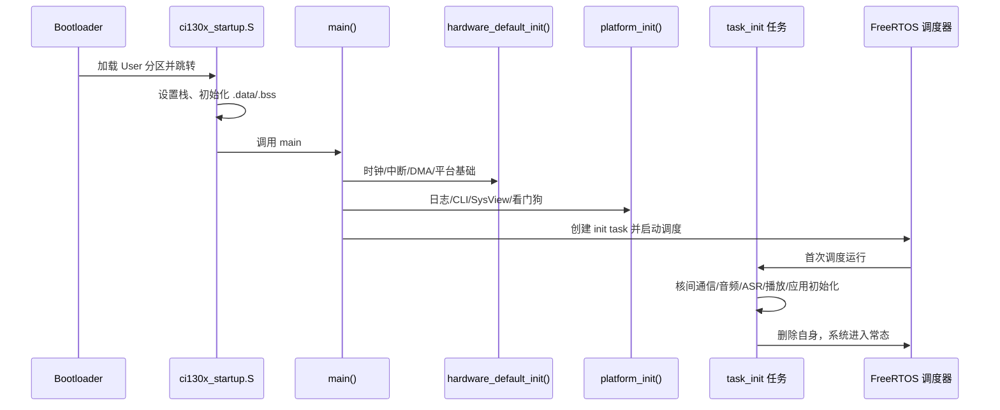
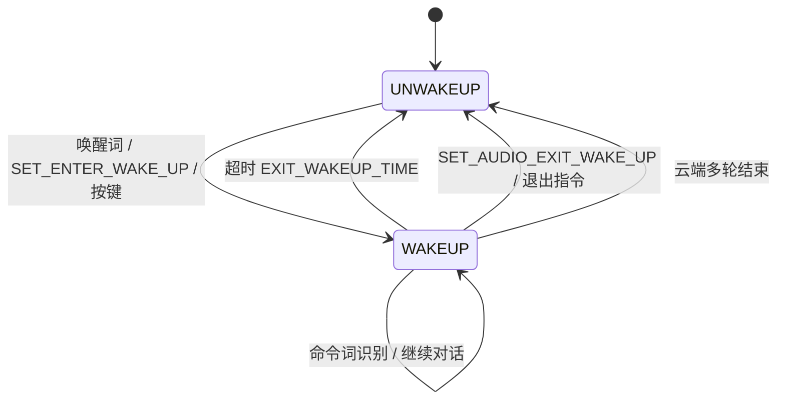

# 03 · 启动流程与运行时

本文以 `projects/offline_asr_llm_aiot_uart_sample/app/app_main/main.c` 为准，描述从上电到系统可交互的完整路径。

---

## 1. 启动总览



---

## 2. 复位与 C 运行时

- `startup/ci130x_startup.S` 是复位入口，负责建立栈、搬运 `.data`、清零 `.bss`。
- `startup/ci130x_vtable.S` 提供中断向量。
- 完成后跳转 `main()`。

此阶段尚未初始化日志，因此早期异常只能通过调试器或 RTT 观察。

---

## 3. `main()` 的三段式初始化

```c
int main(void)
{
    hardware_default_init();   /* 芯片与板级最底层 */
    platform_init();           /* 日志、CLI、SysView、看门狗 */
    welcome();                 /* 打印 SDK 版本、Heap、主频 */

    xTaskCreate(task_init, "init task", 280, NULL, 4, NULL);
    vTaskStartScheduler();

    while (1) { }
}
```

### 3.1 `hardware_default_init()`

关键动作（顺序敏感）：

1. `SystemInit()`：系统时钟与基础寄存器。
2. `eclic_priority_group_set()`：中断优先级分组。
3. 使能全局中断。
4. `enable_mcycle_minstret()`：使能指令周期计数，供性能统计。
5. `init_platform()`：平台级初始化。
6. `maskrom_lib_init()`：ROM 库初始化。
7. 关闭 LDO3（按板级电源设计）。
8. 配置 DMA 通道 1（音频/串口搬运使用）。

### 3.2 `platform_init()`

| 顺序 | 调用 | 说明 |
| --- | --- | --- |
| 1 | `ci_log_init()` | 初始化 UART0 日志（`CONFIG_CI_LOG_UART`） |
| 2 | CLI 初始化 | 通过 `assist/cli` 注册命令行 |
| 3 | SysView 初始化 | `CONFIG_SYSTEMVIEW_EN` 时启用 SEGGER 系统视图 |
| 4 | `IWDG` 初始化 | 默认约 2 秒超时，需在任务中定期喂狗 |

> 若系统在启动阶段反复复位，优先检查是否有长耗时初始化未喂狗。

### 3.3 `welcome()`

打印 SDK 版本、可用 Heap、当前主频，是确认“程序确实跑起来”的第一条日志。

---

## 4. `task_init()`：系统装配

`task_init` 是一个一次性任务，完成后自行删除。顺序如下（与源码一致）：

```c
dsu_init((uint32_t)&SDK_ALG_PRO_SRAM_HOST_END_ADDR);
vTaskDelay(pdMS_TO_TICKS(5));

cm_init();                       /* codec_manager 初始化 */
audio_in_codec_registe();        /* 注册内部 codec */
nuclear_com_init();              /* 核间通信 */

decoder_port_inner_rpmsg_init(); /* 解码器核间端口 */
flash_control_inner_port_init(); /* Flash 核间端口 */

asr_top_nuclear_com_outside_port_init();
flash_manage_nuclear_com_outside_port_init();

codec_manage_inner_port_init();
ciss_init();                     /* 共享状态 */
ciss_param_init();               /* 写入算法/ASR 使能参数 */

mailboxboot_sync();              /* 等待 BNPU 启动同步 */

ci_flash_data_info_init(DEFAULT_MODEL_GROUP_ID);  /* 解析分区表 */

REMOTE_CALL(set_ssp_registe(&audio_capture,
            (ci_ssp_st*)&ci_ssp, sizeof(ci_ssp)/sizeof(ci_ssp_st)));

alg_model_init();                /* VPR/WMAN/降噪/DOA/SED 模型地址 */
ciss_set(CI_SS_HOST_PARAM_SET_OK, BNPU_HOST_PARAM_SYNC_MAGIC);

decoder_task_init_port();

xTaskCreate(audio_in_manage_inner_task, ..., 400, NULL, 4, NULL);
sap_init();                      /* SIMPLE_AUDIO_PLAYER_ENABLE 时 */

/* 若启用 DOA */
xTaskCreate(doa_out_result_hand_task, ...);

cias_online_func_init();         /* 离在线交互初始化 */
userapp_initial();               /* 用户业务初始化 */
sys_msg_task_initial();          /* 系统消息任务 */

xTaskCreate(UserTaskManageProcess, ..., 480, NULL, 4, NULL);

cias_send_cmd(CIAS_AUDIO_SYS_READY, DEF_FILL);  /* 通知模组：语音系统就绪 */
```

### 4.1 为什么先 `mailboxboot_sync()`

BNPU 核独立启动，HOST 必须等待其 Mailbox 就绪后才能发起远端调用或写共享状态。`mailboxboot_sync()` 是双核握手点；此前的初始化只允许操作 HOST 本地资源。

### 4.2 `ciss_param_init()` 写入的关键参数

| 状态 ID | 含义 | 典型值/来源 |
| --- | --- | --- |
| `CI_SS_ASR_ROLL_FRM` | ASR 回退帧数 | 由配置决定 |
| `CI_SS_ASR_EN` | 识别使能 | `USE_ASR` |
| `CI_SS_CWSL_EN` | 自学习使能 | `USE_CWSL` |
| `CI_SS_NN_DENOISE_EN` | NN 降噪使能 | `USE_NN_DENOISE` |
| `CI_SS_TRA_DENOISE_EN` | 传统降噪 | `USE_TRA_DENOISE` |
| `CI_SS_NN_VAD_EN` | NN VAD | `USE_NN_VAD` |
| `CI_SS_NN_DOA_EN` | NN DOA | `USE_NN_DOA` |
| `CI_SS_VPR_EN` / `CI_SS_WMAN_VPR_EN` | 声纹/性别识别 | `USE_VPR` / `USE_WMAN_VPR` |
| `CI_SS_SED_EN` | 事件检测 | `USE_SED_CRY` / `USE_SED_SNORE` |
| `CI_SS_AUDIO_IN_BUFFER_NUM` | 音频输入缓冲数量 | 影响抗抖动 |
| `CI_SS_DECODER_MIN_ACTIVE` | 解码器最小激活 | 默认 400 |
| `CI_SS_DECODER_BEAM` | 解码 beam | 默认 9.5 |

这些值在运行期也可通过 `ciss_set()` 动态调整（例如切换唤醒/命令词模型组时）。

### 4.3 `alg_model_init()`

读取各模型在 Flash 中的地址并写入共享状态，供 BNPU 加载：

- VPR 声纹模型
- WMAN 男女声模型
- NN 降噪模型
- NN DOA 模型
- SED 哭声/鼾声模型

模型文件在 `firmware/dnn/` 下，使用 `[file_id]name.bin` 命名，由 `ci-tool-kit` 合并进 DNN 分区。

---

## 5. FreeRTOS 运行环境

`system/FreeRTOSConfig.h` 的关键配置：

| 配置 | 值 | 影响 |
| --- | --- | --- |
| `configTICK_RATE_HZ` | 500 | 1 tick = 2 ms；`pdMS_TO_TICKS` 依赖它 |
| `configMAX_PRIORITIES` | 6 | 优先级 0~5；idle 独占 0，Timer 服务任务占 5 |
| `configUSE_PREEMPTION` | 1 | 抢占式调度 |
| `configUSE_TIME_SLICING` | 1 | 同优先级轮转 |
| `configMINIMAL_STACK_SIZE` | 180 | 单位为字（StackType_t） |
| `configTOTAL_HEAP_SIZE` | `&__FREERTOSHEAP_SIZE` | 堆大小由链接脚本决定，不是常量 |
| `configUSE_TIMERS` | 1 | 软件定时器可用；Timer 队列长度 5 |
| `configUSE_MUTEXES` | 1 | 互斥量可用 |
| `configCHECK_FOR_STACK_OVERFLOW` | 0 | 默认不检查，调试时可打开 |
| `configUSE_TRACE_FACILITY` | 1 | 可配合 `sys_monitor` 统计任务 |

### 5.1 主要任务

| 任务 | 栈（字） | 优先级 | 创建位置 | 职责 |
| --- | --- | --- | --- | --- |
| `init task` | 280 | 4 | `main.c` | 一次性系统装配 |
| `audio_in_manage_inner_task` | 400 | 4 | `main.c` | 采集、缓冲、预处理调度 |
| `UserTaskManageProcess` | 480 | 4 | `main.c` | 系统消息主循环、唤醒状态机 |
| `doa_out_result_hand_task` | 按配置 | 按配置 | `main.c` | DOA 角度结果处理 |
| 播放器任务 | 组件内部 | 组件内部 | `sap_init()` / player | 解码与输出 |
| 上传/发送任务 | 组件内部 | 组件内部 | `voice_upload_task_init()` | 编码与 UART 发送 |
| 定时器服务任务 | 180 | 5 | FreeRTOS | 软件定时器回调 |

> 新增任务时注意：优先级 4 已聚集多个实时任务，长时间阻塞会直接影响唤醒响应与播放流畅度。

---

## 6. 中断与底层收发

| 中断 | 处理位置 | 用途 |
| --- | --- | --- |
| `UART0_IRQHandler` | `app_audio_handle/cias_uart_protocol.c` | 日志/CLI，或按配置作为协议口 |
| `UART1_IRQHandler` | 同上 | 默认与 WiFi 模组通信（921600） |
| `UART2_IRQHandler` | 同上 | 可选第二协议口 |
| DMA 中断 | `driver/ci130x_chip_driver/src/ci130x_dma.c` | 音频/串口数据搬运 |
| GPIO 中断 | 板级/按键 | 按键、SDIO 握手等 |
| 定时器中断 | `system/ci130x_it.c` | 系统 tick、软件定时器 |
| Mailbox 中断 | `nuclear_com` | 双核消息与远端调用 |

中断中只做收字节/置标志/发队列，解析与业务处理放到任务上下文，避免阻塞音频通路。

---

## 7. 系统消息与状态机

### 7.1 消息类型

`system_msg_deal.h` 定义统一消息联合体 `sys_msg_t`，主要类型：

| 类型 | 数据 | 来源 |
| --- | --- | --- |
| `SYS_MSG_TYPE_ASR` | 识别结果、cmd_id、semantic_id、分数 | ASR 回调 |
| `SYS_MSG_TYPE_CMD_INFO` | 命令词信息 | cmd_info |
| `SYS_MSG_TYPE_KEY` | 键值、按下/长按 | 按键扫描 |
| `SYS_MSG_TYPE_COM` | 串口协议事件 | CIAS/VMUP |
| `SYS_MSG_TYPE_PLAY` | 播放开始/结束 | 播放器回调 |
| `SYS_MSG_TYPE_NET` | 网络状态 | WiFi 模组 |
| `SYS_MSG_TYPE_MNG` | 管理类事件 | 内部 |
| `SYS_MSG_TYPE_AUDIO_IN_STARTED` | 采集已启动 | audio_in_manage |
| `SYS_MSG_TYPE_SED` | 哭声/鼾声事件 | SED |
| `SYS_MSG_TYPE_TEXT` | 文本/NLP 结果 | NLP |
| `SYS_MSG_TYPE_SET_PALY_PARAMETER` | 播放参数 | 应用 |
| `SYS_MSG_TYPE_FACTORY_TEST_PLAY` | 产测播报 | 产测 |

发送与处理接口：

```c
BaseType_t send_msg_to_sys_task(sys_msg_t *msg, TickType_t wait);
void UserTaskManageProcess(void *p);   /* 主循环 */
```

### 7.2 唤醒状态机



相关 API（`system_msg_deal.h`）：

| 函数 | 作用 |
| --- | --- |
| `enter_wakeup_deal()` | 进入唤醒：切换模型组、播放提示音、启动计时 |
| `exit_wakeup_deal()` | 退出唤醒：切回唤醒词模型组、停止交互 |
| `get_wakeup_state()` | 查询 `sys_wakeup_state_t` |
| `update_awake_time()` | 刷新唤醒保持计时 |
| `pause_asr()` / `resume_asr()` | 播报或配置期间暂停识别 |
| `check_current_playing()` | 查询是否正在播放 |
| `vol_set()` / `vol_get()` | 音量设置/读取 |

### 7.3 ASR 状态

`sys_asr_state_t` 有三态：

- `IDLE`：可接收识别。
- `BUSY`：识别处理中。
- `SUSPEND`：被应用主动暂停（如播放提示音、配网）。

`pause_voice_in()` / `resume_voice_in()` 控制采集侧，`pause_asr()` / `resume_asr()` 控制识别侧；两者需成对使用。

---

## 8. 钩子机制

`system_hook.c` 提供四个 `__WEAK` 钩子，应用可覆盖：

```c
void sys_power_on_hook(void);
void sys_weakup_hook(void);
void sys_sleep_hook(void);
void sys_asr_result_hook(...);
```

默认实现通过 `MSG_COM_USE_UART_EN` 判断是否用 VMUP 上报：

- 上电 → `VMUP_MSG_DATA_NOTIFY_POWERON`
- 唤醒 → `VMUP_MSG_DATA_NOTIFY_WAKEUPENTER`
- 休眠 → `VMUP_MSG_DATA_NOTIFY_WAKEUPEXIT`
- 识别结果 → `vmup_send_asr_result_cmd()`

若使用 CIAS 协议，应用层应覆盖钩子或直接走 `cias_*` 接口，避免两套协议重复上报。

---

## 9. 看门狗与异常恢复

- `platform_init()` 初始化 IWDG，默认约 2 s。
- 正常运行时由主循环或监控任务定期喂狗。
- `sys_monitor/ci_task_monitor.c` 可统计任务栈与运行状态，用于定位卡死。
- 若 BNPU 处理过慢，`status_share` 会给出 `BNPU_AUDIO_DEAL_SLOW`，处理方式通常是增大 `CI_SS_AUDIO_IN_BUFFER_NUM`。

---

## 10. 启动阶段排错清单

| 现象 | 优先检查 |
| --- | --- |
| 无任何日志 | 时钟/晶振配置、UART0 波特率、`ci_log_init()` 是否被裁剪 |
| 日志停在 `mailboxboot_sync` | BNPU 镜像是否合并、算法库是否与配置匹配 |
| 反复重启 | IWDG 未喂狗、初始化耗时过长、HardFault |
| 识别无结果 | `ciss_param_init()` 使能位、模型组、模型文件版本 |
| 无提示音 | `sap_init()` 是否执行、Voice 分区是否正确、PA 控制 |
| 模组收不到数据 | UART1 引脚/波特率、CIAS 发送任务是否启动 |
