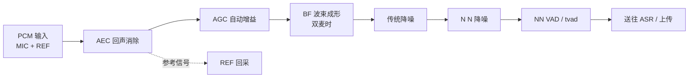

# 04 · 音频采集与前端算法

本文描述从麦克风到 ASR 输入之间的完整音频通路，以及算法开关、参数配置点和常见调优手段。

---

## 1. 硬件通路

默认 UART 工程使用 **1 路模拟 MIC + 1 路参考回采**：

| 配置 | 值 | 宏 |
| --- | --- | --- |
| MIC 数量 | 1 | `HOST_MIC_USE_NUMBER 1` |
| 数字 MIC | 关闭 | `AUDIO_IN_FROM_DMIC 0` |
| MIC 差分/单端 | 单端 | `MIC_DIFF_SINGLE 0` |
| REF 差分/单端 | 单端 | `REF_DIFF_SINGLE 1` |
| 采样率 | 16 kHz | 算法固定输入 |
| 算法帧长 | 512 点 | `PCM_ALG_FRAME_LEN 512` |

其他可选通路：

- **IIS 输入**：`USE_IIS_RECORD=1`，配合外部 Codec（ES7243/ES8311/ES8388 等）。
- **PDM/DMIC**：`AUDIO_IN_FROM_DMIC=1`。
- **参考信号来自内部 Codec**：`USE_REF_IN_FROM_INNER_CODEC=1`，播放回采取自 DAC 通路。

---

## 2. Codec 抽象层（codec_manager）

`components/codec_manager/codec_manager.h` 把“内部 Codec / 外部 IIS Codec”统一为可注册设备。

### 2.1 数据结构

```c
typedef struct {
    int (*codec_init)(cm_codec_hw_info_t *);
    int (*codec_config)(cm_sound_info_t *, io_direction_t);
    int (*codec_start)(io_direction_t);
    int (*codec_stop)(io_direction_t);
    int (*codec_ioctl)(io_direction_t, uint32_t, uint32_t, uint32_t);
} cm_codec_interface_t;
```

`cm_codec_hw_info_t` 描述 I2C 总线、输入/输出 IIS 参数、Codec 操作函数与初始增益。

### 2.2 主要 API

| 函数 | 作用 |
| --- | --- |
| `cm_init()` | 初始化管理器 |
| `cm_reg_codec(index, info)` | 注册 Codec（最多 `MAX_CODEC_NUM=3`） |
| `cm_config_codec(index, dir, sound_info)` | 配置采样率/位宽/声道 |
| `cm_config_pcm_buffer(index, dir, buf_info)` | 配置 DMA 环形缓冲 |
| `cm_start_codec` / `cm_stop_codec` | 启停采集或播放 |
| `cm_read_codec` | 读取一帧采集数据地址与长度 |
| `cm_write_codec` | 写入 PCM 到播放缓冲 |
| `cm_get_pcm_buffer` / `cm_release_pcm_buffer` | 获取/归还缓冲块 |
| `cm_set_codec_adc_gain` / `cm_set_codec_dac_gain` | 模拟增益 |
| `cm_set_codec_alc` / `cm_get_codec_alc_state` | ALC 开关与查询 |
| `cm_set_codec_mute` | 静音控制 |
| `icodec_*` | 内部 Codec 的默认实现 |

### 2.3 注册流程

`task_init()` 中的顺序：

```c
cm_init();
audio_in_codec_registe();          /* 内部 codec 注册为 index 0 */
codec_manage_inner_port_init();    /* 核间 codec 端口 */
```

外部 Codec 由板级文件（如 `driver/boards/CI-D02GS01J.c`）或应用在 `userapp_initial()` 中注册。

---

## 3. 采集与缓冲（audio_in_manage）

`components/audio_in_manage/` 负责：

1. 从 Codec/DMA 取 PCM。
2. 维护多块环形缓冲，抵抗任务调度抖动。
3. 将数据送到预处理通路（BNPU 或 HOST 本地算法）。
4. 维护 VAD 起点/终点标记与丢帧统计。

### 3.1 对外接口

```c
int32_t audio_in_buffer_init(void);
int32_t audio_in_hw_straight_mode_init(void);
void    audio_in_preprocess_mode_task(void *p);
void    audio_in_rpmsg_init(void);
bool    get_audio_queue_space_is_enough(void);
```

- `audio_in_buffer_init()`：分配音频缓冲。
- `audio_in_hw_straight_mode_init()`：旁路模式，音频直通（调试/产测用）。
- `audio_in_preprocess_mode_task()`：预处理任务主体。
- `audio_in_rpmsg_init()`：初始化核间音频传输。
- `get_audio_queue_space_is_enough()`：供上层判断是否可继续灌数据。

### 3.2 缓冲数量的影响

`CI_SS_AUDIO_IN_BUFFER_NUM` 决定缓存帧数：

- 过小：BNPU 偶发繁忙时丢帧，表现为识别率下降、VAD 断裂。
- 过大：端到端延迟增加，唤醒响应变慢。
- 若出现 `BNPU_AUDIO_DEAL_SLOW`，优先适当增大。

---

## 4. 预处理算法链



实际顺序与启用项由 `user_alg_config.mk` 与 `ciss` 使能位共同决定；单麦配置下 BF 不参与。

### 4.1 算法能力表

| 算法 | 作用 | 典型配置宏 | 实现 |
| --- | --- | --- | --- |
| AEC | 消除自身播报回声，支持播放打断 | `USE_AEC 1`、`AEC_INTERRUPT_TYPE 2` | `libaec.a` / `libbnpu_core_alg_pro_*_aec.a` |
| AGC / ALC | 自动增益/电平，防止过载或过小 | `AUTO_GET_AEC_GAIN 0`、`USE_ALC_AUTO_SWITCH_MODULE` | `libaec.a`、`libalc_auto_switch.a` |
| BF | 双麦波束成形，提升目标方向信噪比 | `USE_BF`、`BF_DEEPSE_MODE 1` | `libbf.a`、`libasr_*_deepse_v2` |
| 传统降噪 | 稳态噪声抑制 | `USE_TRA_DENOISE` | `libdenoise.a` |
| NN 降噪 | 深度网络降噪，非稳态噪声效果更好 | `USE_NN_DENOISE 1` | `libdenoise.a` + DNN 模型 60003 |
| NN VAD | 深度 VAD，降低误触发 | `USE_NN_VAD 1` | `libasr*.a` |
| tvad | 时域 VAD | `tvad/` | `libasr*.a` |
| Dereverb | 去混响 | `USE_DEREVERB` | `libdr.a` / `libbnpu_core_alg_pro_*_dereverb*` |
| DOA | 声源定位（NN/GCC） | `USE_NN_DOA` / `USE_GCC_DOA` | `libdoa.a` + 模型 60004 |
| PWK | 就近唤醒（多设备） | `USE_PWK_ENABLE` | `libpwk`（随算法库分发） |
| SED | 哭声/鼾声检测 | `USE_SED_CRY` / `USE_SED_SNORE` | 模型 60002/60005 |
| VPR / WMAN | 声纹/男女声识别 | `USE_VPR` / `USE_WMAN_VPR` | 模型 60001/60008 |
| ALC auto switch | 根据场景自动开关 ALC | `USE_ALC_AUTO_SWITCH_MODULE 0` | `libalc_auto_switch.a` |

> 算法实现大部分以静态库交付；`components/alg/` 提供的是参数结构体与调用胶水，不是算法源码。

### 4.2 算法配置实例

`app/app_main/ci_ssp_config.c` 定义并初始化以下配置对象，再由 `task_init()` 通过 `REMOTE_CALL(set_ssp_registe(...))` 注册给 BNPU：

| 对象 | 作用 |
| --- | --- |
| `iis_out_audio_config` | 预处理结果 IIS 输出：开关、左右通道、VAD 标记 |
| `alc_auto_switch_config` | ALC 自动切换阈值与滞回 |
| `stft_istft_config` | STFT/ISTFT 窗长、帧移、频点数 |
| `ci_pwk_config` | 就近唤醒参数 |
| `tra_denoise_config` | 传统降噪强度、噪声估计 |
| `nn_noise_est_config` | NN 降噪的噪声能量估计参数 |
| `nn_denoise_config` | NN 降噪模型参数、beta 自适应、能量阈值 |

修改这些结构体是调整降噪/回声效果的主要入口；修改后必须重新编译并确认 BNPU 算法库与配置匹配。

---

## 5. 算法开关与 SRAM 预算

`system/user_alg_config.mk` 同时承担两件事：**功能裁剪**与**内存预算**。

默认值（摘要）：

```make
USE_ASR              := 1
USE_ANY_MIC          := 0
USE_AEC              := 1
USE_CWSL             := 0
USE_NN_DENOISE       := 1
USE_NN_VAD           := 1
USE_GCC_DOA          := 0
USE_IIS_RECORD       := 0
USE_REF_IN_FROM_INNER_CODEC := 0

SDK_ALG_PRO_SRAM_HOST_NOT_ALG_END_ADDR = 0x1FFD3000
```

对应 SRAM 预留：

| 模块 | 预留 |
| --- | --- |
| AEC | 30 KB |
| CWSL | 0 |
| NN_DENOISE | 47 KB |
| TVAD | 0 |
| NN_DOA | 60 KB |
| GCC_DOA | 23 KB |
| IIS | 0 |

构建时 `parse_user_alg_config_mk.lua` 会读取这些值，生成/校验 BNPU 算法库所需的配置，并触发 `bnpu_core_alg_pro` 重新编译。

> 打开一个算法不只是加一个宏：它同时改变 SRAM 预算、链接库选择、BNPU 固件内容。超出预算通常表现为链接失败或运行期内存踩踏。

---

## 6. 关键运行参数

| 参数 | 默认 | 位置 | 说明 |
| --- | --- | --- | --- |
| `PCM_ALG_FRAME_LEN` | 512 | `user_config.h` | 算法帧点数（16 kHz 下 32 ms） |
| `NN_VAD_SENSITIVITY` | 1 | `user_config.h` | NN VAD 灵敏度 |
| `NN_VAD_FRONT_PORCH` | 35 | `user_config.h` | VAD 起点前保留帧 |
| `NN_VAD_BACK_PORCH` | 25 | `user_config.h` | VAD 终点后保留帧 |
| `NN_VAD_VALID_CHECK_MODE` | 1 | `user_config.h` | 后置有效性检查模式 |
| `NN_VAD_VALID_NUM` | 25 | `user_config.h` | 有效判定帧数 |
| `VAD_TIMEOUT_VALUE` | 5 | `user_config.h` | VAD 最长等待（秒） |
| `LOCAL_REC_VAD_END_ENABLE` | 1 | `user_config.h` | 本地 VAD 结束上传 |
| `BF_DEEPSE_MODE` | 1 | `user_config.h` | BF deepse 模式 |
| `AEC_INTERRUPT_TYPE` | 2 | `user_config.h` | 播放打断时的 AEC 策略 |
| `VOLUME_DEFAULT` | 5 | `user_config.h` | 默认音量（1~7） |

---

## 7. AEC、ALC 与播放的耦合

播放打断（barge-in）能成立的前提是 AEC 正常工作：

1. 播放时 DAC 输出同时作为 REF 送入 AEC。
2. AEC 从 MIC 信号中减去回声分量。
3. 残余信号送 VAD/ASR，若识别到唤醒词或命令词即可打断播放。

相关细节：

- `AEC_INTERRUPT_TYPE=2` 表示采用较积极的打断策略；若误打断多，可调整该值或提高唤醒阈值。
- `AUTO_GET_AEC_GAIN=0` 表示不自动标定 MIC/REF 增益；量产时可用 `CIAS_AEC_GET_MIC_REF_GAIN (0x0515)` 触发自动获取，结果经 `CIAS_AEC_GAIN_RESULT (0x0516)` 返回。
- ALC 在 AEC 处理期间可能需要临时关闭，状态机由 `ci_ss_aec_alc_state` 管理。

---

## 8. 调试建议

| 问题 | 排查方向 |
| --- | --- |
| 识别率低 | 检查 MIC 增益、AEC 参考通路、降噪强度、模型版本 |
| 唤醒误触发 | 提高 VAD/唤醒阈值，检查 `NN_VAD_VALID_NUM`，确认环境噪声 |
| 播放时无法打断 | REF 是否正确接入、AEC 是否使能、`AEC_INTERRUPT_TYPE` |
| 音频断续 | 增大 `CI_SS_AUDIO_IN_BUFFER_NUM`，检查任务优先级与 Flash 占用 |
| 双麦无效 | 确认 `HOST_MIC_USE_NUMBER=2`、IIS/PDM 通道映射、BF 库链接 |
| 自学习与降噪冲突 | 参考 `user_config.h` 末尾的 `#error` 互斥约束 |

> 采集原始 PCM 的最直接方式：启用 `UPLOAD_NNDENOISE_AUDIO_DATA_ENABLE` 或 IIS 输出通路，用外部工具录音对比。
