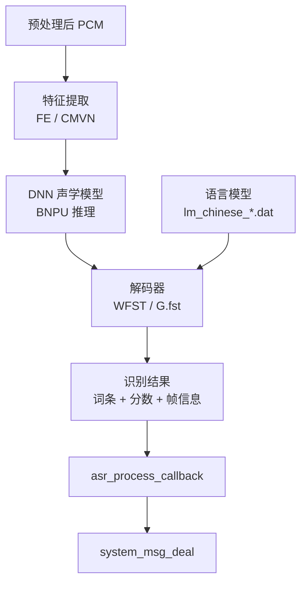
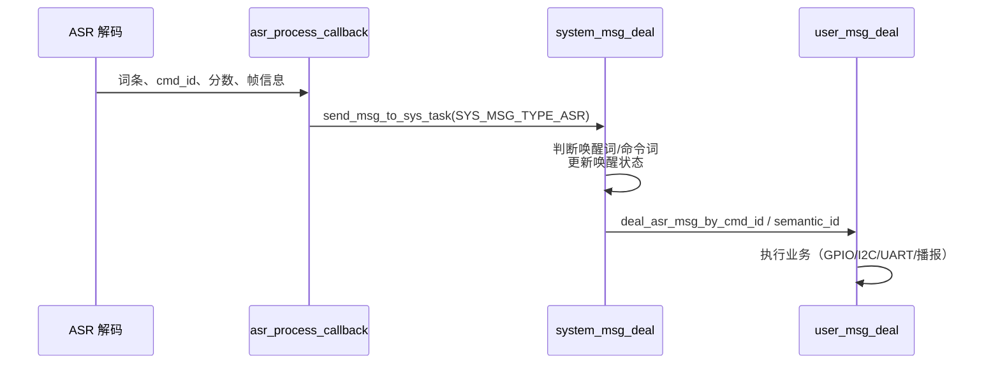

# 05 · 离线语音识别与模型

## 1. ASR 系统组成



| 部分 | 位置 | 说明 |
| --- | --- | --- |
| ASR 主体 | `components/asr/` + `libasr*.a` | 任务、模型管理、解码 |
| 声学模型 | `firmware/dnn/[0]G3-FS-CH-S-V02142.fefixbin458` | DNN 权重，烧录到 Module 分区 |
| 语言模型 | `firmware/asr/[0]lm_chinese_CI1306_V02142.dat` 等 | 词条与语法 |
| 命令词表 | `firmware/asr/G.fst0.txt`、`G.fst1.txt` | 组 0 命令词、组 1 唤醒词 |
| 命令词信息 | `firmware/user_file/cmd_info/` → file id `60000` | cmd_id、semantic_id、播报映射 |
| 回调胶水 | `components/asr/asr_process_callback.c` | 把底层结果转为系统消息 |

---

## 2. 双模型组机制

工程默认使用**两个模型组**：

| 组 ID | 内容 | 文件 | 使用时机 |
| --- | --- | --- | --- |
| 0 | 命令词 | `G.fst0.txt` + `[0]lm_chinese_*.dat` | 已唤醒，等待命令 |
| 1 | 唤醒词 | `G.fst1.txt` + `[1]lm_chinese_*.dat` | 未唤醒，只监听唤醒词 |

`DEFAULT_MODEL_GROUP_ID 1` 表示上电后先加载唤醒词组。切换由应用层完成：

```c
change_asr_wakeup_word();   /* 切到唤醒词模型组 */
change_asr_normal_word();   /* 切到命令词模型组 */
```

`enter_wakeup_deal()` / `exit_wakeup_deal()` 内部会调用上述函数，并配合提示音与超时计时。

> 双组不是简单“两个文件”：DNN 输出位宽、语言模型地址、模型索引通过 `asrtop_asr_system_start()` 的 `pdata` 参数一次性传入。

---

## 3. 模型加载与切换 API

`components/asr/asr_api.h`：

| 函数 | 作用 |
| --- | --- |
| `asrtop_taskmanage_create(bool use_ulxx_type)` | 创建 ASR 任务、信号量、队列并配置默认参数 |
| `asrtop_asrpcmbuf_mem_cfg(base, frm_nums, frm_shift)` | 配置 ASR 的 PCM 缓存 |
| `asrtop_asr_system_start(lg0, lg0_size, ac, ac_size, pdata)` | 加载模型并启动识别 |
| `asrtop_asr_system_release()` | 释放 ASR 占用（FE/CMVN/DNN/解码缓存），释放后可安全操作 Flash |
| `asrtop_asr_system_pause()` / `asrtop_asr_system_continue()` | 暂停/恢复识别，必须配对 |
| `asrtop_asr_switch_fst(fst_idx, pdata)` | 在已加载模型内切换语言模型网络 |
| `asrtop_sys_isbusy()` | 查询 ASR 是否忙 |
| `get_asrtop_asrfrmshift()` | 获取帧移（PCM 点数） |
| `send_requset_flash_msg_to_dnn()` / `send_release_flash_semaphore_to_dnn()` | 与 DNN 协调 Flash 使用权 |
| `set_asr_sigle_word_confidence_count_threshold()` | 设置单命令词置信度/有效次数阈值 |
| `asrtop_dynamic_confidence_mode_cfg()` | 打分模式：0 平均，-1 最大值 |
| `dynmic_confidence_config(min, max, step)` | 动态置信度区间 |
| `get_asr_sys_verinfo(buf)` | 查询 ASR 版本 |

### 3.1 `pdata` 参数约定

```c
pdata[0] = DNN 输出位宽：1 → 8 bit，其他 → 16 bit（默认）
pdata[1] = 0：pdata[2..4] 无效
           1：启用第二语言模型
pdata[2] = 第二语言模型地址
pdata[3] = 第二语言模型大小
pdata[4] = 启动的模型索引号
```

这正是双模型组共存的基础：两套语言模型可同时驻留，通过索引切换。

### 3.2 Flash 访问协调

ASR/DNN 运行时会占用 Flash 带宽。应用若要擦写 NV、升级固件或读取大文件，应先：

```c
asrtop_asr_system_pause();          /* 或 release */
/* ... 操作 Flash ... */
asrtop_asr_system_continue();       /* 恢复 */
```

否则可能出现读模型超时、音频卡顿或升级失败。

---

## 4. 从 Flash 找到模型

`components/flash_control/flash_control_inc/ci_flash_data_info.h`：

```c
uint32_t ci_flash_data_info_init(uint8_t default_model_group_id);
uint32_t get_current_model_addr(uint32_t *dnn_addr, uint32_t *dnn_size,
                               uint32_t *asr_addr, uint32_t *asr_size);
uint32_t get_group_addr(uint32_t partition_addr, uint16_t group_id);
uint32_t get_file_addr(uint32_t group_addr, uint16_t file_id,
                       uint32_t *file_addr, uint32_t *file_size);
uint32_t get_dnn_addr_by_id(uint16_t dnn_file_id,
                            uint32_t *dnn_addr, uint32_t *dnn_size);
```

调用关系：

1. `ci_flash_data_info_init(DEFAULT_MODEL_GROUP_ID)` 解析分区表并缓存。
2. `get_current_model_addr()` 取得当前组的 ASR/DNN 地址。
3. `asrtop_asr_system_start()` 用这些地址加载模型。
4. 切换模型组时重复 2~3 步，或调用 `asrtop_asr_switch_fst()`。

### 4.1 模型文件 ID

| ID | 用途 |
| --- | --- |
| `60000` | 命令词信息（cmd_info） |
| `60001` | 声纹模型 |
| `60002` | 哭声检测模型 |
| `60003` | NN 降噪模型 |
| `60004` | NN DOA 模型 |
| `60005` | 鼾声检测模型 |
| `60006` | 通话降噪模型 |
| `60008` | 男女声纹模型 |

音频/提示音使用独立 ID 段（如 `[0]开机音`、`[1]唤醒播放`），由 Voice 分区的文件表索引。

---

## 5. 命令词表与 cmd_info

### 5.1 文本 → G.fst

`firmware/asr/G.fst0.txt` / `G.fst1.txt` 是编译模型时的词条/语法描述。修改命令词后必须重新生成模型文件，不能只改文本。

### 5.2 xlsx → bin

`firmware/user_file/cmd_info/` 提供命令词信息表格：

- `[60000]{cmd_info}.xlsx`：命令词、cmd_id、semantic_id、播报音 ID 等。
- `cmd_info.bat`：调用工具把 xlsx 转成 bin。
- 产物 `[60000]cmd_info.bin` 由 `合成分区bin文件.bat` 合并进 UserFile 分区。

运行期由 `components/cmd_info/command_file_reader*.c` 解析，提供：

- 命令词文本/索引
- cmd_id 与 semantic_id
- 对应的提示音 ID

### 5.3 cmd_id 与 semantic_id

| 概念 | 用途 | 处理入口 |
| --- | --- | --- |
| `cmd_id` | 标识“说了哪一条命令” | `deal_asr_msg_by_cmd_id()` |
| `semantic_id` | 标识“这条命令的语义/意图” | `deal_asr_msg_by_semantic_id()` |

示例工程中命令词 `cmd_id` 位于 100~106 区间（具体以 `cmd_info` 表为准）。同一 semantic_id 可对应多个 cmd_id，便于同义说法归并。

---

## 6. 识别结果如何进入应用



关键函数：

| 函数 | 文件 | 作用 |
| --- | --- | --- |
| `asr_result_callback_nlp()` | `system_msg_deal.c` | 把 ASR 文本送入 NLP |
| `sys_deal_asr_msg()` | `system_msg_deal.c` | 系统级识别结果处理 |
| `deal_asr_msg_by_cmd_id()` | `user_msg_deal.c` | 按命令 ID 分发 |
| `deal_asr_msg_by_semantic_id()` | `user_msg_deal.c` | 按语义分发 |
| `sys_asr_result_hook()` | `system_hook.c` | 可覆盖的结果钩子 |

### 6.1 NLP

`components/nlp/ci_nlp.h` 提供轻量意图解析：

```c
int nlp_callback(void);
int set_intent_output(char *cmd_detail, short flag, char *entity);
void nlp_param_set(NlpParamTypedef *p);
```

`app_main/ci_nlp_user.c` 实现 `nlp_module_init()`、`nlp_result()`、`nlp_intents_sort()`，用于把“打开空调”“温度调到二十六度”这类文本拆成意图与实体。

若不需要 NLP，可直接按 cmd_id 处理，减少代码与 RAM 占用。

---

## 7. 唤醒与退出逻辑

默认行为（`user_config.h`）：

| 宏 | 值 | 含义 |
| --- | --- | --- |
| `USE_SEPARATE_WAKEUP_EN` | 1 | 唤醒词与命令词分离 |
| `DEFAULT_MODEL_GROUP_ID` | 1 | 上电加载唤醒词组 |
| `EXIT_WAKEUP_TIME` | 30×1000 ms | 唤醒保持 30 秒 |
| `PLAY_WELCOME_EN` | 1 | 上电播报欢迎音 |
| `PLAY_ENTER_WAKEUP_EN` | 1 | 进入唤醒播报 |
| `PLAY_EXIT_WAKEUP_EN` | 1 | 退出唤醒播报 |
| `PLAY_OTHER_CMD_EN` | 1 | 命令词播报 |

流程：

1. 未唤醒：仅组 1 模型生效，识别到唤醒词 → `enter_wakeup_deal()`。
2. 进入唤醒：切组 0、播放提示音、启动 30 s 计时、可选上报模组。
3. 唤醒期间：命令词识别 → 业务处理；每次有效交互可 `update_awake_time()` 续期。
4. 超时或无有效交互 → `exit_wakeup_deal()`，切回组 1。
5. 云端多轮对话可延长唤醒，也可由 `SET_AUDIO_EXIT_WAKE_UP (0x010D)` 主动退出。

### 7.1 唤醒期间暂停识别

播放提示音或执行耗时业务时：

```c
pause_asr();      /* 进入 SUSPEND */
/* ... */
resume_asr();     /* 回到 IDLE */
```

只暂停采集用 `pause_voice_in()` / `resume_voice_in()`。二者不要混用。

---

## 8. 可选识别能力

### 8.1 命令词自学习（CWSL）

- 组件：`ci_cwsl_v2/`、`app_cwsl/`
- 开关：`USE_CWSL`（默认 0）
- 协议：`0x0701~0x0709`
- 注意：与 PWK、BF、NN 降噪等存在互斥约束（见 `user_config.h` 末尾 `#error`）。

### 8.2 声纹（VPR / WMAN）

- 注册/识别：`components/VPR/voice_print_recognition.c`
- 男女声：`voice_print_wman_recognition.c`
- 模型 ID：60001 / 60008
- 协议触发：`vpr_cloud_cmd_init_call()` 等

### 8.3 声音事件检测（SED）

- 组件：`alg/sound_event_detection/`、`app_sed/`
- 模型：60002（哭声）、60005（鼾声）
- 结果经 `SYS_MSG_TYPE_SED` 进入应用
- 开关：`USE_SED_CRY` / `USE_SED_SNORE`

### 8.4 声源定位（DOA）

- NN DOA（`USE_NN_DOA`）或 GCC DOA（`USE_GCC_DOA`）
- 结果经 `DOA_ANGLE (0x0901)` 上报，或由 `doa_out_result_hand_task` 本地处理
- 需要双麦/阵列输入

---

## 9. 识别调优

| 目标 | 可调项 |
| --- | --- |
| 提高唤醒率 | 唤醒词模型质量、`NN_VAD_SENSITIVITY`、MIC 增益、AEC 参考 |
| 降低误唤醒 | 提高置信度阈值、增加 `NN_VAD_VALID_NUM`、启用后置有效性检查 |
| 提高远场识别 | 双麦 BF、NN 降噪、AGC、去混响 |
| 减少响应延迟 | 减小 `CI_SS_AUDIO_IN_BUFFER_NUM`、优化任务优先级、确保 Flash 不被打断 |
| 提高命令词区分度 | 重新训练 G.fst、避免同音词、调整 `DECODER_BEAM` |
| 低功耗场景 | 关闭非必要算法、降低唤醒保持时间、使用 tvad 替代 NN VAD |

> 修改模型后必须同时更新 `firmware/asr/`、`firmware/dnn/` 与 `cmd_info`，并重新执行 `合成分区bin文件.bat`，否则会出现“模型版本不匹配”或识别结果与播报错位。
