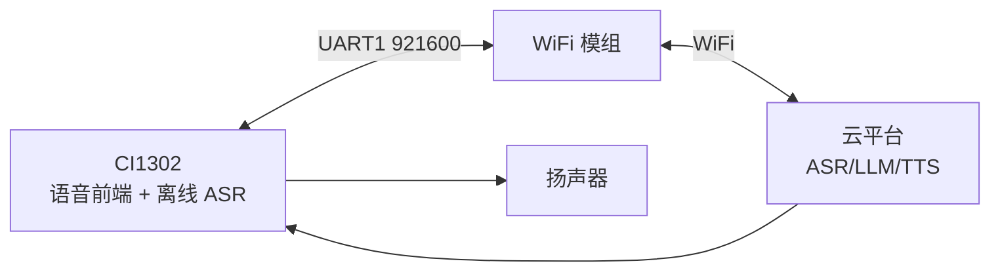
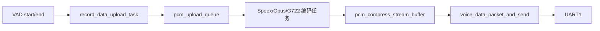
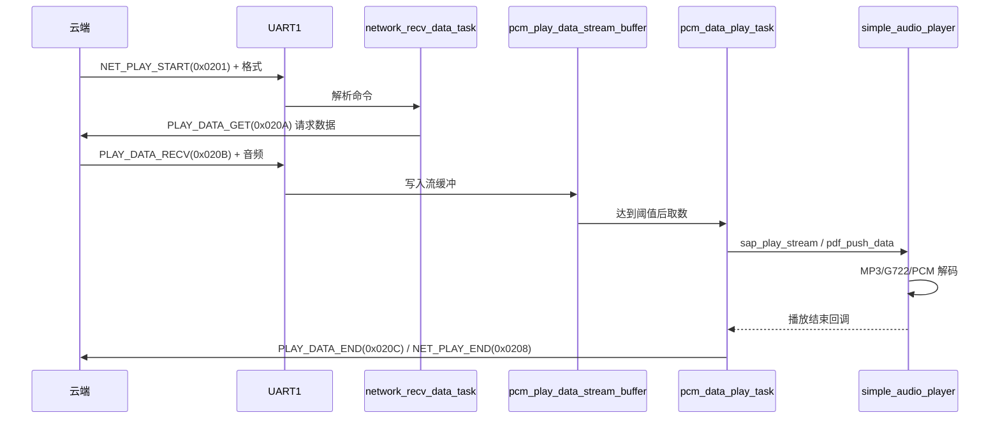

# 06 · 离在线 AIoT 与协议

本文覆盖 CI1302 与 WiFi 模组/云端之间的通信：帧格式、命令集、语音上传、云端播放、多轮/全双工、配网与 OTA。

---

## 1. 角色与链路



CI1302 负责：

- 本地唤醒、命令词、VAD、降噪、AEC。
- 把有效语音压缩后上传。
- 接收云端音频并解码播放。
- 执行云端下发的控制命令（音量、配网、OTA、播放控制）。

WiFi 模组负责：

- 网络连接与云端鉴权。
- 在 UART 与云协议之间转发。
- 部分模组还负责云端 VAD（下发 `VAD_END`）。

---

## 2. 串口与帧格式

### 2.1 默认配置

| 项目 | 值 | 宏 |
| --- | --- | --- |
| 协议串口 | UART1 | `UART_NUM_SEND_PLAY_AUDIO_NUMBER HAL_UART1_BASE` |
| 波特率 | 921600 | `UART_NUM_SEND_PLAY_AUDIO_BAUDRATE UART_BaudRate921600` |
| 日志串口 | UART0 | `CONFIG_CI_LOG_UART HAL_UART0_BASE` |
| 协议版本 | V2 | `UART_PROTOCOL_VER 2` |
| 音频带协议头 | 是 | `AUDIO_SEND_WITH_PROTOCOL_HEADER 1` |

### 2.2 VMUP 帧（通用模组协议）

定义于 `components/msg_com/voice_module_uart_protocol.h`：

```c
#pragma pack(1)
typedef struct {
    uint16_t header;         /* 0xA5 0xFC */
    uint16_t data_length;
    uint8_t  msg_type;       /* 0xA0 上行命令, 0xA1 下行命令,
                                0xA2 ACK, 0xA3 通知 */
    uint8_t  msg_cmd;
    uint8_t  msg_seq;
    uint8_t  msg_data[20];
    /* checksum 与 tail 由发送函数自动追加 */
} sys_msg_com_data_t;
```

| 字段 | 值 |
| --- | --- |
| 帧头 | `VMUP_MSG_HEAD_LOW=0xA5`、`VMUP_MSG_HEAD_HIGH=0xFC` |
| 帧尾 | `VMUP_MSG_TAIL=0xFB` |
| 最大数据 | `VMUP_MSG_DATA_MAX_SIZE=20` |

常用 `msg_cmd`：

| 命令 | 值 | 说明 |
| --- | --- | --- |
| `VMUP_MSG_CMD_ASR_RESULT` | 0x91 | 上报识别结果 |
| `VMUP_MSG_CMD_PLAY_VOICE` | 0x92 | 播放本地提示音 |
| `VMUP_MSG_CMD_GET_FLASHUID` | 0x93 | 读取 Flash UID |
| `VMUP_MSG_CMD_GET_VERSION` | 0x94 | 读取版本 |
| `VMUP_MSG_CMD_RESET_MODULE` | 0x95 | 复位模组 |
| `VMUP_MSG_CMD_SET_CONFIG` | 0x96 | 配置 |
| `VMUP_MSG_CMD_ENTER_OTA_MODE` | 0x97 | 进入升级 |
| `VMUP_MSG_CMD_NOTIFY_STATUS` | 0x9A | 状态通知 |
| `VMUP_MSG_CMD_ACK_COMMON` | 0xAA | 通用 ACK |

状态通知子命令：`POWERON(0xB0)`、`WAKEUPENTER(0xB1)`、`WAKEUPEXIT(0xB2)`、`PLAYSTART(0xB3)`、`PLAYEND(0xB4)`。

### 2.3 CIAS 帧（云端业务协议）

定义于 `app/app_audio_handle/cias_network_msg_protocol.h`，命令字为 16 位：

| 段 | 范围 | 用途 |
| --- | --- | --- |
| 语音识别/上传 | `0x0101~0x011E` | 唤醒、VAD、PCM、参数设置 |
| 网络播放 | `0x0201~0x0218` | 播放控制、数据请求、播放状态 |
| IoT/音量 | `0x0301~0x030D` | 云端指令、音量、JSON |
| 网络状态/配网 | `0x0401~0x040C` | 配网、连接状态、鉴权 |
| 系统/产测/OTA | `0x0500~0x0516` | 版本、OTA、产测、AEC 增益 |
| 系统就绪 | `0x0601~0x0603` | ready/error/reset |
| 自学习 | `0x0701~0x0709` | CWSL 注册/删除 |
| 指令执行状态 | `0x0801` | 命令执行结果回传 |
| DOA | `0x0901` | 角度输出 |

底层帧头结构：

```c
#pragma pack(1)
typedef struct {
    unsigned int   head;
    unsigned short checksum;
    unsigned short cmd;
    unsigned short length;
    unsigned short version;
} pro_headpart_typedef;
```

> 用户自定义命令建议从 `0x4xxx` 开始，避免与系统命令冲突（源码注释明确要求）。

### 2.4 两套协议如何共存

- `MSG_COM_USE_UART_EN` 控制 VMUP 是否启用；默认 0。
- `UART_PROTOCOL_VER=2` 选择 VMUP V2 实现。
- CIAS 由 `cias_network_msg_protocol.c` 独立解析，业务层直接调用 `cias_send_cmd()`。
- 若两者共用同一 UART，需要在收包状态机中按帧头区分，避免互相吞帧。

---

## 3. 语音上传链路

### 3.1 任务与队列



`app_audio_handle/cias_aiot_protocol.h` 中的 `CiasAiotRunParamTypedef` 保存：

| 字段 | 作用 |
| --- | --- |
| `pcm_upload_queue` | 待编码 PCM 队列 |
| `pcm_compress_stream_buffer` | 编码后码流缓冲 |
| `pcm_play_data_stream_buffer` | 云端播放数据缓冲 |
| `pcm_debug_stream_buffer` | 调试音频缓冲 |
| `opus_play_queue` / `g722_play_queue` | 对应格式播放队列 |
| `cloud_play_state` | 云端播放状态机 |
| `cloud_parse_is_busy_flag` | 协议解析忙标志 |
| `cloud_ans_time_out_flag` | 云端响应超时标志 |
| `speex_busy_flag` | 编码器占用标志 |

### 3.2 关键函数

| 函数 | 文件 | 作用 |
| --- | --- | --- |
| `voice_upload_task_init()` | `cias_voice_upload.c` | 创建采集/编码任务 |
| `asr_wakeup_on_handle()` | 同上 | 唤醒后启动上传 |
| `asr_wakeup_exit_handle()` | 同上 | 退出唤醒时收尾 |
| `cias_aiot_vad_start_handle()` | 同上 | VAD 起点处理 |
| `cias_aiot_vad_end_handle()` | 同上 | VAD 终点处理 |
| `vad_state_handle_task()` | 同上 | VAD 状态轮询 |
| `record_data_upload_task()` | 同上 | 从采集缓冲取 PCM |
| `speex_encode_task()` | 同上 | Speex 编码 |
| `opus_encode_task()` / `g722_encode_task()` | 同上 | 其他编码 |
| `cloud_ans_count_timer_callback()` | 同上 | 云端响应超时计时 |
| `cias_aiot_param_refresh()` | 同上 | 刷新运行参数 |
| `wifi_net_state_check()` | 同上 | 网络状态检查 |

### 3.3 上传参数

| 宏 | 默认 | 说明 |
| --- | --- | --- |
| `AUDIO_DATA_UPLOAD_BY_UART` | 1 | 经 UART 上传 |
| `AUDIO_COMPRESS_SPEEX_ENABLE` | 1 | Speex 压缩 |
| `AUDIO_COMPRESS_OPUS_ENABLE` | 0 | Opus（与 Speex 互斥） |
| `AUDIO_COMPRESS_G722_ENABLE` | 0 | G.722（与 Speex 互斥） |
| `PCM_UPLOAD_QUEUE_NUM` | 60 | PCM 队列深度 |
| `COMPRESS_NEED_PCM_LEN` | 320 | 每次编码所需 PCM 长度 |
| `COMPRESS_UPLOAD_QUEUE_TIEM_SIZE` | 43 | 编码输出队列项大小 |
| `UPLOAD_NNDENOISE_AUDIO_DATA_ENABLE` | 1 | 上传降噪后音频 |
| `LOCAL_REC_VAD_END_ENABLE` | 1 | 本地判断 VAD 结束 |

上传帧类型：

- `PCM_MIDDLE (0x0105)`：中间音频包。
- `PCM_FINISH (0x0106)`：最后一包。
- `PCM_IDLE (0x0107)`：空闲/无有效语音。
- `PCM_DENOISE_ENABLE (0x010E)`：控制是否上传降噪后数据。

### 3.4 VAD 与上传边界

| 命令 | 作用 |
| --- | --- |
| `VAD_START (0x0108)` | 本地 VAD 起点 |
| `VAD_END (0x0103)` | 云端 VAD 终点 |
| `SET_VAD_SENSITIVITY (0x010A)` | 设置灵敏度 |
| `SET_VAD_FILTER_FRAME (0x010F)` | 过滤过短语音（16 ms/帧） |
| `SET_VAD_SENSITIVITY_ACTIVATE_LENTH (0x0110)` | 静音多久产生 VAD end |
| `SET_VAD_START_MAX_TIMEOUT (0x0111)` | 最长录音时间，默认 5 s |
| `SET_FORCE_VAD_END (0x011D)` | 强制结束 |
| `VAD_VAILD_CHECK_RESULT (0x011E)` | 后置有效性检查结果 |

---

## 4. 云端播放链路

### 4.1 数据流



### 4.2 播放控制命令

| 命令 | 值 | 说明 |
| --- | --- | --- |
| `NET_PLAY_START` | 0x0201 | 开始播放 |
| `NET_PLAY_PAUSE` | 0x0202 | 暂停 |
| `NET_PLAY_RESUME` | 0x0203 | 恢复 |
| `NET_PLAY_STOP` | 0x0204 | 停止 |
| `NET_PLAY_RESTART` | 0x0205 | 重播 |
| `NET_PLAY_NEXT` | 0x0206 | 下一首 |
| `NET_PLAY_LOCAL_TTS` | 0x0207 | 本地 TTS 提示 |
| `NET_PLAY_END` | 0x0208 | 播放结束 |
| `PLAY_DATA_GET` | 0x020A | 请求后续数据 |
| `PLAY_DATA_RECV` | 0x020B | 数据到达 |
| `PLAY_DATA_END` | 0x020C | 数据接收完 |
| `PLAY_AUDIO_SIZE` | 0x0213 | 音频长度 |
| `PLAY_AUDIO_TYPE` | 0x0214 | 音频类型 |
| `SET_AUDIO_PLAY_MODE` | 0x0215 | 1 打断当前，0 顺序播放 |
| `VAD_START_STOP_PLAY` | 0x0216 | 全双工下 VAD start 是否停播 |

### 4.3 关键函数

| 函数 | 文件 | 作用 |
| --- | --- | --- |
| `network_recv_data_task()` | `cias_network_msg_protocol.c` | UART 收包与命令分发 |
| `wifi_msg_deal()` | 同上 | 单帧处理 |
| `request_play_data_func()` | `cias_audio_data_handle.c` | 向云端请求数据 |
| `request_play_data_task()` | 同上 | 请求任务 |
| `pcm_data_play_task()` | 同上 | 播放调度 |
| `opus_data_decode_task()` | 同上 | Opus 解码播放 |
| `play_done_callback()` / `play_end_callback()` | 同上 | 播放回调 |
| `cias_online_func_init()` | 同上 | 初始化播放/网络任务 |
| `network_send_data_task()` | `cias_network_msg_send_task.c` | 发送队列与重发 |
| `cias_send_cmd()` | `cias_network_msg_send_task.c` | 上层发送入口 |

### 4.4 缓冲与延迟

| 宏 | 默认 | 说明 |
| --- | --- | --- |
| `AIOT_AUDIO_PLAY_BUF_SIZE` | 6 KB | 播放总缓冲 |
| `PLAY_BUF_GET_DATA_MIN_SIZE` | 4 KB | 达到该水位才开始播放 |
| `REQUEST_ONE_FRAME_SEZIE` | 1024 | 单次请求数据量 |
| `AUDIO_PLAY_MODE` | 1 | 1 打断式，0 顺序式 |
| `NET_AUDIO_PLAY_BY_MP3` | 1 | 云端音频为 MP3 |

水位越高越抗抖动，但首包延迟越大；弱网环境可适当增大 `PLAY_BUF_GET_DATA_MIN_SIZE`。

---

## 5. 多轮对话与全双工

| 宏 | 默认 | 含义 |
| --- | --- | --- |
| `CUR_INTERACTION_MULTI_ROUND_ENABLE` | 1 | 多轮对话 |
| `UPLOAD_PLAY_FULL_DUPLEX_ENABLE` | 1 | 播放时继续上传 |
| `VAD_START_STOP_PLAY_ENABLE` | 0 | VAD start 是否停止播放 |
| `CLOUD_ANS_TIME_OUT_ENEABLE` | 0 | 云端响应超时退出 |
| `CLOUD_ANS_TIME_OUT_VALUE` | 6 | 超时秒数 |

对应远程命令：

- `SET_INTERACTION_NULTI_ROUND_ENABLE (0x0115)`
- `UPLOAD_PLAY_FULL_DUPLEX_EANBLE (0x0116)`
- `SET_AUDIO_PLAY_MODE (0x0215)`
- `VAD_START_STOP_PLAY (0x0216)`
- `SET_CLOUD_ANS_TIMEOUT_EXIT (0x011C)`

### 5.1 全双工的代价

播放时上传意味着 MIC 会拾取自身扬声器声音，必须依赖 AEC。若 AEC 收敛不好：

- 云端会把回声当成用户语音，导致误识别。
- 解决顺序：确认 REF 通路 → 标定 MIC/REF 增益 → 调整 AEC 参数 → 再考虑关闭全双工。

---

## 6. 网络状态与配网

### 6.1 状态上报

`wifi_curr_state_t`：

| 值 | 状态 |
| --- | --- |
| `WIFI_CONNECTED_STATE (0x0101)` | 已连 WiFi，未连云 |
| `WIFI_CONFIGING_STATE (0x0102)` | 配网中 |
| `WIFI_DISCONNECT_STATE (0x0103)` | 断开 |
| `CLOUD_CONNECTED_STATE (0x0104)` | 已连云 |
| `CLOUD_DISCONNECT_STATE (0x0105)` | 云断开 |

对应 CIAS 命令：`WIFI_CONNECTED(0x0406)`、`WIFI_DISCONNECTED(0x0405)`、`CLOUD_CONNECTED(0x0409)`、`CLOUD_DISCONNECTED(0x040A)`。

### 6.2 配网命令

| 命令 | 值 | 说明 |
| --- | --- | --- |
| `ENTER_NET_CONFIG` | 0x0401 | 进入配网 |
| `NET_CONFIGING` | 0x0402 | 配网中 |
| `EXIT_NET_CONFIG` | 0x0403 | 退出配网 |
| `INIT_SMARTCONFIG` | 0x0404 | 恢复出厂网络配置 |
| `NET_CONFIG_SUCCESS` | 0x040B | 配网成功 |
| `NET_CONFIG_FAIL` | 0x040C | 配网失败 |
| `GET_PROFILE` / `NEED_PROFILE` | 0x0407 / 0x0408 | 鉴权文件 |

`CHECK_NET_WORK_STATE_ENABLE` 默认 0；置 1 后会在上传前检查网络状态，避免无效数据占用带宽。

### 6.3 典型提示音

| ID | 含义 |
| --- | --- |
| 2000 | 联网中，请稍后 |
| 2001 | 网络连接成功 |
| 2003 | 云平台连接成功 |
| 2004 | 网络已断开 |
| 2005 | 网络未连接，请先连接网络 |
| 2006/2021 | 配网失败 |
| 2007/2022 | 配网成功，请等待连接云平台 |
| 2020 | 开始配网，请扫描二维码 |
| 2040 | 请配置鉴权文件 |

完整列表见 [CI1302 工程功能说明报告](../CI1302_工程功能说明报告.md) 附录 B。

---

## 7. OTA 与双 Code

### 7.1 云端 OTA 命令

| 命令 | 值 | 说明 |
| --- | --- | --- |
| `CIAS_GET_SOFT_VER` | 0x0500 | 获取软件版本 |
| `CIAS_OTA_START` | 0x0501 | 开始 OTA |
| `CIAS_OTA_DATA` | 0x0502 | OTA 数据 |
| `CIAS_OTA_SUCESS` | 0x0503 | 升级成功 |

底层下载协议（`cias_network_msg_protocol.h`）：

| 命令 | 值 |
| --- | --- |
| `DL_OTA_REQ/RSP` | 0x0001 / 0x0002 |
| `DL_LOGIN_INFO_REQ/RSP` | 0x0003 / 0x0004 |
| `DL_VER_REQ/RSP` | 0x0005 / 0x0006 |
| `DL_AREA_INFO_REQ/RSP` | 0x0006 |
| `DL_ERASE_AREA_REQ/RSP` | 0x0007 |
| `DL_WRITE_DATA_REQ/RSP` | 0x0008 |
| `DL_WRITE_DATA_COMPLETE_REQ/RSP` | 0x0009 |
| `DL_VERIFY_AREA_REQ/RSP` | 0x000A |
| `DL_COMPLETE_OTA_REQ/RSP` | 0x000E |
| `DL_RESET_SYS` | 0xFE |

实现位于 `components/ota/`：`firmware_updater.c`、`flash_update.c`、`ota_aes.c`、`ota_partition_verify.c`。

### 7.2 配置注意

| 宏 | 默认 | 影响 |
| --- | --- | --- |
| `CI_OTA_ENABLE` | 0 | 决定分区表读取地址：0 → `0x2000`，1 → `0x6000` |
| `USER_CODE_SWITCH_ENABLE` | 0 | 双 Code 分区切换 |
| `firmware_version`（config.ini） | `FW_V2` | `FW_V1` 支持 OTA，`FW_V2` 不支持，`FW_V4` 新 OTA |

> 已有一份实测记录指出：本工程 `CI_OTA_ENABLE=0`，但打包工具实际把分区表写在 `0x6000`。做 OTA 改动前务必核对“工具写入位置”与“固件读取位置”，否则会读不到分区表。

### 7.3 双 Code 切换

- 组件：`app_main/code_switch.c`、`flash_control` 中的 `user_code1/user_code2` 字段。
- `config.ini` 中 `code1_*` / `code2_*` 定义两个代码区。
- `USER_CODE_SWITCH_ENABLE=1` 时可在运行期选择从 Code1/Code2 启动，用于 A/B 升级或回滚。
- 切换前必须确保目标区 CRC/status 有效。

---

## 8. 配置与命令执行回执

| 命令 | 值 | 说明 |
| --- | --- | --- |
| `LOCAL_ASR_RESULT_NOTIFY` | 0x0101 | 本地识别结果 |
| `WAKE_UP` | 0x0102 | 唤醒 |
| `EXIT_WAKE_UP` | 0x0109 | 退出唤醒 |
| `SET_ENTER_WAKE_UP` | 0x0114 | 强制进入唤醒 |
| `SET_AUDIO_VOLUME` | 0x0117 | 音量 1~7 |
| `SET_VOLUME_MUTE_STATE` | 0x0119 | 静音 |
| `SET_AUDIO_START_RECORD` / `STOP_RECORD` | 0x011A / 0x011B | 手动录音 |
| `CIAS_CMD_EXEC_STATE` | 0x0801 | 指令执行结果（命令类型 2 字节 + 结果 1 字节） |
| `CIAS_AUDIO_SYS_READY` | 0x0601 | 语音系统就绪 |
| `CIAS_AUDIO_SYS_ERR` | 0x0602 | 系统异常 |
| `CIAS_AUDIO_RST` | 0x0603 | 复位语音芯片 |

`cmd_need_ack(cmd)` 决定某条命令是否需要 ACK；需要时由发送任务重发直至超时。

---

## 9. 应用层源码地图

| 关注点 | 文件 |
| --- | --- |
| 命令字与帧解析 | `cias_network_msg_protocol.c/.h` |
| 发送队列/ACK | `cias_network_msg_send_task.c/.h` |
| UART 中断 | `cias_uart_protocol.c/.h` |
| 录音与编码上传 | `cias_voice_upload.c/.h` |
| 云端播放 | `cias_audio_data_handle.c/.h` |
| 播放器封装 | `cias_voice_plyer_handle.c/.h` |
| 环形缓冲 | `cias_circle_queue.c/.h` |
| 运行参数结构 | `cias_aiot_protocol.h` |

---

## 10. 联调检查表

| 现象 | 检查项 |
| --- | --- |
| 模组无响应 | UART1 TX/RX 引脚、波特率 921600、共地、模组供电 |
| 收到乱码 | 帧头/校验/长度字段、协议版本、是否误把日志口当协议口 |
| 能唤醒但无上传 | `asr_wakeup_on_handle()`、VAD 起点、Speex 编码任务、队列是否满 |
| 上传有数据但云端无识别 | 压缩格式与云端约定、采样率、是否上传了降噪后数据 |
| 云端音频不出声 | `NET_PLAY_START` 格式、`PLAY_DATA_GET` 是否发出、播放缓冲水位、解码器注册 |
| 播放卡顿 | 增大 `AIOT_AUDIO_PLAY_BUF_SIZE`、提高请求频率、检查 UART 丢包 |
| 播放无法打断 | AEC、`AUDIO_PLAY_MODE`、`VAD_START_STOP_PLAY` |
| OTA 失败 | 分区表地址、`CI_OTA_ENABLE`、目标区大小、AES 密钥、模组重发 |
