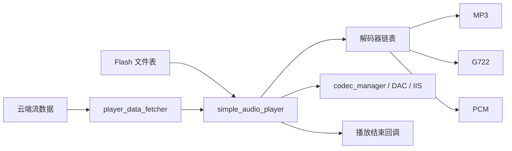
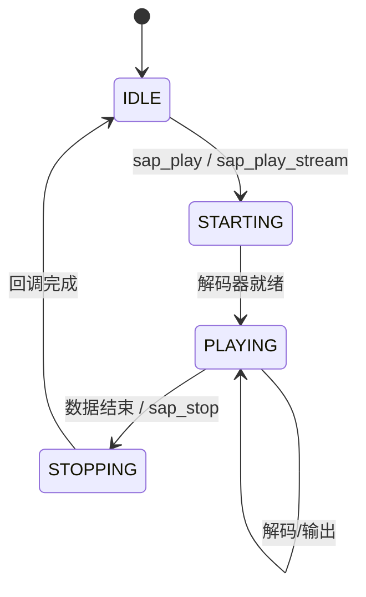
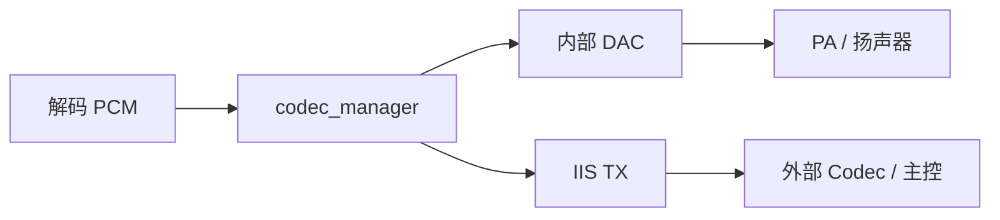

# 07 · 播放器与音频输出

SDK 内含两套播放器，通过 `SIMPLE_AUDIO_PLAYER_ENABLE` 二选一：

| 播放器 | 组件 | 特点 | 适用 |
| --- | --- | --- | --- |
| SAP（精简播放器） | `components/simple_audio_player/` | 体积小、支持 Flash 与流式、解码器按需注册 | 离在线 AIoT 默认 |
| 老播放器 | `components/player/` | 功能全：MP3/AAC/FLAC/M4A/ADPCM、变速、暂停续播 | 本地音乐/复杂播放场景 |

Makefile 中 `USE_AUDIO_PLAYER_TYPE := 0` 对应默认选择；切换时需同步检查音频解码库与 Flash 占用。

---

## 1. SAP 架构



### 1.1 关键数据结构

```c
typedef enum {
    SAP_DATA_SRC_FLASH,
    SAP_DATA_SRC_STREAM,
} sap_src_type_t;

typedef enum {
    SAP_STATE_STARTING,
    SAP_STATE_PLAYING,
    SAP_STATE_STOPPING,
    SAP_STATE_IDLE,
} sap_status_t;

typedef struct {
    uint32_t samprate;
    int32_t  src_data_size;
    int32_t  samples_per_frame;
    uint8_t  channels;
    uint8_t  bits_per_sample;
} audio_format_info_t;
```

解码器接口：

```c
typedef struct audio_decoder_interface_st {
    const char *name;
    void *(*init)(void);
    void (*deinit)(void *);
    int  (*get_info)(void *, uint8_t *data, int *data_size,
                     uint8_t *pcm_buf, audio_format_info_t *fmt);
    int  (*decode_one_frame)(void *, uint8_t *data, int *data_size,
                             uint8_t *pcm_buf, uint32_t *pcm_size);
    struct audio_decoder_interface_st *next;
} audio_decoder_interface_t;
```

### 1.2 API

| 函数 | 作用 |
| --- | --- |
| `sap_init()` | 初始化播放器与任务 |
| `sap_play(data_addr, callback)` | 播放 Flash 中的音频（按文件表地址） |
| `sap_play_stream(fmt, buf_size, block_size, end_cb, req_cb)` | 播放流式音频 |
| `sap_get_state()` | 查询状态 |
| `sap_stop()` | 同步停止 |
| `sap_register_decoder(decoder)` | 注册解码器 |
| `pdf_push_data(data, size, wait)` | 向播放器推送码流 |
| `audio_play_set_vol_gain(gain)` | 设置音量增益 |
| `audio_play_hw_pa_da_ctl(cmd, is_control_pa)` | 控制 PA |

### 1.3 解码器自动注册

```c
#define register_audio_decoder(fmt, _init, _deinit, _get_info, _decode_one_frame) \
    __attribute__((constructor)) static void __register_##fmt##_decoder(void) { ... }
```

`constructor` 属性让解码器在 `main()` 之前自动挂到链表，业务代码无需手动注册。

现有解码器：

| 格式 | 文件 |
| --- | --- |
| MP3 | `mp3_decoder_api.c` |
| G.722 | `g722_decoder_api.c` |
| PCM | `pcm_decoder_api.c` |

### 1.4 流式取数

`player_data_fetcher.c` 维护一个取数缓冲：

1. `sap_play_stream()` 指定 `fetcher_buffer_size` 与 `request_block_size`。
2. 播放器水位低于阈值时调用 `SAP_PLAY_DATA_REQUEST_CALLBACK`。
3. 业务层（`cias_audio_data_handle.c`）向云端发 `PLAY_DATA_GET`。
4. 数据到达后 `pdf_push_data()` 写入。

这套机制把“播放器”和“网络协议”解耦：播放器只关心“我要数据”，不关心数据来自 UART 还是 Flash。

---

## 2. 本地提示音播放

### 2.1 地址来源

提示音位于 Voice 分区，通过文件表按 ID 查找：

```c
uint32_t get_voice_addr_by_id(uint16_t *ids, uint32_t *addrs, uint32_t num);
```

典型调用链：

```c
get_voice_addr_by_id(&voice_id, &addr, 1);
sap_play(addr, play_done_callback);
```

或由 `system_msg_deal` 中的播报流程统一封装。

### 2.2 提示音文件命名

`firmware/voice/` 下使用 `[id]名称.wav`（源文件）与 `[id]名称.mp3/.opus`（打包产物）：

```
[0]开机音.wav
[1]唤醒播放.wav
[2]退出唤醒.wav
[4]音量增大.wav
[199]好的.wav
[2000]联网中，请稍后.wav
```

- `[65535]参数信息勿删` 是音频参数说明文件，不可删除。
- ID 与 `cmd_info` 中的播报字段对应；改 ID 必须同步改表。

### 2.3 打包流程

`firmware/合成分区bin文件.bat` 中 `fmt=4`（MP3）时的处理：

1. `lame --cbr -b16 --resample 16000` 把 wav 转 16 kHz MP3。
2. `ci-tool-kit ID3-editor` 写入 ID3 标签（存放文件 ID）。
3. `ci-tool-kit merge user-file -i mp3 -o mp3` 合并为 `voice.bin`。

也支持 ADPCM、PCM、FLAC、Opus，脚本中保留分支；不同格式影响 Flash 占用与解码算力。

---

## 3. 播放状态与回调



应用层关心的回调：

| 回调 | 触发 | 典型动作 |
| --- | --- | --- |
| `play_done_callback` | 单条提示音播完 | 恢复 ASR、发送状态 |
| `play_end_callback` | 云端音频播完 | 上报 `NET_PLAY_END`、退出唤醒或继续多轮 |
| `data_request_callback` | 缓冲低水位 | 请求云端下一包 |
| `mp3/m4a/wav/tts_player_end_callbk` | 老播放器各格式结束 | 更新播放状态 |

播放期间的系统状态通过 `CI_SS_PLAY_STATE` 共享，ASR 可据此决定是否暂停。

---

## 4. 音量、静音与 PA

| 功能 | 接口 | 说明 |
| --- | --- | --- |
| 音量设置 | `vol_set()` / `vol_get()` | 应用层封装，范围 1~7 |
| 增益 | `audio_play_set_vol_gain()` | 直接设置数字增益 |
| 静音 | `cm_set_codec_mute()` / `audio_play_set_mute()` | 硬件 mute |
| PA 控制 | `audio_play_hw_pa_da_ctl()` | 播放前后开关功放，避免爆音 |
| 协议音量 | `SET_AUDIO_VOLUME (0x0117)`、`VOLUME_INC/DEC` | 云端/模组控制 |

默认值：`VOLUME_DEFAULT=5`、`VOLUME_MAX=7`、`VOLUME_MIN=1`。

> 音量值通常映射到 DAC 增益表；修改映射需同时检查最大音量是否导致削顶（AGC/ALC 会掩盖问题但引入失真）。

---

## 5. 老播放器（`components/player/`）

### 5.1 API

`audio_play/audio_play_api.h`：

| 函数 | 作用 |
| --- | --- |
| `play_prompt(addr, num, cb)` | 播放提示音 |
| `play_audio(dir_or_url, name, offset, decoder, cb)` | 播放文件/URL |
| `stop_play(cb, woken)` | 停止 |
| `pause_play(cb, woken)` | 暂停 |
| `continue_history_play(cb)` | 续播 |
| `get_play_offset()` / `get_data_load_offset()` | 播放进度 |
| `audio_play_set_vol_gain()` / `audio_play_get_vol_gain()` | 音量 |
| `audio_play_set_mute()` | 静音 |
| `set_play_speed()` | 变速（sonic） |
| `play_with_outside*` | 外部码流输入 |

### 5.2 解码器

| 格式 | 目录 |
| --- | --- |
| MP3 | `mp3lib/` |
| AAC | `aaclib/` |
| FLAC | `flacdec/` |
| M4A | `m4a/` |
| ADPCM | `adpcm/` |
| 变速 | `sonic/` |

老播放器功能完整但代码/ROM 占用明显更大；在 2 MB Flash 且 DNN 模型占 1.3 MB 的工程里，通常选择 SAP。

---

## 6. 音频输出通路



| 输出方式 | 配置 | 说明 |
| --- | --- | --- |
| 内部 DAC + PA | 默认 | `audioplay_hw_pa_da_ctl` 控制功放 |
| IIS TX | `iis_out_audio_config` | 可输出 16 kHz 预处理音频或播放音频 |
| HPOUT 工程 | `offline_asr_llm_aiot_hpout_sample` | 模拟输出给外部主控 |
| IIS 工程 | `offline_asr_llm_aiot_iis_sample` | 数字输出给外部主控 |

### 6.1 采样率与格式

- 提示音统一转 16 kHz。
- 云端 MP3 默认 16 kHz 单声道（由 `lame --resample 16000` 与云端约定保证）。
- G.722 为 16 kHz 宽带语音。
- 若外部 Codec 只支持 8 kHz，需要在链路中重采样或改用 G.722/窄带配置。

---

## 7. 播放与识别的协同

| 场景 | 推荐配置 |
| --- | --- |
| 唤醒提示音 | 播放时 `pause_asr()`，播完恢复 |
| 云端长音频 | 全双工上传 + AEC，允许打断 |
| 命令词播报 | `AUDIO_PLAY_MODE=1` 打断式，避免堆积 |
| 多轮对话 | 播放结束回调中上报 `NET_PLAY_END`，保持唤醒 |
| 低延迟要求 | 降低 `PLAY_BUF_GET_DATA_MIN_SIZE`，但需保证 UART 不丢包 |

---

## 8. 常见问题

| 现象 | 原因 | 处理 |
| --- | --- | --- |
| 提示音无声 | Voice 分区未打包/ID 不存在/PA 未开 | 检查 `voice.bin`、`get_voice_addr_by_id()`、PA 控制 |
| 播放速度不对 | 采样率与文件头不一致 | 统一 16 kHz，检查 ID3/参数文件 |
| 播放破音 | 增益过高/削顶 | 降低数字增益或 DAC 增益，检查 ALC |
| 流播放卡顿 | 请求不及时/缓冲太小/UART 丢包 | 增大缓冲与请求块，检查协议重发 |
| 播完不回调 | 解码器未注册/结束帧缺失 | 检查 `register_audio_decoder` 与数据结束标志 |
| 播放后识别失灵 | 未 `resume_asr()` | 在播放结束回调中恢复 |
