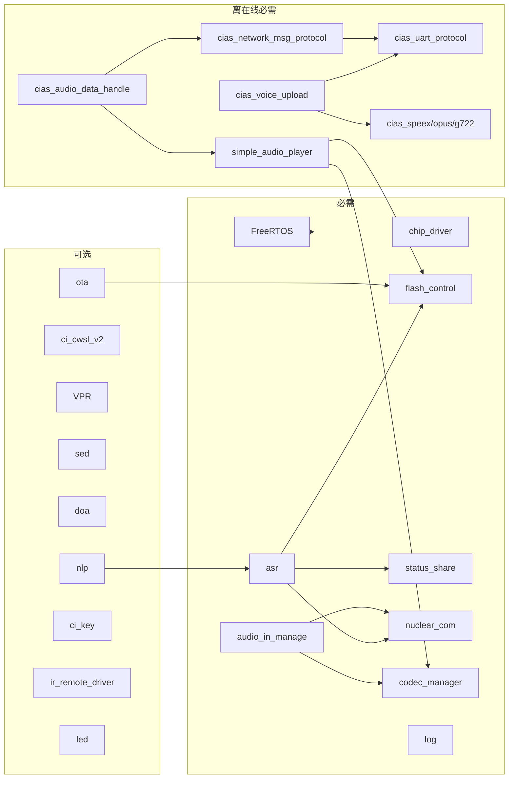

# 10 · 配置矩阵与依赖关系

本文汇总影响编译结果与运行行为的宏，给出依赖链、互斥约束、资源预算和排错路径。

---

## 1. 配置入口

| 文件 | 作用 | 谁修改 |
| --- | --- | --- |
| `app/app_main/user_config.h` | 业务/板级/音频/协议宏 | 应用开发者 |
| `system/user_alg_config.mk` | 算法开关与 SRAM 预算 | 算法/系统配置 |
| `system/sdk_default_config.h` | SDK 默认值 | 一般不改 |
| `system/FreeRTOSConfig.h` | 内核参数 | 系统级调整 |
| `project_file/makefile` | 编译/链接/库选择 | 构建维护 |
| `firmware/config.ini` | Flash 分区与版本 | 产品配置 |
| `firmware/asr/G.fst*.txt` | 命令词/唤醒词语法 | 模型制作 |
| `firmware/user_file/cmd_info/*.xlsx` | 命令词信息表 | 产品/应用 |

---

## 2. `user_config.h` 宏矩阵

### 2.1 板级与芯片

| 宏 | 默认 | 说明 |
| --- | --- | --- |
| `USE_CI_D02GS01J_BOARD` | 1 | 选择参考板 |
| `CI_CHIP_TYPE` | 1302 | 由板级宏展开 |
| `BOARD_PORT_FILE` | `"CI-D02GS01J.c"` | 板级初始化文件 |
| `USE_EXTERNAL_CRYSTAL_OSC` | 1 | 外部晶振 |
| `HOST_MIC_USE_NUMBER` | 1 | MIC 数量 |
| `AUDIO_IN_FROM_DMIC` | 0 | 数字 MIC |
| `MIC_DIFF_SINGLE` / `REF_DIFF_SINGLE` | 0 / 1 | 差分/单端 |
| `USE_IR_ENABLE` | 0 | 红外功能 |

### 2.2 串口与协议

| 宏 | 默认 | 说明 |
| --- | --- | --- |
| `CONFIG_CI_LOG_UART` | `HAL_UART0_BASE` | 日志口 |
| `MSG_COM_USE_UART_EN` | 0 | 启用 VMUP |
| `UART_PROTOCOL_NUMBER` | `HAL_UART2_BASE` | VMUP 使用的串口 |
| `UART_PROTOCOL_VER` | 2 | VMUP 版本 |
| `CLOUD_UART_PROTOCOL_EN` | 0 | 云端协议封装 |
| `UART_NUM_SEND_PLAY_AUDIO_NUMBER` | `HAL_UART1_BASE` | CIAS 音频口 |
| `UART_NUM_SEND_PLAY_AUDIO_BAUDRATE` | 921600 | 音频口波特率 |

### 2.3 音频上传

| 宏 | 默认 | 说明 |
| --- | --- | --- |
| `AUDIO_DATA_UPLOAD_BY_UART` | 1 | UART 上传 |
| `AUDIO_DATA_PLAY_BY_UART` | 1 | UART 播放 |
| `AUDIO_COMPRESS_SPEEX_ENABLE` | 1 | Speex |
| `AUDIO_COMPRESS_OPUS_ENABLE` | 0 | Opus |
| `AUDIO_COMPRESS_G722_ENABLE` | 0 | G.722 |
| `NET_AUDIO_PLAY_BY_MP3` | 1 | 云端 MP3 |
| `AUDIO_SEND_WITH_PROTOCOL_HEADER` | 1 | 音频带协议头 |
| `UPLOAD_NNDENOISE_AUDIO_DATA_ENABLE` | 1 | 上传降噪音频 |
| `CHECK_NET_WORK_STATE_ENABLE` | 0 | 上传前检查网络 |

### 2.4 交互行为

| 宏 | 默认 | 说明 |
| --- | --- | --- |
| `CUR_INTERACTION_MULTI_ROUND_ENABLE` | 1 | 多轮 |
| `UPLOAD_PLAY_FULL_DUPLEX_ENABLE` | 1 | 全双工 |
| `VAD_START_STOP_PLAY_ENABLE` | 0 | VAD 停播 |
| `CLOUD_ANS_TIME_OUT_ENEABLE` | 0 | 云端超时 |
| `CLOUD_ANS_TIME_OUT_VALUE` | 6 | 超时秒 |
| `AUDIO_PLAY_MODE` | 1 | 打断式播放 |
| `EXIT_WAKEUP_TIME` | 30 s | 唤醒保持 |
| `USE_SEPARATE_WAKEUP_EN` | 1 | 双模型组 |
| `DEFAULT_MODEL_GROUP_ID` | 1 | 上电组 |
| `PLAY_WELCOME_EN` | 1 | 欢迎音 |
| `PLAY_ENTER_WAKEUP_EN` | 1 | 进入唤醒音 |
| `PLAY_EXIT_WAKEUP_EN` | 1 | 退出唤醒音 |
| `PLAY_OTHER_CMD_EN` | 1 | 命令播报 |

### 2.5 VAD 与算法

| 宏 | 默认 | 说明 |
| --- | --- | --- |
| `NN_VAD_SENSITIVITY` | 1 | NN VAD 灵敏度 |
| `NN_VAD_FRONT_PORCH` | 35 | 起点前保留 |
| `NN_VAD_BACK_PORCH` | 25 | 终点后保留 |
| `NN_VAD_VALID_CHECK_MODE` | 1 | 后置检查 |
| `NN_VAD_VALID_NUM` | 25 | 有效帧数 |
| `VAD_TIMEOUT_VALUE` | 5 | 超时秒 |
| `PCM_ALG_FRAME_LEN` | 512 | 帧长 |
| `LOCAL_REC_VAD_END_ENABLE` | 1 | 本地 VAD 结束 |
| `BF_DEEPSE_MODE` | 1 | BF deepse |
| `AEC_INTERRUPT_TYPE` | 2 | 打断策略 |
| `AUTO_GET_AEC_GAIN` | 0 | 自动增益标定 |

### 2.6 音量与存储

| 宏 | 默认 | 说明 |
| --- | --- | --- |
| `VOLUME_MIN/Max/DEFAULT` | 1 / 7 / 5 | 音量 |
| `CI_OTA_ENABLE` | 0 | OTA |
| `USER_CODE_SWITCH_ENABLE` | 0 | 双 Code |
| `PCM_UPLOAD_QUEUE_NUM` | 60 | 上传队列 |
| `COMPRESS_NEED_PCM_LEN` | 320 | 编码输入长度 |
| `AIOT_AUDIO_PLAY_BUF_SIZE` | 6 KB | 播放缓冲 |
| `PLAY_BUF_GET_DATA_MIN_SIZE` | 4 KB | 播放启动水位 |
| `REQUEST_ONE_FRAME_SEZIE` | 1024 | 请求块大小 |

---

## 3. `user_alg_config.mk` 算法矩阵

| 宏 | 默认 | 关联库/预算 | 说明 |
| --- | --- | --- | --- |
| `USE_ASR` | 1 | `libasr*.a` | 离线识别 |
| `USE_ANY_MIC` | 0 | `libbnpu_core_alg_pro_any_mic_aec.a` | 任意 MIC |
| `USE_AEC` | 1 | `libaec.a`、30 KB | 回声消除 |
| `USE_CWSL` | 0 | `libcwsl_v2.a`、0 KB | 自学习 |
| `USE_NN_DENOISE` | 1 | `libdenoise.a`、47 KB | NN 降噪 |
| `USE_NN_VAD` | 1 | `libasr*.a` | NN VAD |
| `USE_GCC_DOA` | 0 | `libdoa.a`、23 KB | GCC DOA |
| `USE_NN_DOA` | 0 | 60 KB | NN DOA |
| `USE_IIS_RECORD` | 0 | 0 KB | IIS 采集 |
| `USE_REF_IN_FROM_INNER_CODEC` | 0 | — | 内部回采 |
| `USE_DEREVERB` | 0 | `libdr.a` | 去混响 |
| `USE_ALC_AUTO_SWITCH_MODULE` | 0 | `libalc_auto_switch.a` | ALC 自动切换 |
| `AIOT_AUDIO_COMPRESS_TYPE` | 1 | `libspeex.a` / `libopus.a` / G722 | 上传压缩 |

SRAM 分界：

```make
SDK_ALG_PRO_SRAM_HOST_NOT_ALG_END_ADDR = 0x1FFD3000
```

---

## 4. 编译期依赖链

```mermaid
flowchart TD
    UC[user_config.h] --> MK[project_file/makefile]
    UAC[user_alg_config.mk] --> MK
    MK -->|USE_*| CFLAGS[C_FLAGS 宏]
    MK -->|AIOT_AUDIO_COMPRESS_TYPE| LIBS[链接库]
    UAC --> LUA[parse_user_alg_config_mk.lua]
    LUA --> BNPU[bnpu_core_alg_pro 重新编译]
    BNPU --> ALGLIB[[1]code.bin]
    MK --> LDS[生成 ci130x_asr_alg_mcu.lds]
    LDS --> ELF[build/xxx.elf]
    CFLAGS --> ELF
    LIBS --> ELF
    ELF --> CODE0[[0]code.bin]
    CODE0 --> MERGE[ci-tool-kit merge]
    ALGLIB --> MERGE
    MERGE --> UC_BIN[user_code.bin]
    CFG[firmware/config.ini] --> PACK[打包升级]
    UC_BIN --> PACK
    ASR[firmware/asr] --> PACK
    DNN[firmware/dnn] --> PACK
    VOICE[firmware/voice] --> PACK
    UF[firmware/user_file] --> PACK
```

### 4.1 “改一个宏”会牵动什么

| 改动 | 直接效果 | 需要同步检查 |
| --- | --- | --- |
| `USE_NN_DENOISE=1` | 链接降噪库、BNPU 重建、SRAM 预算变化 | 模型 60003、`nn_denoise_config`、LDS |
| `AUDIO_COMPRESS_OPUS_ENABLE=1` | 链接 `libopus.a`、Opus 编码任务 | 关闭 Speex/G722、云端格式 |
| `NET_AUDIO_PLAY_BY_MP3=0` | 播放格式切换 | 解码器注册、云端下发格式 |
| `HOST_MIC_USE_NUMBER=2` | 双通道采集 | BF 库、IIS/PDM 通道、`ci_ssp_config` |
| `CI_OTA_ENABLE=1` | 分区表读取地址变 `0x6000` | 打包工具写入位置、`firmware_version` |
| `USER_CODE_SWITCH_ENABLE=1` | 双 Code | Code2 区大小、切换逻辑、回滚验证 |
| `DEFAULT_MODEL_GROUP_ID` | 上电模型组 | G.fst 文件、提示音、唤醒流程 |

---

## 5. 互斥约束

`user_config.h` 末尾用 `#error` 强制约束了若干组合。常见类别：

| 约束 | 原因 |
| --- | --- |
| PWK 与 BF / NN 降噪 / 自学习 / SED 互斥 | 算法在同一 BNPU 周期内竞争资源与模型槽位 |
| PWM/UART 上传与 PWK 互斥 | PWK 需要独占音频/时序通路 |
| Speex / Opus / G.722 三选一 | 编码器共用缓冲与任务，格式不能并存 |
| 本地播放格式与云端播放格式需一致 | 解码器与播放器状态机只按一种主格式设计 |
| `CI_OTA_ENABLE` 与分区表地址必须匹配工具 | 否则读不到分区表 |
| 单麦配置不能启用 BF | BF 需要多通道输入 |

**处理原则**：先看编译报错指向的宏组合，再回查 `user_config.h` 的 `#error` 条件；不要通过注释掉 `#error` 来“绕过”，通常会在运行期以内存踩踏或识别异常的形式暴露。

---

## 6. 资源预算

### 6.1 Flash（2 MB）

| 分区 | 预留 | 占比 | 备注 |
| --- | --- | --- | --- |
| DNN | 1336 KB | ~65% | 最大消耗项 |
| User | 252 KB | ~12% | HOST + BNPU 代码 |
| Voice | 232 KB | ~11% | 提示音 |
| Boot + 表 | 40 KB | ~2% | |
| NV | 16 KB | <1% | 固定顶端 |
| ASR / UserFile | 各 8 KB | <1% | |
| 余量 | ~148 KB | ~7% | 可借给 DNN/Voice |

压缩提示音（MP3/Opus/ADPCM）能显著降低 Voice 占用；DNN 模型是主要约束。

### 6.2 SRAM

| 区域 | 说明 |
| --- | --- |
| HOST SRAM | FreeRTOS 堆、任务栈、协议缓冲、播放缓冲 |
| BNPU 算法 SRAM | AEC/降噪/DOA 等按 `user_alg_config.mk` 预留 |
| 分界符号 | `SDK_ALG_PRO_SRAM_HOST_END_ADDR` |

FreeRTOS 堆大小由链接脚本符号 `__FREERTOSHEAP_SIZE` 决定，不是固定常量。新增任务/队列后若 `pvPortMalloc` 返回 NULL，需要调整 LDS。

---

## 7. 依赖关系图（运行时）



---

## 8. 排错索引

| 症状 | 可能原因 | 定位文件 |
| --- | --- | --- |
| 编译报宏互斥 | 功能组合冲突 | `user_config.h` 末尾 `#error` |
| 链接缺符号 | 库未选/BNPU 未重建 | `makefile`、`user_alg_config.mk` |
| SRAM 溢出 | 算法预算过大 | `user_alg_config.mk`、LDS |
| 启动卡在 mailbox | BNPU 镜像/算法库不匹配 | `bnpu_core_alg_pro`、`[1]code.bin` |
| 无唤醒 | 模型组/模型文件/VAD 阈值 | `firmware/asr`、`ciss_param_init()` |
| 无上传 | Speex 任务/队列/VAD | `cias_voice_upload.c` |
| 无播放 | 解码器/缓冲/PA | `simple_audio_player`、`cias_audio_data_handle.c` |
| 播放卡顿 | 缓冲小/UART 丢包/Flash 争用 | `AIOT_AUDIO_PLAY_BUF_SIZE`、`asrtop_asr_system_pause()` |
| 打包失败 | 分区预留不足 | `firmware/config.ini` |
| OTA 失败 | 分区表地址/AES/区大小 | `CI_OTA_ENABLE`、`ota/` |

### 8.1 建议的二分排查顺序

1. **能否启动**：日志、IWDG、`mailboxboot_sync`。
2. **能否采集**：IIS/模拟通路、`audio_in_manage` 缓冲、丢帧计数。
3. **能否唤醒**：模型组、VAD、AEC、MIC 增益。
4. **能否上传**：VAD 起止、编码任务、UART 波形。
5. **能否播放**：协议帧、缓冲水位、解码器、PA。
6. **能否打断**：AEC 收敛、播放模式、VAD 停播配置。

---

## 9. 移植到新板级

1. 在 `driver/boards/` 新增板级文件，参考 `board_port_template.c`。
2. 在 `user_config.h` 选择板级宏，确认 `CI_CHIP_TYPE`、`BOARD_PORT_FILE`。
3. 配置时钟/晶振、MIC/REF 通道、PA 引脚、UART/I2C 引脚。
4. 调整 `ci_ssp_config.c` 的算法参数（MIC 增益、AEC 参考、I2S 通道）。
5. 检查 `firmware/config.ini` 的 flash 大小与分区。
6. 重新生成模型/提示音，执行完整打包与烧录。
7. 用 [08-构建、烧录与运行](08-构建、烧录与运行.md) 的调试手段逐项验证。

---

## 10. 版本与兼容性

| 项目 | 注意点 |
| --- | --- |
| SDK 版本 | 本仓库 V3.0.19；模型/协议/工具需匹配 |
| 模型版本 | `G.fst` 与 `lm_chinese_*.dat`、DNN `.fefixbin` 必须同批生成 |
| 协议版本 | `UART_PROTOCOL_VER=2` 对应 VMUP V2；CIAS 命令表随 SDK 变化 |
| 打包工具 | `ci-tool-kit` 与 `config.ini` 的 `config_version=V2` 匹配 |
| OTA | `firmware_version` 的 FW_V1/V2/V4 语义不同，升级前确认 |

> 升级 SDK 时，优先比对 `user_config.h`、`user_alg_config.mk`、`config.ini` 与 `app/` 的差异，不要直接覆盖业务代码。
