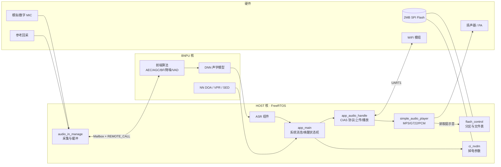

# CI130X SDK Code Wiki

> 适用仓库：`YCSC-CI13XX_SDK_LLM_AIOT_V3.0.19`
> 目标芯片：CI1302（CI130X 系列）
> 参考工程：`projects/offline_asr_llm_aiot_uart_sample`
> 文档性质：面向开发者的代码结构、运行机制与二次开发索引

---

## 1. 这套文档回答什么

| 问题 | 对应章节 |
| --- | --- |
| 这个 SDK 是什么、能做什么 | 本页、[01-系统架构](01-系统架构.md) |
| 每个目录/组件负责什么 | [02-目录结构与模块职责](02-目录结构与模块职责.md) |
| 程序从上电到跑起来经历了什么 | [03-启动流程与运行时](03-启动流程与运行时.md) |
| 麦克风数据如何变成识别结果 | [04-音频采集与前端算法](04-音频采集与前端算法.md)、[05-离线语音识别与模型](05-离线语音识别与模型.md) |
| 如何与 WiFi 模组/云端通信 | [06-离在线AIoT与协议](06-离在线AIoT与协议.md) |
| 提示音和云端音频如何播放 | [07-播放器与音频输出](07-播放器与音频输出.md) |
| 如何编译、打包、烧录、调试 | [08-构建、烧录与运行](08-构建、烧录与运行.md) |
| 关键接口和数据结构速查 | [09-关键API参考](09-关键API参考.md) |
| 宏开关、依赖、互斥与排错 | [10-配置矩阵与依赖关系](10-配置矩阵与依赖关系.md) |

已有两份专题材料可作为补充：

- [CI1302 工程功能说明报告](../CI1302_工程功能说明报告.md)：功能清单、命令表、提示音表、分区表。
- [CI1302 开发配置文件与 Flash 分区说明](../../CI1302_开发配置文件与Flash分区说明.md)：分区排布与“固件超 flash”问题复盘。

---

## 2. 项目定位

该 SDK 是启英泰伦 CI130X 系列芯片的**离线语音识别 + 离在线 AIoT** 应用框架：

- 芯片内部为 **HOST 核（RISC-V）+ BNPU 神经网络加速核** 的双核结构。
- HOST 核运行 FreeRTOS，负责外设、协议、播放、应用逻辑。
- BNPU 核运行算法固件，承担 DNN 声学模型、NN 降噪、NN VAD、NN DOA、声纹、事件检测等算力任务。
- 典型链路：本地麦克风 → 前端算法 → 离线 ASR → 串口上传语音到 WiFi 模组 → 云端大模型/TTS → 串口回传音频 → 本地解码播放。

示例工程 `offline_asr_llm_aiot_uart_sample` 通过 UART1 与 WiFi 模组通信；同目录还有 `offline_asr_llm_aiot_hpout_sample`（音频经 HPOUT）和 `offline_asr_llm_aiot_iis_sample`（音频经 IIS），三者共用同一套 `app/` 代码，通过 `AUDIO_UPLOAD_TYPE` 区分。

---

## 3. 关键参数速览（默认 UART 工程）

| 项目 | 值 | 来源 |
| --- | --- | --- |
| 芯片 / Flash | CI1302 / 2 MB | `user_config.h`、`firmware/config.ini` |
| 参考板 | CI-D02GS01J | `USE_CI_D02GS01J_BOARD 1` |
| 外部晶振 | 使用 | `USE_EXTERNAL_CRYSTAL_OSC 1` |
| 麦克风 | 1 路模拟 MIC | `HOST_MIC_USE_NUMBER 1`、`AUDIO_IN_FROM_DMIC 0` |
| 采样 | 16 kHz、算法帧 512 点 | `PCM_ALG_FRAME_LEN 512` |
| 与 WiFi 模组 | UART1 @ 921600 | `UART_NUM_SEND_PLAY_AUDIO_NUMBER` |
| 日志 | UART0 | `CONFIG_CI_LOG_UART` |
| 上传压缩 | Speex（默认） | `AUDIO_COMPRESS_SPEEX_ENABLE 1` |
| 云端播放 | MP3 | `NET_AUDIO_PLAY_BY_MP3 1` |
| 唤醒保持 | 30 s | `EXIT_WAKEUP_TIME 30*1000` |
| 默认模型组 | 组 1（唤醒词） | `DEFAULT_MODEL_GROUP_ID 1` |
| 系统节拍 | 500 Hz | `FreeRTOSConfig.h` |
| 任务优先级数 | 6（0~5） | `FreeRTOSConfig.h` |

---

## 4. 一图看懂系统



---

## 5. 最快上手

```powershell
# 在仓库根目录，工具链与 busybox/lua 由 tools/build-tools/bin 提供
cd projects/offline_asr_llm_aiot_uart_sample/project_file

# 设置项目名（Makefile 依赖 PROJECT_NAME）
$env:PROJECT_NAME = "offline_asr_llm_aiot_uart_sample"
$env:PATH = "d:\Projects\CI1302\YCSC-CI13XX_SDK_LLM_AIOT_V3.0.19\tools\build-tools\bin;" + $env:PATH

make -j8

# 产物：build/<PROJECT_NAME>.elf
# 自动 objcopy 到 ../firmware/user_code/[0]code.bin
# 若启用 BNPU，会与 [1]code.bin 合并
```

打包完整固件与烧录见 [08-构建、烧录与运行](08-构建、烧录与运行.md)。

---

## 6. 术语表

| 缩写 | 含义 |
| --- | --- |
| ASR | Automatic Speech Recognition，语音识别 |
| BNPU | 神经网络处理单元（芯片内加速核） |
| AEC | Acoustic Echo Cancellation，回声消除 |
| AGC / ALC | 自动增益控制 / 自动电平控制 |
| BF | Beamforming，波束成形 |
| VAD | Voice Activity Detection，语音活动检测 |
| tvad | 时域/传统 VAD 组件 |
| DOA | Direction of Arrival，声源定位 |
| CWSL | 命令词自学习 |
| VPR / WMAN | 声纹识别 / 男女性别识别 |
| SED | Sound Event Detection，声音事件检测（哭声/鼾声） |
| PWK | 就近唤醒 |
| CIAS | 芯片与云端/模组之间的应用层协议（0x01xx~0x09xx 命令） |
| VMUP | 语音模组串口协议（帧头 0xA5 0xFC） |
| SAP | Simple Audio Player，精简播放器 |
| ciss | 核间共享状态模块（status_share） |
| LTO | Link Time Optimization，链接期优化 |
